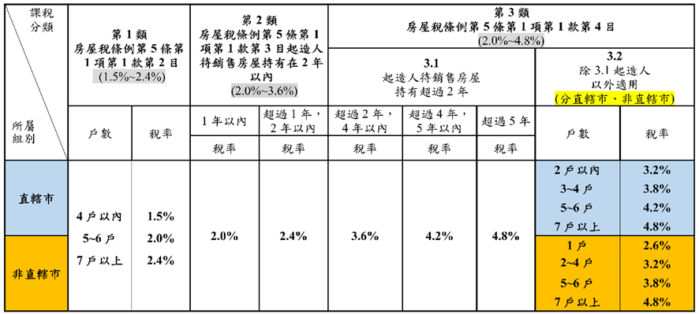

# 房屋稅計算範例

## 文章資訊
- 文章編號：915580
- 作者：曾榮耀(蘇偉強)
- 發布日期：2026/05/05
- 關鍵詞：房屋稅課稅、房屋稅
- 爬取時間：2026-11-27 16:19:52
- 原文連結：[閱讀原文](https://real-estate.get.com.tw/Columns/detail.aspx?no=915580)

## 內文
甲為自然人，於115年期房屋稅課稅年度持有下列9戶住家用房屋，均坐落於臺中市，且均為甲單獨所有。甲已於法定期限內完成相關使用情形申報，且各戶均全年持有、全年使用情形不變。試問：甲114年期各戶房屋之房屋課稅現值、適用稅率及應納房屋稅各為多少？總應納房屋稅為多少？

| 房屋 | 使用情形 | 單價 | 面積 | 折舊率 | 年數 | 路段率 |
| --- | --- | --- | --- | --- | --- | --- |
| 房屋 | 使用情形 | 單價 | 面積 | 折舊率 | 年數 | 路段率 |
| A | 自住使用，已設戶籍 | 12,000元 | 100㎡ | 1% | 10年 | 100% |
| B | 自住使用，已設戶籍 | 10,000元 | 80㎡ | 1% | 10年 | 100% |
| C | 出租且申報所得達標準 | 10,000元 | 90㎡ | 1% | 10年 | 100% |
| D | 繼承取得共有房屋 | 9,000元 | 100㎡ | 1% | 10年 | 100% |
| E | 空置未使用 | 8,000元 | 100㎡ | 1% | 10年 | 100% |
| F | 空置未使用 | 10,000元 | 100㎡ | 1% | 20年 | 100% |
| G | 空置未使用 | 12,500元 | 80㎡ | 1% | 20年 | 100% |
| H | 空置未使用 | 9,000元 | 100㎡ | 1% | 20年 | 100% |
| I | 繼承取得共有房屋 | 10,000元 | 80㎡ | 1% | 10年 | 100% |

註：請依據所附各縣市適用稅率級距計算。

[圖片1]

解答

• (一) 計算各戶房屋現值

房屋現值＝核定單價 × 面積 ×（1－折舊率 × 折舊年數）× 路段率

| 房屋 | 計算式 | 稅基(房屋現值) |
| --- | --- | --- |
| 房屋 | 計算式 | 稅基(房屋現值) |
| A | 12,000 × 100 ×（1－1%×10）×1 00% | 1,080,000元 |
| B | 10,000 × 80 ×（1－1%×10）×10 0% | 720,000元 |
| C | 10,000 × 90 ×（1－1%×10）×10 0% | 810,000元 |
| D | 9,000 × 100 ×（1－1%×10）×10 0% | 810,000元 |
| E | 8,000 × 100 ×（1－1%×10）×10 0% | 720,000元 |
| F | 10,000 × 100 ×（1－1%×20）×1 00% | 800,000元 |
| G | 12,500 × 80 ×（1－1%×20）×10 0% | 800,000元 |
| H | 9,000 × 100 ×（1－1%×20）×10 0% | 720,000元 |
| I | 10,000 × 80 ×（1－1%×10）×10 0% | 720,000元 |

• (二) 判斷各房屋適用稅率

本題應先依房屋使用情形分類，而非單純以甲持有9戶全部合併適用同一稅率。

1. 自住住家用房屋 A、B屋均供自住使用，且已設戶籍，合計2戶，未超過全國3戶限制，故適用自住住家用稅率：A、B屋＝1.2%。

2. 出租達租金標準及繼承取得共有房屋 C屋為出租且申報所得達租金標準；D、I屋為繼承取得共有房屋。C、D、I合計為3戶，屬4戶以下，故適用稅率：C、D、I屋＝1.5%。

3. 其他非自住住家用房屋 E、F、G、H屋均為空置未使用，屬其他非自住住家用房屋合計4戶，屬3至4戶級距，故適用較高稅率：E、F、G、H屋＝3.8%。

• (三) 計算各戶應納房屋稅

| 房屋 | 稅基(房屋現值) | 稅率 | 應納房屋稅 |
| --- | --- | --- | --- |
| 房屋 | 稅基(房屋現值) | 稅率 | 應納房屋稅 |
| A | 1,080,000元 | 1.2% | 12,960元 |
| B | 720,000元 | 1.2% | 8,640元 |
| C | 810,000元 | 1.5% | 12,150元 |
| D | 810,000元 | 1.5% | 12,150元 |
| E | 720,000元 | 3.8% | 27,360元 |
| F | 800,000元 | 3.8% | 30,400元 |
| G | 800,000元 | 3.8% | 30,400元 |
| H | 720,000元 | 3.8% | 27,360元 |
| I | 720,000元 | 1.5% | 10,800元 |

因此，甲114年期房屋稅總額為各戶加總＝172,220元。

## 文章圖片

---
*注：本文圖片存放於 ./images/ 目錄下*
