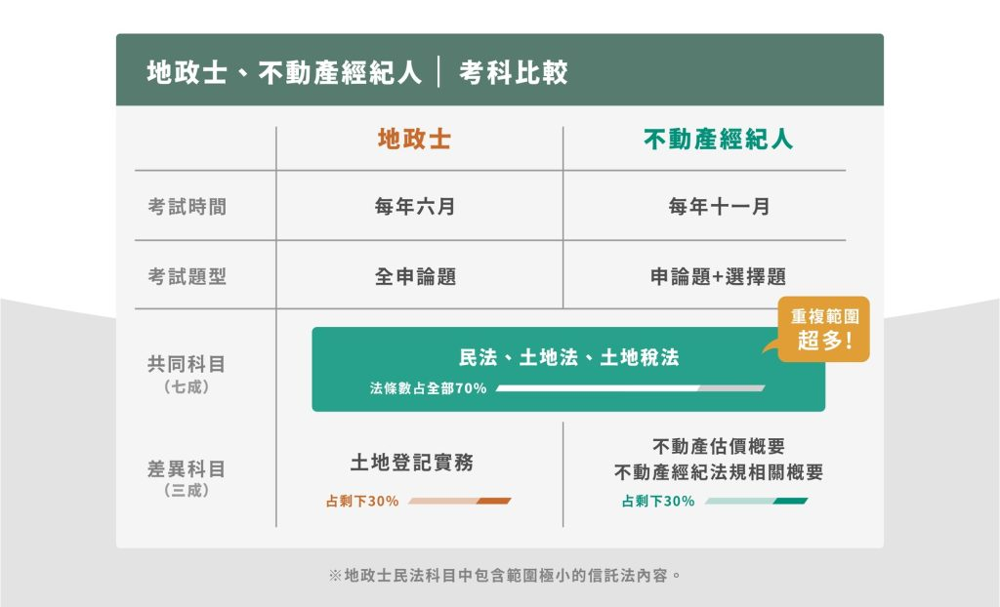

> 不動產經紀人考試約每年八月報名，十一月考試，不動產經紀人考試屬於國家考試「普考」階級，只要高中職畢業就能應考，想知道更多關於不動產經紀人的考試資訊嗎？讓Jasper一一來告訴你！

<h3 class="wp-block-heading" style="line-height:1.8">報名日期：</h3>

約每年八月，到考選部官網報名

<h3 class="wp-block-heading" style="line-height:1.8">考試日期：</h3>

約每年十一月

<h3 class="wp-block-heading" style="line-height:1.8">應考資格：</h3>

<strong>滿足下列兩項條件則一即可</strong>

1.公立或立案之私立高級中等或高級職業學校以上學校畢業，領有畢業證書者。

2.高等或普通檢定考試及格者。

<h3 class="wp-block-heading">考試科目：</h3>

<strong>1.共同科目（共一科）：</strong>國文

<strong>2.專業科目（共四科）：</strong>民法／土地法與土地相關稅法概要／不動產估價概要／ 不動產經紀相關法規概要

<h3 class="wp-block-heading">考試題型：</h3>

<strong>1.共同科目：</strong>國文考兩篇作文，一篇佔 50 分，滿分 100 分。但共同科目僅佔總成績 10 %，因此重心應放在專業科目。

<strong>2.專業科目：</strong>四科皆為 50 分申論題＋ 50 分選擇題。申論題考兩篇，一篇佔 25 分，選擇題考25題，一題2分。專業科目佔總成績 90 %，應專心準備。

<h3 class="wp-block-heading">及格標準：</h3>

1.總成績平均滿六十分及格。

2.共同科目成績 x 0.1 + 四個專業科目成績總和 ÷4 x 0.9 &gt;= 60

3.有一科成績為零分或專業科目平均成績未滿五十分者，均不予及格。缺考之科目，以零分計算。

<h3 class="wp-block-heading">歷年錄取率：約在 10 %~ 20 %之間，屬於國家考試中較為簡單的考試</h3>

<figure class="aligncenter size-large is-resized"><noscript></noscript></figure>

地政士與不動產經紀人併稱不動產黃金雙證照，不僅實務上配合密切、未來合作發展性高，兩張證照考試的考科當中最難的三科還都是重複的，考生只要多讀其他較簡單的小科目就可以一次考取兩張證照，因此非常多考生會選擇兩場考試一起準備，來讓效益最大化唷！

以上是不動產經紀人考試資訊全介紹，想知道如何準備考試嗎？

歡迎聯絡Jasper一對一免費諮詢，我們將根據您的情況給出客製化的建議！

<h4 class="wp-block-heading has-black-color has-text-color has-normal-plus-font-size" id="免費諮詢" style="line-height:1.8">．延伸閱讀</h4>

下篇：<a href="https://www.jasper-realestate.com/02-%e5%9c%b0%e6%94%bf%e5%a3%ab%e8%80%83%e8%a9%a6%e8%b3%87%e8%a8%8a%e5%85%a8%e4%bb%8b%e7%b4%b9/">02 地政士｜考試資訊全介紹</a>  上篇：<a href="https://www.jasper-realestate.com/01-%e4%b8%8d%e5%8b%95%e7%94%a2%e7%b6%93%e7%b4%80%e4%ba%ba-%e8%ad%89%e7%85%a7%e4%bb%8b%e7%b4%b9%e5%84%aa%e5%8b%a2/">01 不動產經紀人｜證照介紹&amp;優勢</a>

<h4 class="wp-block-heading has-black-color has-text-color has-normal-plus-font-size" id="免費諮詢" style="line-height:1.8">．免費諮詢</h4>

<a data-id="https://line.me/R/ti/p/%40851hgrwp" data-type="URL" href="https://line.me/R/ti/p/%40851hgrwp" rel="noreferrer noopener" target="_blank">Line 官方帳號</a>｜<a data-id="https://www.facebook.com/Jasper-%E4%B8%8D%E5%8B%95%E7%94%A2%E7%B6%93%E7%B4%80%E4%BA%BA%E8%80%83%E8%A9%A6%E8%BC%94%E5%B0%8E%E5%93%A1-104204235060276/" data-type="URL" href="https://www.facebook.com/Jasper-%E4%B8%8D%E5%8B%95%E7%94%A2%E7%B6%93%E7%B4%80%E4%BA%BA%E8%80%83%E8%A9%A6%E8%BC%94%E5%B0%8E%E5%93%A1-104204235060276/" rel="noreferrer noopener" target="_blank">Facebook 粉絲專頁</a>

