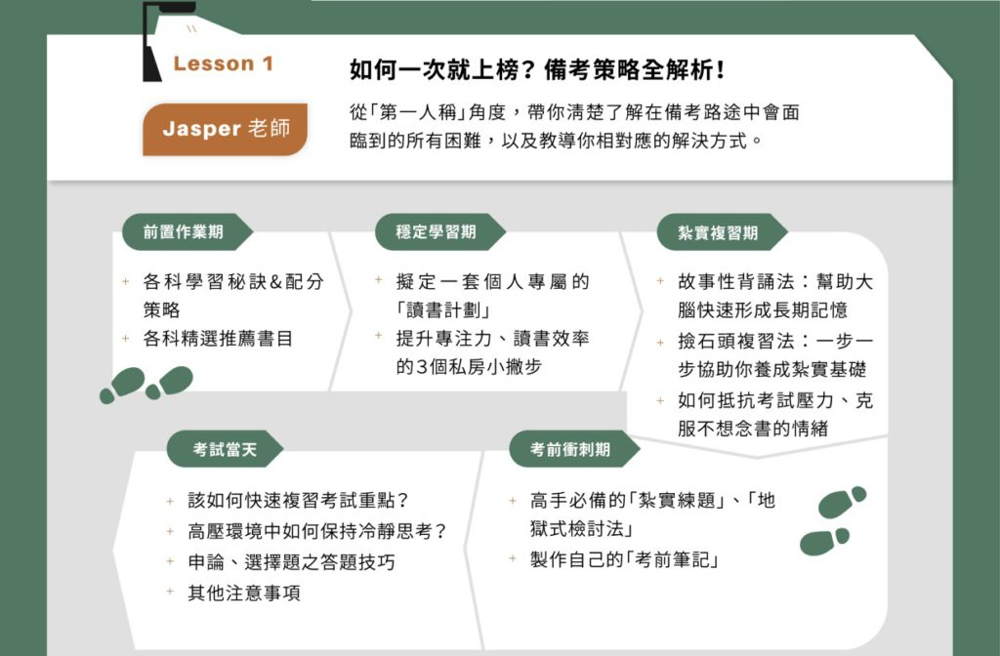

> 一提到考試，大家想到的第一件事情幾乎都是先找老師來學習。但如果你想穩穩通過考試，那必須先明白，老師只是幫助你考上的因素之一，真正能在考試中讓你百戰百勝的，是你個人的學習能力與技巧。

<h3 class="wp-block-heading">100滿分的考試其實分成三個部分，且分別對應到下列3大學習能力，其三者相輔相成，缺一不可。</h3>
<h1 class="wp-block-heading"> 學習能力１：找到一位「適合」自己的老師</h1>

如何判斷老師適不適合自己呢？很簡單，如果老師說話的邏輯你都能聽懂，即便有不懂的地方，老師也都會耐心的用其他方式解說到你懂為止，這樣的老師就是適合你的！

比起自己買書土法煉鋼的讀，有老師的帶領，可以幫助你更快速的理解各考科的專業知識，也能針對考試重點學習，不浪費任何摸索、整理的時間。尤其法律的專業知識生硬複雜，學習過程中容易遇到許多問題，此時老師也是你最棒的詢問管道。當然，老師也能在最後階段針對考試制度協助你擬定適合自己的配分策略，藉此增加上榜機會。 

如果你有找到一位適合自己的老師帶領你學習，恭喜你已經獲得了第一部分的分數，也就是33分。

<h1 class="wp-block-heading" id="上榜能力２-讀書計畫-確實複習">學習能力２：正確的讀書方法、並制定專屬讀書計畫</h1>

學生A：老師… 法律概念真的好複雜，有時寫錯答案，連看解答都似懂非懂，而且還常常背了又忘，明明花很多時間讀條文卻總是背不起來，到底該怎麼念書呢？

學生B：老師… 我身兼工作又要讀書，壓力真的好大，我該怎麼樣安排自己的讀書計劃呢?

Jasper：在協助上千位考生備考的經驗中，許多考生都曾遭遇上述的狀況，其中也有許多人會認為是因為自己沒那麼聰明，但這其實不是聰不聰明的問題，而是因為使用的讀書方法不對。

以我就讀台大的經驗，雖然真的有少數光是聊天就能知道他的智商一定超高的同學，但大多人都還是靠著正確的讀書方法、讀書計劃，以及堅持到底的毅力而考上台大的。

那究竟正確的讀書方法分別有什麼？又可以幫助到我什麼呢？

 以下的圖表，將從「第一人稱」角度，帶你清楚了解在備考路途中各階段會面臨到的所有困難，以及教導你相對應的解決方式。

<figure class="wp-block-image size-large"><noscript></noscript></figure>

以上是一位考生從0到上榜一步一步將會面臨的各種學習階段，以及相對應需要的讀書方法，如果你有運用正確的讀書方法學習並擁有一套專屬於自己的讀書計劃，恭喜你，你已經獲得了第二部分的分數，跟第一部分相加已經66分囉！

<h1 class="wp-block-heading" id="實例說明">學習能力３：考題練習＆「地獄式」檢討</h1>

大家以前在考試的時候，一定很常遇到小考、段考、模擬考的接連轟炸。應該不少人會在看到題目的時候驚覺——哇！怎麼跟我讀的，還有老師教的都不一樣？

這其實是一種出題技巧，出題老師會把題目透過包裝，讓我們看到題目時不容易直接聯想到答案，這就是所謂的考題「防護罩」。

所以，在練考古題、檢討時，絕不是單純寫過去就有用。而是要能夠分辨並針對考試重點的熱門題目做練習，去習慣每一年出題老師的「防護罩」，並且透過課程中的「地獄式」檢討來攻破它。

所謂地獄式的檢討，不僅能夠透過題目地毯式的把自己所有的弱點蒐集完畢，還能幫助自己針對弱點去補足，在考試衝刺期如此精華的時間，若你能專注在訓練自己的弱點，得分效率將大大的提升。如此一來，在真正考試的時候，就能很有信心的面對題目，不容易感到心慌和害怕，是所有考生成為黑馬的關鍵！

考試很多時候是敗在「感性」，因為正式考試時難免有不少壓力，碰到不會的題目就很容易感到害怕跟緊張，導致原本會的題目都寫不出來。而上榜考生的共通點，就是能夠「理性」的根據題目線索找出答案，並在面對題目時保持信心與冷靜思考。

如果你以上都有做到，恭喜你，你已經獲得第三部分的分數，假設你前面也都有做到，相加起來就會是100分！

<h1 class="wp-block-heading" id="實例說明">要如何才能擁有這三大學習能力呢？</h1>

找到一位好的老師、正確的讀書方法、擬定一套完善的讀書計畫、要找哪些考題練習、地獄式的檢討⋯⋯實際上又該如何操作呢？

在我們的課程中，會詳細教學每項能力實際上的訓練方法，也會依照各考生學習背景、程度，提供一對一客製化的讀書建議，所有授課老師皆會在Line群組中提供考生24小時無限次的問答服務，相信一定能讓你了解實際上榜需要努力的方向以及詳細操作的方式。

想準備國家考試？Jasper老師提供免費的一對一考前諮詢服務，點擊下方按鈕即可開始詢問Jasper老師唷！

<h4 class="wp-block-heading has-black-color has-text-color has-normal-plus-font-size" id="免費諮詢" style="line-height:1.8">．延伸閱讀</h4>

<a href="https://www.jasper-realestate.com/%e6%b0%91%e6%b3%95%c2%a7464474%ef%bd%9c%e6%b6%88%e8%b2%bb%e5%80%9f%e8%b2%b8vs%e4%bd%bf%e7%94%a8%e5%80%9f%e8%b2%b8/">民法§464&amp;474｜消費借貸VS使用借貸</a>

<a href="https://www.jasper-realestate.com/%e5%9c%9f%e5%9c%b0%e7%a8%85%e6%b3%95-%c2%a735%ef%bd%9c%e5%9c%9f%e5%9c%b0%e5%a2%9e%e5%80%bc%e7%a8%85%e9%87%8d%e8%b3%bc%e9%80%80%e7%a8%85/">土地稅法 §35｜土地增值稅重購退稅</a>

<h4 class="wp-block-heading has-black-color has-text-color has-normal-plus-font-size" id="免費諮詢" style="line-height:1.8">．免費諮詢</h4>

<a data-id="https://line.me/R/ti/p/%40851hgrwp" data-type="URL" href="https://line.me/R/ti/p/%40851hgrwp" rel="noreferrer noopener" target="_blank">Line 官方帳號</a>｜<a data-id="https://www.facebook.com/Jasper-%E4%B8%8D%E5%8B%95%E7%94%A2%E7%B6%93%E7%B4%80%E4%BA%BA%E8%80%83%E8%A9%A6%E8%BC%94%E5%B0%8E%E5%93%A1-104204235060276/" data-type="URL" href="https://www.facebook.com/Jasper-%E4%B8%8D%E5%8B%95%E7%94%A2%E7%B6%93%E7%B4%80%E4%BA%BA%E8%80%83%E8%A9%A6%E8%BC%94%E5%B0%8E%E5%93%A1-104204235060276/" rel="noreferrer noopener" target="_blank">Facebook 粉絲專頁</a>

