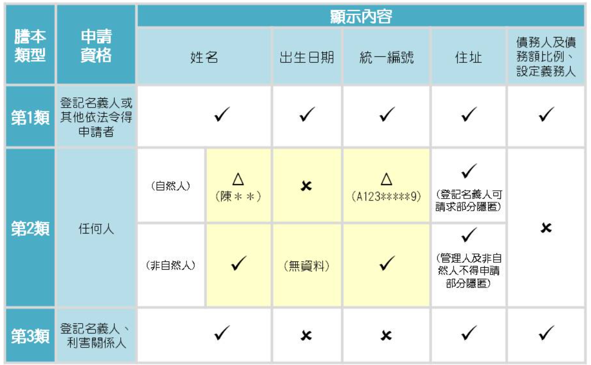

> 土地登記謄本之分類：常見到新聞報導，與屋主素未謀面的房仲，卻可以一字不差知道屋主的地址、姓名，並登門「拜訪」，造成許多屋主困擾，甚至覺得房仲是否是非法取得個資；然而，因為我國土地登記的公示原則，所以是任何人都可以向地政事務所申請土地謄本的喔！只是近年修法後，將謄本分為三類，究竟此分類是否能確實保護個人隱私呢？讓我們看下去吧！

<h1 class="wp-block-heading" id="實例說明">土地登記謄本之分類的意義</h1>

內政部在兼顧不動產交易安全與個人資料隱私的原則下，修正了「土地登記規則」第 24 條之 1 等條文，自 104 年 2 月 2 日起，任何人皆能申請的第二類土地登記謄本，將不公開所有權人的完整姓名資料，並另新增利害關係人申請的第三類土地登記謄本，分級保護個人資料。又第三類謄本，係為提供利害關係人申請，以避免影響民眾處理不動產事務。

<h1 class="wp-block-heading">土地登記謄本的分類</h1>
<ul class="has-black-color has-text-color has-normal-plus-font-size wp-block-list">
<li style="line-height:1.8">第一類：顯示登記名義人全部登記資料。</li>
<li style="line-height:1.8">第二類：隱匿登記名義人之出生日期、部分姓名、部分統一編號、債務人及債務額比例、設定義務人及其他依法令規定需隱匿之資料。但限制登記、非自然人之姓名及統一編號，不在此限。</li>
<li style="line-height:1.8">第三類：隱匿登記名義人之統一編號、出生日期之資料。</li>
</ul>

<h2 class="wp-block-heading" id="hank-老師提醒"><meta charset="utf-8"/>Erin 老師提醒</h2>

登記名義人如果有需求，可以向地政機關申請隱匿部分住址資料，這樣別人在申請二類謄本時，自己的住址就不會一字不漏地揭露了。但注意，如果是登記名義人之管理人或者登記名義人非自然人（如公司行號）的話，就不適用前述申請隱匿的規定囉！

<noscript></noscript>

<h4 class="wp-block-heading has-black-color has-text-color has-normal-plus-font-size" id="免費諮詢" style="line-height:1.8">．延伸閱讀</h4>

<a href="https://www.jasper-realestate.com/%e9%99%90%e5%88%b6%e7%ab%b6%e7%88%ad%e4%b9%8b%e7%b5%90%e5%90%88%e8%a1%8c%e7%82%ba/">公平交易法 § 10~§ 13｜限制競爭之結合行為</a>

<a href="https://www.jasper-realestate.com/%e9%99%90%e5%88%b6%e7%ab%b6%e7%88%ad%e4%b9%8b%e7%8d%a8%e5%8d%a0%e8%a1%8c%e7%82%ba/">公平交易法 §7~§9｜限制競爭之獨占行為</a>

<h4 class="wp-block-heading has-black-color has-text-color has-normal-plus-font-size" id="免費諮詢" style="line-height:1.8">．免費諮詢</h4>

<a data-id="https://line.me/R/ti/p/%40851hgrwp" data-type="URL" href="https://line.me/R/ti/p/%40851hgrwp" rel="noreferrer noopener" target="_blank">Line 官方帳號</a>｜<a data-id="https://www.facebook.com/Jasper-%E4%B8%8D%E5%8B%95%E7%94%A2%E7%B6%93%E7%B4%80%E4%BA%BA%E8%80%83%E8%A9%A6%E8%BC%94%E5%B0%8E%E5%93%A1-104204235060276/" data-type="URL" href="https://www.facebook.com/Jasper-%E4%B8%8D%E5%8B%95%E7%94%A2%E7%B6%93%E7%B4%80%E4%BA%BA%E8%80%83%E8%A9%A6%E8%BC%94%E5%B0%8E%E5%93%A1-104204235060276/" rel="noreferrer noopener" target="_blank">Facebook 粉絲專頁</a>

