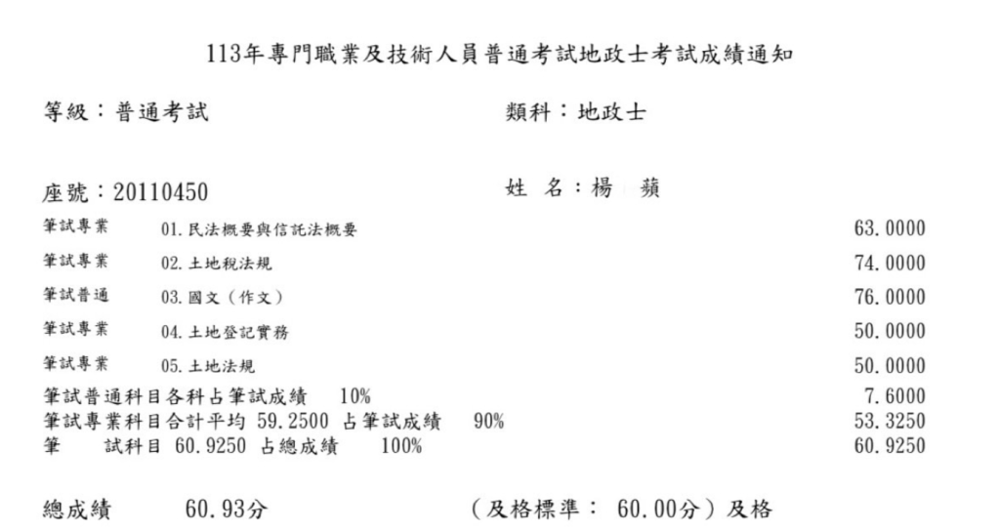

> 一、考生背景 非本科系畢業，在準備地政考

<h2 class="wp-block-heading">一、考生背景</h2>

非本科系畢業，在準備地政考試之前並沒有讀過法科，之前有不動產一年的工作經驗，自修考上經紀人，就想繼續報考地政士。

<h2 class="wp-block-heading">二、地政士考試準備過程</h2>

之前在短期間自修衝刺經紀人之後，身心太累，之後出現報復性休息狀態，在上一次考前一個月才發現有 Jasper 這個輔考團隊，買了講義來看，條列的方式有助於檢驗自己的構造建立架構，當看到其他上榜學長姐心得，在決定再準備考試之後，我便報名了 Jasper 地政士課程。

雖然我從小不太喜歡補習，覺得考試端看自己的努力，但這次我學習放下自己固有想法，從一開始就好好的請教老師讀書計劃的安排與執行，而在學習過程中對於法條有疑問都可以在讀書 LINE 群組請教老師們，這對先前孤軍奮戰的我很有幫助。

另外也有線上課程，在節省荷包的同時可以藉由課程快速找到重點，但近期考試趨勢越發靈活，為了再延伸閱讀相關釋義，我還有搭配團隊推薦的參考書籍來學習。

<h2 class="wp-block-heading">三、地政士考試各科準備</h2>

<h3 class="wp-block-heading">民法：</h3>

因為去年跟之前考經紀人我確實沒有好好準備這部分，幾乎裸考，（大多數人都說著重在專業科目，但以我的經驗，民法是法科的基礎，如果沒有好好打底法感，在後面的其它考科也會有相應的壓力）所以這次在準備前期我就好好的把民法課程跟教科書紮實的看完，後期就是解題書跟參與 Jasper 團隊的練筆團！即便有讀書進度壓力，但還是秉持盡量練習，Josh 律師的出題方向跟整個答題格式修正對我幫助很大！感謝！

<h3 class="wp-block-heading">國文：</h3>

這部分真的是我從小就很喜歡寫作有關，平時多累積國學的語感，多看多唸，相信會對這部分有所幫助，引言佳句，帶到自身經驗會更好。

<h3 class="wp-block-heading">土法：</h3>

去年花了很多時間在這塊，今年就稍微把重心轉移，有三題在考試中間竟然突然忘記本來記得的內容（我真的看了超過十遍以上，這情況是真的有可能發生的！不要慌！）於是我只能應憑著記憶點，慢慢拼湊出答案，這時候你平常的積累就非常重要。

<h3 class="wp-block-heading">土税：</h3>

這部分，我有針對不同的稅法整理個人筆記，集結土地稅法體系跟講義，另外觀察歷年大概出哪些稅法，找到其中的趨勢，跟今年可能的方向，其實稅法大多考的都是很基礎的東西。

<h3 class="wp-block-heading">土登：</h3>

大家都建議就是背到底，但其實我比較不喜歡背跟硬記，習慣將內容用自己的話說出來，這部分我滿推薦強登的土登書籍，他法條後有白話版，我覺得對理解上有幫助。

另外就是 Logan 老師觀察趨勢後的 bonus 題，雖然只剩一兩週，我還是盡力記熟，直接反映在考題上，真的非常感謝！

土法跟土登，我在準備上只求「有」的階段，沒有特別覺得要每個題目拿高分，沒有寫的特別完整，所以也確實反映在基本每題分數並沒有太高，但成績出來評分又比自己原先預期的來得低，確實老師們改題相當嚴謹。

因為這項考試就是要比誰在最短時間內寫出最完整的答案，但當初我準備這兩科的時間並不允許我做到這個程度，（其實是自己中間假期期間時間安排太鬆散，雖然還是有讀書，但是玩耍太久⋯不要學我）於是我把焦點放在選擇取捨，考前找到不同老師的考前提醒重點。依據不同階段要有不同的讀書進程，把焦點範圍縮小，聚焦。

<h2 class="wp-block-heading">四、結語</h2>

考運很重要，這次考試也是我第一次在考前、放榜前拜文昌帝君，感恩文昌帝君！另外吃素也比較能夠安定自己讀書的躁動的狀態，推薦給大家試試。還有要相信自己能夠做得到！

既然決心要走這條路，就踏踏實實的走完，過去如何、背景如何都不重要，維持正常健康的作息，規律的生活，可以讀書是很幸福的！

<figure class="wp-block-image size-large"><noscript></noscript></figure>

　

<h3 class="wp-block-heading" id="免費諮詢" style="line-height:1.8">．延伸閱讀</h3>

<a href="https://www.jasper-realestate.com/01-%e4%b8%8d%e5%8b%95%e7%94%a2%e7%b6%93%e7%b4%80%e4%ba%ba-%e8%ad%89%e7%85%a7%e4%bb%8b%e7%b4%b9%e5%84%aa%e5%8b%a2/">01 不動產經紀人｜證照介紹 &amp; 優勢</a>

<a href="https://www.jasper-realestate.com/02-%e4%b8%8d%e5%8b%95%e7%94%a2%e7%b6%93%e7%b4%80%e4%ba%ba%e8%80%83%e8%a9%a6%e8%b3%87%e8%a8%8a%e5%85%a8%e4%bb%8b%e7%b4%b9/">02 不動產經紀人｜考試資訊全介紹</a>

<h4 class="wp-block-heading has-text-color has-link-color wp-elements-217661994d7d4a0f28ce2500f2d632d0" id="免費諮詢" style="color:#ffffff;font-size:9px"><a data-id="https://line.me/R/ti/p/%40851hgrwp" data-type="URL" href="https://line.me/R/ti/p/%40851hgrwp" rel="noreferrer noopener" target="_blank">Line 官方帳號</a>｜<a data-id="https://www.facebook.com/Jasper-%E4%B8%8D%E5%8B%95%E7%94%A2%E7%B6%93%E7%B4%80%E4%BA%BA%E8%80%83%E8%A9%A6%E8%BC%94%E5%B0%8E%E5%93%A1-104204235060276/" data-type="URL" href="https://www.facebook.com/Jasper-%E4%B8%8D%E5%8B%95%E7%94%A2%E7%B6%93%E7%B4%80%E4%BA%BA%E8%80%83%E8%A9%A6%E8%BC%94%E5%B0%8E%E5%93%A1-104204235060276/" rel="noreferrer noopener" target="_blank">Facebook 粉絲專頁</a></h4>

