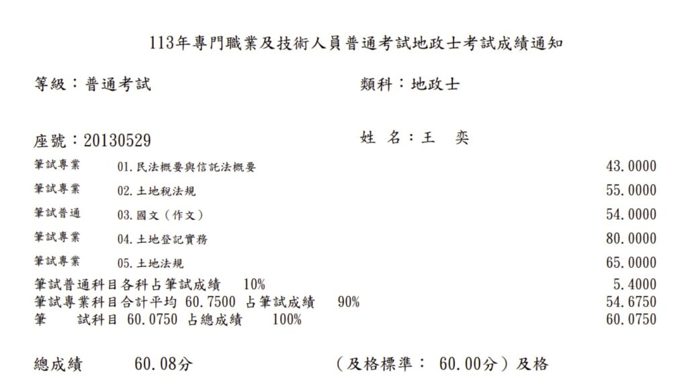

> 一、背景 本身非本科系，也在銀行及傳產前

<h2 class="wp-block-heading">一、背景</h2>

本身非本科系，也在銀行及傳產前後加起來快 10 年工作經驗，鑑於年紀漸增，也告訴自己若未來再轉換跑道，也許是人生最後一次轉職，而自己最終目標也期望能夠開業自己當老闆，做了許多觀察及研究之後，決定踏入不動產及地政這塊市場，因此決定踏上國考之路，好好為自己人生再衝刺一次。

在經過多家線上補習班比較之後，後來選擇 Jasper 地政士&amp;不動產經紀人考試輔導員，非常大推線上群組 24 小時都可以在群組問問題，不僅學員間大家會互相幫忙解答，更有專業的各科老師會做最完整詳細的解說，且價格相對也便宜，各科老師上課的影片及資料都是精華濃縮各科重點。

而我在去年 11 月也成功考取不動產經紀人，今年我也繼續跟著 Jasper 輔考團隊的地政士課程繼續衝刺，讓我能在一年內考取雙證照。另外 Jasper 老師也會幫助我們審視讀書計畫並針對我們的時間安排及課程提供專業的意見及解說，讓我覺得在這個群組學員及老師大家就像一個大家庭彼此解答問題，讓備考之路不孤單。

<h2 class="wp-block-heading">二、地政士考試準備過程</h2>

因為在準備不動產經紀人的時候已經有打過基礎，我一開始起步時，是先按照老師的意見，先選擇一套自己看的順眼的教科書，以一套為原則，先把各科法條理解，一定要先理解之後再針對比較重要常考的法條再做背誦，搭配近 10 年的考古題再加上老師上課的影片，大概就能慢慢抓出重點法條並做理解及背誦。

<h2 class="wp-block-heading">三、心態調整及時間分配</h2>

心態及時間安排我認為是對於備考之路非常重要的一門環節，心態方面對自己有信心，考試是及格制不用跟別人比較，因此無論報名人數多少都與我們無關，我們只要戰勝自己，但既然都要拼了，就要非常認真有一次就上的決心。

時間方面因為本身要上班，但中午吃飯後的休息時間我會先快速預習晚上回家要讀的東西，這樣晚上回家也能更快速進入讀書狀態，備考之路不容易尤其又在職，很累很辛苦。

但就像 Jasper 老師說的要堅持住，且老師也時常跟我們說只要我們想讀，老師及整個專業的輔導團隊都在，備考過程一直堅持到考完第二天最後一科要放鬆再來好好放鬆。

<h2 class="wp-block-heading">四、各科準備方式</h2>

由於在準備不動產經紀人時已經有對各科教科書做一次完整法條打底，因此在此次準備地政士過程，我把各科老師上課的影片再看了 2 遍，並複習上課內容 3 遍，如果時間允許可以再看更多次讓自己印象更清楚，再來近 10 年的考古題一定也要反覆刷 3 遍以上，除了訓練手感及看到題目的反應度，也能更清楚了解考試的大方向及抓出重點法條。

<h3 class="wp-block-heading">國文：</h3>

平常可以多看一些文章，時事新聞等等，國文考題偏白話好理解及發揮，並可平常看到不錯的佳句可以運用上去，穩穩的寫基本分數應該都可以拿到。

<h3 class="wp-block-heading">民法：</h3>

打底很重要，民法法條一千多條，老師上課的講義跟影片一定要熟讀，上課的法條都是濃縮的重點精華，再來搭配考古題，訓練抓關鍵字，練敏感度，分享一個小方法，民法跟我們生活其實是習習相關，我會把自己融入題目當中，想像自己就是當事人，用理解及寫故事的方式，不用刻意一字不漏硬背，自然看到題目後你就能歷生其境，寫出屬於自己的答案，先引用法條再寫出結論。

<h3 class="wp-block-heading">土地法規：</h3>

老師上課的影片一樣熟讀，並把課堂上提到的法條都要列出來熟讀，像是徵收、平權條例等等，地政士法也要把握一定會出一題，當然也是要搭配考古題，整理重要法條看到題目就大概知道方向在哪。

<h3 class="wp-block-heading">土地登記：</h3>

老師上課的影片跟講義一定要熟讀，重點老師在講義上補充的很詳細，這一科剛開始讀會有點不知所措，且內容也很多，但上課的講義多讀個2～3遍並搭配考題一定能慢慢掌握這科的重點並做理解及背誦，一定要把握這科背多分的科目。

<h3 class="wp-block-heading">土地稅法：</h3>

老師上課的重點一定要熟讀，我認為這也是很好拿分的一個科目，各個稅法的重點老師幾乎講義都有詳細說明，之後當然還是要好好的背誦，無論是計算或稅率等等的都要把握住。

<h2 class="wp-block-heading">五、結論</h2>

各科都不要放棄掉，一定每科都要把握住，一定有容錯的空間，但當然能每題都有把握到是最好的，另外要非常注意各科法條上的更新，例如今年土地稅法就考了最新房屋稅的稅率，因此無論哪科都要特別留意修法的部分。

考試當天保持好心情及好體力，考前也能誠信向文昌帝君祈禱並許個願，最後就是帶著自信心上戰場，只要有信心決心，再搭配努力，一定能順利上榜。

<figure class="wp-block-image size-large"><noscript></noscript></figure>

　

<h3 class="wp-block-heading" id="免費諮詢">．延伸閱讀</h3>

<a href="https://www.jasper-realestate.com/01-%e4%b8%8d%e5%8b%95%e7%94%a2%e7%b6%93%e7%b4%80%e4%ba%ba-%e8%ad%89%e7%85%a7%e4%bb%8b%e7%b4%b9%e5%84%aa%e5%8b%a2/">01 不動產經紀人｜證照介紹 &amp; 優勢</a>

<a href="https://www.jasper-realestate.com/02-%e4%b8%8d%e5%8b%95%e7%94%a2%e7%b6%93%e7%b4%80%e4%ba%ba%e8%80%83%e8%a9%a6%e8%b3%87%e8%a8%8a%e5%85%a8%e4%bb%8b%e7%b4%b9/">02 不動產經紀人｜考試資訊全介紹</a>

<h4 class="wp-block-heading has-text-color has-link-color wp-elements-217661994d7d4a0f28ce2500f2d632d0" id="免費諮詢" style="color:#ffffff;font-size:9px"><a data-id="https://line.me/R/ti/p/%40851hgrwp" data-type="URL" href="https://line.me/R/ti/p/%40851hgrwp" rel="noreferrer noopener" target="_blank">Line 官方帳號</a>｜<a data-id="https://www.facebook.com/Jasper-%E4%B8%8D%E5%8B%95%E7%94%A2%E7%B6%93%E7%B4%80%E4%BA%BA%E8%80%83%E8%A9%A6%E8%BC%94%E5%B0%8E%E5%93%A1-104204235060276/" data-type="URL" href="https://www.facebook.com/Jasper-%E4%B8%8D%E5%8B%95%E7%94%A2%E7%B6%93%E7%B4%80%E4%BA%BA%E8%80%83%E8%A9%A6%E8%BC%94%E5%B0%8E%E5%93%A1-104204235060276/" rel="noreferrer noopener" target="_blank">Facebook 粉絲專頁</a></h4>

