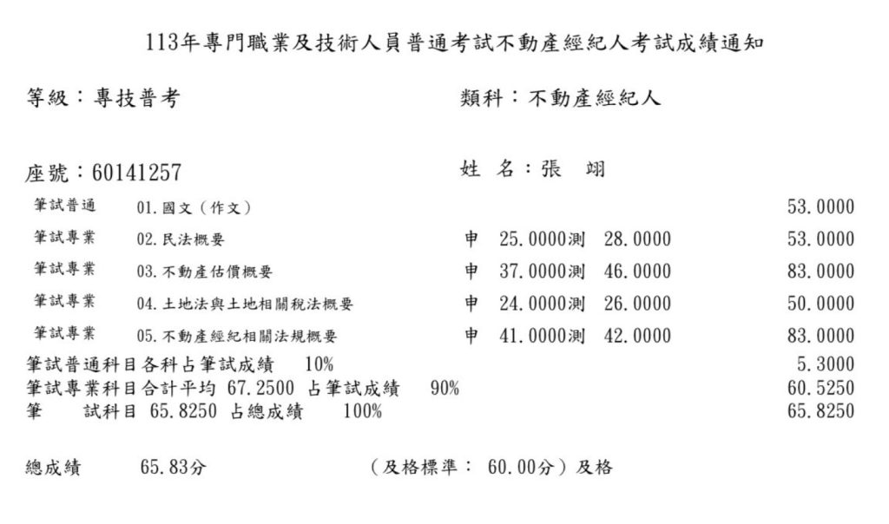

> 嗨～大家！如果你正在準備不動產經紀人考試

嗨～大家！如果你正在準備不動產經紀人考試，希望這篇心得可以給你一點方向窩～

<h2 class="wp-block-heading">一、不動產經紀人考試動機</h2>

我是考完研究所後，才開始準備經紀人考試的！主要是因為爸爸媽媽開了仲介公司，希望我能考到這張證照～但問題來了！我完全沒有法律背景，所以第一個想法就是——找補習班！畢竟快、狠、準抓住考試重點才是王道！（跟我準備經濟研究所的方式一樣！）

剛好朋友推薦了 Jasper團隊的線上課程方案，我還特地去 Dcard 爬文、加 Line 問榜單評價，確認過才報名。在我與 Jasper 考試輔導員聊完之後，我就直接報名了！！ 

首先 Jasper 的榜單漂亮（這點超重要！代表老師教學方向正確），第二朋友推薦（身邊有人報名過，安心感UP！），第三 Jasper 有 Line 群組（隨時可以發問，老師解答速度超快！）

就這樣，我踏上了經紀人考試的征途啦～

<h2 class="wp-block-heading">二、準備方式</h2>

因為我同時有工作，一開始讀書節奏比較慢，直到碩班開學才驚覺——糟了！時間不夠用！不推自己一把不行！

10月初，我終於完成 Jasper 所有課程，同時老師上課很多精華我都把它整理成自己的筆記，（考前讀筆記真的超受用）接下來就是觀念複習＋刷題。

科目準備：

<h3 class="wp-block-heading">✅ 不動產經紀相關法規＆不動產估價概要：</h3>

內容較少、準備效率高！直接把 Jasper 老師上課內容螢幕截圖列印出來做筆記猛複習，這2科是最穩的拿分重點！一定要考前多看一下，就像 Jasper 老師說的準備的投資報酬率很高，一定值得！

<h3 class="wp-block-heading">✅ 土地法與土地相關稅法、民法：</h3>

內容較多，讀起來比較吃力，需要花相對多的時間，所以很謝謝 Jasper 老師把枯燥的法條結合了實例，讓我更好吸收。我本來試著課堂前提前預習，但是看到民法的條文就快昏倒了。

法律條文本來很難啃，結果學著學著覺得——哇，這些東西超實用欸！學法律真的不只是為了考試，而是法律是用來保護懂法律的人！是實用性很強的兩科。

<h3 class="wp-block-heading">✅ 國文（作文）：</h3>

😂其實這科我沒有做任何準備，考試的時候記得多寫一點就好囉。

<h2 class="wp-block-heading">三、讀書策略及上榜心得</h2>

📍 先理解觀念，再刷題！ 時間有限，主要先專注課程筆記 👉 再題目帶觀念複習。

📍 Jasper LINE 群組超好用！ 隨時發問老師快速解惑。

📍 建議提早準備！上完所有課程後儘量留個2-3個月，我只留1.5個月拼命衝刺，真的超趕超緊張！因為經濟系碩班期中考超炸，差不多10月底才考完。最後一個禮拜好險有校慶，我整個閉關苦讀，所以才能非常非常幸運的考上。

最後真的很感謝 Jasper 團隊的老師們！讓我順利考上～

也祝大家金榜題名！所有努力都有收穫！加油 💪

<figure class="wp-block-image size-large"><noscript></noscript></figure>

　

<h3 class="wp-block-heading" id="免費諮詢" style="line-height:1.8">．延伸閱讀</h3>

<a href="https://www.jasper-realestate.com/01-%e4%b8%8d%e5%8b%95%e7%94%a2%e7%b6%93%e7%b4%80%e4%ba%ba-%e8%ad%89%e7%85%a7%e4%bb%8b%e7%b4%b9%e5%84%aa%e5%8b%a2/">01 不動產經紀人｜證照介紹 &amp; 優勢</a>

<a href="https://www.jasper-realestate.com/02-%e4%b8%8d%e5%8b%95%e7%94%a2%e7%b6%93%e7%b4%80%e4%ba%ba%e8%80%83%e8%a9%a6%e8%b3%87%e8%a8%8a%e5%85%a8%e4%bb%8b%e7%b4%b9/">02 不動產經紀人｜考試資訊全介紹</a>

<h4 class="wp-block-heading has-text-color has-link-color wp-elements-217661994d7d4a0f28ce2500f2d632d0" id="免費諮詢" style="color:#ffffff;font-size:9px"><a data-id="https://line.me/R/ti/p/%40851hgrwp" data-type="URL" href="https://line.me/R/ti/p/%40851hgrwp" rel="noreferrer noopener" target="_blank">Line 官方帳號</a>｜<a data-id="https://www.facebook.com/Jasper-%E4%B8%8D%E5%8B%95%E7%94%A2%E7%B6%93%E7%B4%80%E4%BA%BA%E8%80%83%E8%A9%A6%E8%BC%94%E5%B0%8E%E5%93%A1-104204235060276/" data-type="URL" href="https://www.facebook.com/Jasper-%E4%B8%8D%E5%8B%95%E7%94%A2%E7%B6%93%E7%B4%80%E4%BA%BA%E8%80%83%E8%A9%A6%E8%BC%94%E5%B0%8E%E5%93%A1-104204235060276/" rel="noreferrer noopener" target="_blank">Facebook 粉絲專頁</a></h4>

