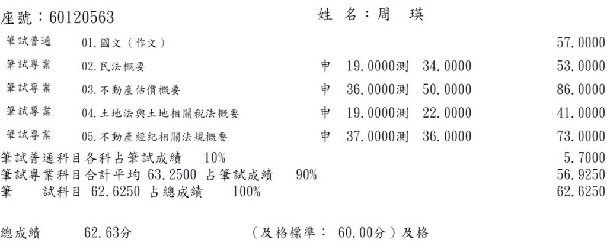

> 一、考生背景 我是育嬰留職停薪三年重新回

<h2 class="wp-block-heading">一、考生背景</h2>

我是育嬰留職停薪三年重新回到職場的媽媽，原本在貿易公司任職，因為想要有更彈性的工作時間陪伴孩子成長，再加上先生從事代書業，於是決定轉換跑道當房仲。

在貿易業我有15年的工作經驗，但在不動產領域的經驗卻趨近於零，先生鼓勵我報名經紀人考試，藉此增加不動產專業知識。

由於已經開始從事房仲業，要兼顧工作、家庭、孩子，實在沒有太多時間去補習班上課，經過評估決定購買 Jasper 團隊的不動產經紀人課程，選擇Jasper最主要的原因是我能讀書的時間很零碎，而 Jasper 課程可以隨時線上觀看影片，再加上每一章節的授課時間不會太長，讓我能在較短的時間內讀完一個章節的重點。

課程採主題分類，老師把必考重點區分出來，著重於常考的法條教學，不常考的內容不浪費時間著墨適當的瀏覽略過，對於沒有太多時間可以讀書的人來說真是一大福音，正如 Jasper 老師所說，我們目標是考過而不是考高分。

我在八月初購買了課程，但實在太忙了，一直到九月中才正式開始看線上課程，雖然起步的晚，但我很認真的從 Lesson 1 （讀書前的準備）開始看，首先依照影片中老師的建議培養讀書習慣、擬定讀書計畫，特別是時間有限的在職媽媽考生，更是需要把每一考科的讀書進度好好規劃出來。

<h2 class="wp-block-heading">二、不動產經紀人考試準備方式</h2>

以下為我備考方式，與大家分享：

<h3 class="wp-block-heading">1. 國文：</h3>

考試前搜尋YouTube 上作文教學影片，惡補一下作文書寫架構，太久沒寫作文了，無法寫出名言佳句或精美詞彙，只能做好審題不要離題，下筆前列出每段大綱，字數盡力寫超過1200字以上。

<h3 class="wp-block-heading">2. 民法、土法土稅：</h3>

這兩個考科範圍太廣，我只看 Jasper 課程影片，不懂的地方反覆重播看，把影片有講到的基本概念讀熟，由於時間緊迫並沒有花太多時間研讀。不過稅法的部分，平時公司教育訓練有上過，準備起來相對較熟悉。

<h3 class="wp-block-heading">3. 估價、不動產經紀相關法規：</h3>

拉高分數關鍵考科，我把所有時間和精力都放在這兩科，理解每一條法條的內容，並用白話和口訣的方式幫助記憶。估價的計算題也是不斷的重複算，練到一看到題目就知道套用哪一個公式。

考前一個月我向店長請假暫緩工作拼業績，每天至少唸書10小時以上，並且不斷練習考古題，申論題練習我只手寫下各段落的標題，然後閉上眼將每段標題所要論述的內容口述出來，這樣省下的寫字時間可以練習更多的考古題。

另外一定要製作專屬自己的筆記，我用心智圖法和表格化法把各科重點和考古題常錯的法條筆記下來幫助自己記憶，每天睡前先把自己寫的筆記看過一輪，然後邊睡邊回想筆記內容直到睡著為止。

<h2 class="wp-block-heading">三、結語</h2>

人說「一孕傻三年，生完小孩會變笨」我實在很有感，記憶力衰退老是忘東忘西，準備經紀人考試著實讓我非常吃力。

感謝Jasper團隊的教學系統，也感謝先生和家人分擔家務事，更感謝靠意志力努力堅持下去的自己。

我這腦袋不太靈光的在職媽媽都能考過了，相信其他同學們只要找到適合自己的讀書方式，堅持下去不要放棄一定也可以榜上題目，祝福大家。

<figure class="wp-block-image size-large"><noscript></noscript></figure>

　

<h3 class="wp-block-heading has-black-color has-text-color" id="免費諮詢" style="line-height:1.8">．延伸閱讀</h3>

<a href="https://www.jasper-realestate.com/01-%e4%b8%8d%e5%8b%95%e7%94%a2%e7%b6%93%e7%b4%80%e4%ba%ba-%e8%ad%89%e7%85%a7%e4%bb%8b%e7%b4%b9%e5%84%aa%e5%8b%a2/">01 不動產經紀人｜證照介紹 &amp; 優勢</a>

<a href="https://www.jasper-realestate.com/02-%e4%b8%8d%e5%8b%95%e7%94%a2%e7%b6%93%e7%b4%80%e4%ba%ba%e8%80%83%e8%a9%a6%e8%b3%87%e8%a8%8a%e5%85%a8%e4%bb%8b%e7%b4%b9/">02 不動產經紀人｜考試資訊全介紹</a>

<h4 class="wp-block-heading has-text-color has-link-color wp-elements-217661994d7d4a0f28ce2500f2d632d0" id="免費諮詢" style="color:#ffffff;font-size:9px"><a data-id="https://line.me/R/ti/p/%40851hgrwp" data-type="URL" href="https://line.me/R/ti/p/%40851hgrwp" rel="noreferrer noopener" target="_blank">Line 官方帳號</a>｜<a data-id="https://www.facebook.com/Jasper-%E4%B8%8D%E5%8B%95%E7%94%A2%E7%B6%93%E7%B4%80%E4%BA%BA%E8%80%83%E8%A9%A6%E8%BC%94%E5%B0%8E%E5%93%A1-104204235060276/" data-type="URL" href="https://www.facebook.com/Jasper-%E4%B8%8D%E5%8B%95%E7%94%A2%E7%B6%93%E7%B4%80%E4%BA%BA%E8%80%83%E8%A9%A6%E8%BC%94%E5%B0%8E%E5%93%A1-104204235060276/" rel="noreferrer noopener" target="_blank">Facebook 粉絲專頁</a></h4>

