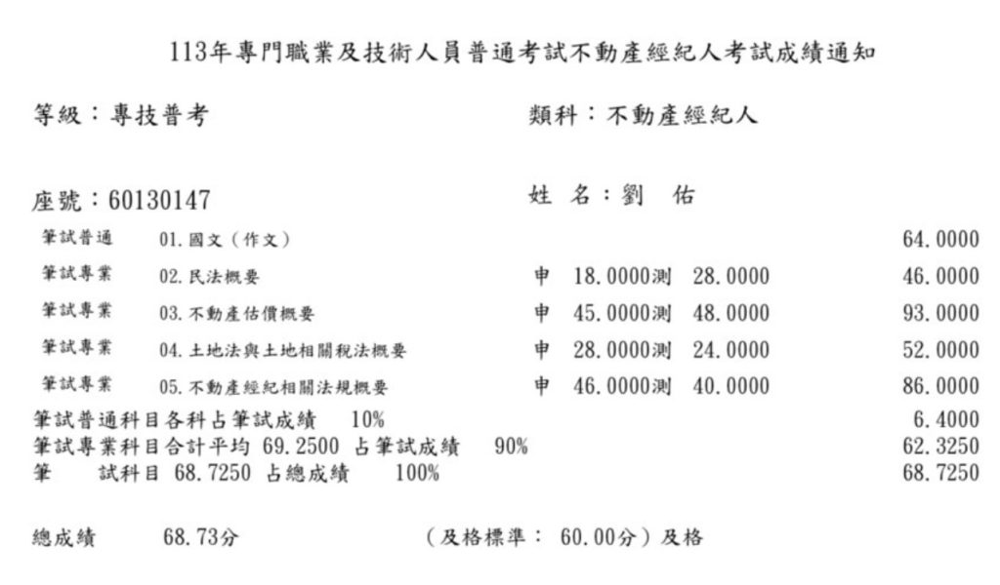

> 商科出身的我一直對房地產領域很感興趣，但

商科出身的我一直對房地產領域很感興趣，但由於並非不動產或法律相關科系出身，因此在決定考取不動產經紀人證照的時候其實壓力很大，害怕自己無法理解那些生硬的法律條文，就像有考過卻沒上的朋友說的「明明都是國字，但是就是看不懂」。然而，面對完全陌生的專業知識，如何有效準備成了最大挑戰。

<h2 class="wp-block-heading">一、課程選擇</h2>

在多方比較後，選擇了 Jasper 的不動產經紀人教材與課程，這對於沒有相關背景的我來說，提供了完整且有系統的學習方式。其中，讀書計畫的安排，幫助我掌握進度，且讀書會LINE群組，讓大家能即時討論問題，而線上課程，則提供靈活的學習時間，不需擔心風吹日曬雨淋還要去補習班，隨時都能上課。

<h2 class="wp-block-heading">二、準備方式</h2>

民法真的很難！所以課前老師就有特別教大家配分技巧，我自己是掌握分數最好把握的2樣科目（經紀法規+估價概要），去加強練選擇題，以及每天不斷的反覆複習影片（不熟悉的民法加土地法），從一開始的不知半解到後期突然某一天你就被打通任督二脈一樣，可以理解這些國字的組合了。

考前半個月基本上都在刷題，每天刷個300題選擇題，加上1年歷屆試題，申論題的部分原本也是我比較擔心的部分，還好老師們對條文的解說都用比較白話的方式，讓法律小白的我也可以用理解的方式去代替死背。

當然也有讀書到一半卡關的時候，覺得都看了影片二個月卻也不理解條文的意思，這時候我就會去打掃掃廁所，放空自己給自己休假個1天2天，就跟減肥的停滯期一樣，給自己個放縱期，過2天再來努力，通常效果也還不錯。千萬不要再卡關的時候放棄自己，堅持到底才有可口果實喔！

<h2 class="wp-block-heading">三、總結</h2>

回顧這四個月的準備過程，雖然一開始對於零基礎備考感到不安，但透過完整課程與支援，讓我能夠系統化學習，並成功通過考試。有興趣的人其實都可以試試看，也不要擔心沒時間讀書，因為時間就像乳溝一樣，擠一擠就有了。當手上的資源越多，相信未來的選擇道路也會更多的！

<figure class="wp-block-image size-large"><noscript></noscript></figure>

  

<h3 class="wp-block-heading has-black-color has-text-color" id="免費諮詢" style="line-height:1.8">．延伸閱讀</h3>

<a href="https://www.jasper-realestate.com/01-%e4%b8%8d%e5%8b%95%e7%94%a2%e7%b6%93%e7%b4%80%e4%ba%ba-%e8%ad%89%e7%85%a7%e4%bb%8b%e7%b4%b9%e5%84%aa%e5%8b%a2/">01 不動產經紀人｜證照介紹 &amp; 優勢</a>

<a href="https://www.jasper-realestate.com/02-%e4%b8%8d%e5%8b%95%e7%94%a2%e7%b6%93%e7%b4%80%e4%ba%ba%e8%80%83%e8%a9%a6%e8%b3%87%e8%a8%8a%e5%85%a8%e4%bb%8b%e7%b4%b9/">02 不動產經紀人｜考試資訊全介紹</a>

<h4 class="wp-block-heading has-text-color has-link-color wp-elements-217661994d7d4a0f28ce2500f2d632d0" id="免費諮詢" style="color:#ffffff;font-size:9px"><a data-id="https://line.me/R/ti/p/%40851hgrwp" data-type="URL" href="https://line.me/R/ti/p/%40851hgrwp" rel="noreferrer noopener" target="_blank">Line 官方帳號</a>｜<a data-id="https://www.facebook.com/Jasper-%E4%B8%8D%E5%8B%95%E7%94%A2%E7%B6%93%E7%B4%80%E4%BA%BA%E8%80%83%E8%A9%A6%E8%BC%94%E5%B0%8E%E5%93%A1-104204235060276/" data-type="URL" href="https://www.facebook.com/Jasper-%E4%B8%8D%E5%8B%95%E7%94%A2%E7%B6%93%E7%B4%80%E4%BA%BA%E8%80%83%E8%A9%A6%E8%BC%94%E5%B0%8E%E5%93%A1-104204235060276/" rel="noreferrer noopener" target="_blank">Facebook 粉絲專頁</a></h4>

