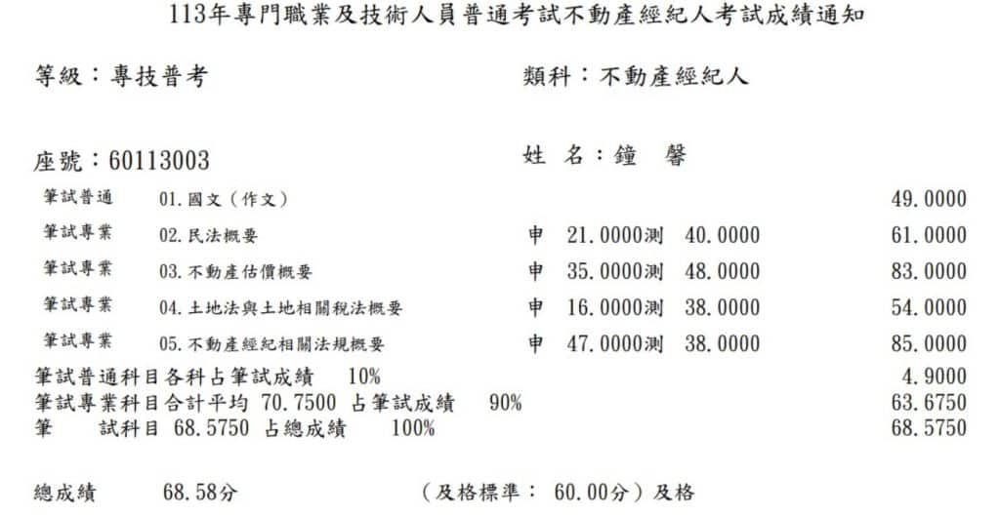

> 希望這篇心得，能幫助到正在準備，或還在觀

希望這篇心得，能幫助到正在準備，或還在觀望是否要報考不動產經紀人的同學們～

<h2 class="wp-block-heading">一、考生背景</h2>

我是非本科生，在準備考試前，幾乎沒有系統性接觸過法條。原本主要的目標是地政士考試，後來在規劃讀書方向時發現，地政士與不動產經紀人之間有不少重複科目，再加上不動產相關的法律與實務本來就非常實用，覺得多準備一張證照其實也有加分效果，所以最後決定一起報考！

對我來說，這張證照不只是考試通過而已，更像是一個把不動產相關觀念重新整理、建立系統的過程。也很幸運，第一次報考就能順利上榜！

<h2 class="wp-block-heading">二、學習資源</h2>

一開始準備時，在網路上爬了不少心得文，也比較過各種補習與線上課程。後來注意到「 Jasper 地政士＆不動產經紀人考試輔導員」，特別是看到不少非本科、零基礎的考生分享，讓我決定進一步瞭解。

真正讓我決定選擇 Jasper的課程，是因為他們有提供試看課程。實際看過之後，覺得整體製作非常用心，每堂課都有完整字幕，搭配整理好的 PPT，不用擔心看不清楚板書，用線上方式學習也不會有跟不上進度的困擾，可以重複聽，對個人時間的彈性安排非常加分。

另外，在一開始諮詢課程時，說明也很清楚、親切，一起討論適合的準備方式的過程，感受得到單位的用心。聊完之後，原本對國考沒什麼頭緒的心情真的放鬆不少，也更有勇氣跨出第一步正式開始準備。

後來實際上課，更覺得挑對了！尤其是讀書群，氣氛很好，鼓勵同學提問、互相交流，而老師的回覆都很快而且很詳細，透過群組的方式，也能從同學的提問中發覺自己沒有注意到的盲點，對考試準備幫助很大！

<h2 class="wp-block-heading">三、不動產經紀人各科準備方式</h2>

<h3 class="wp-block-heading">1. 民法概要</h3>

民法是許多人心中的大魔王，法條很多、而且重概念理解，Jasper的課程把重點精華都清楚的整理成心智圖，對法條邏輯脈絡理解非常有幫助！

老師推薦的陳聰富教授《民法概要》真的很適合初學者，裡面有很多生活化的例子，我常常把內容當故事看，再搭配 Jasper 課程中對構成要件與法律效果的拆解，把法條實際放進生活情境中理解，記憶會深很多。

實際讀法上，我通常會先自己看書抓一輪概念，再看 Jasper 的線上課程幫忙整理重點，不懂的地方就多聽幾次或先做記號。等整個章節有基本輪廓後，再開始寫歷屆試題，確認自己到底哪個觀念沒抓好，會越讀越輕鬆。

<h3 class="wp-block-heading">2. 土地法＆土地稅法概要</h3>

土地法範圍不小，對完全沒接觸過法條的人來說，一開始一定會有點壓力。不過照老師的建議，先把民法唸過一輪，讓自己先習慣法律的邏輯架構，再回來讀土地法，理解上真的順很多。

土地法其實有不少內容滿直觀的，例如市地重劃、區段徵收，自己在看法條的時候，會感覺內容比較跳，也容易漏東漏西，但是搭配 Jasper 講義中整理好的程序圖，脈絡會很清楚！

至於土地稅法，準備方式就相對單純，重點就是整理＋記憶。我會照著講義把稅基、稅率、適用條件畫成圖表，在空白紙上自己回想再畫出來，每次畫圖都是加深印象，對於記憶上幫助很大。

<h3 class="wp-block-heading">3. 不動產估價概要</h3>

對數學比較沒信心的同學，其實真的不用太擔心！不動產估價這科條文最少，只有134條，而且重點不在複雜計算，就算有算式，也大多是基本的加減乘除，核心還是在於理解概念跟記憶的部分。

Jasper 的估價課程，講解節奏很清楚，還會搭配「好記的口訣」，上完課後腦袋都有聲音了！準備時只要熟悉看到哪些「關鍵字」要用哪一種「估價法」，搭配歷屆試題反覆練習，這一科其實很好拿分！法條少，多練歷屆試題，其實會發現都是重複的概念在考，只要有刷題基本上選擇題就穩了，一定要好好把握！

<h3 class="wp-block-heading">4. 不動產經紀相關法規概要</h3>

這一科包含《不動產經紀業管理條例》、《公平交易法》、《消費者保護法》，以及《公寓大廈管理條例》，整體範圍不算大，而且條文內容都很白話～

相較於民法需要理解，這一科比較偏記憶型，只要把「重點條文」、「罰則金額」、「適用對象」整理清楚，搭配多練習歷屆試題，其實也是非常適合拿來拉分的一科！考前多看幾次條文搭配歷屆題目，效果會很明顯的！

<h2 class="wp-block-heading">四、考場實戰經驗分享</h2>

進考場後真的不要太緊張，考前把課程講義架構圖看過一遍，自己在腦袋裡回想。考試開始後就放輕鬆，題目拿到先快速掃過一遍，把有把握的題目先寫完，確保該拿的分數都有拿到，不確定的題目留到最後再回頭想，不要卡在不會的地方因小失大。

申論題作答的時候，建議用條列式，把重點清楚寫出來，讓閱卷老師一眼就清楚知道你在寫什麼。平時也可以用歷屆題練習，提升真正考試的時候的手感～

<h2 class="wp-block-heading">五、結語：給之後準備的同學</h2>

除了學生時期上過公民課之外，我對法條幾乎是完全零基礎。一開始準備會比較辛苦，覺得自己理解速度很慢、怎麼看了那麼久卻沒看多少…不過只要堅持下去，把法律基礎慢慢建立起來，會明顯感覺越唸越輕鬆。

準備時間來說，因為我在同一年也同步準備地政士考試，重複科目斷斷續續大約看了半年，非重複科目是在年中考完地政士後才開始念，每天大概唸 2～3 小時。當然也常常有覺得唸不下去的時候，我會選擇果斷休息！後面再陸續把進度補上來。因為考試是長期抗戰，保持好的狀態很重要，有好的狀態才可以事半功倍，也不會讓讀書一不小心就變成一件壓力巨大的麻煩事。

綜上，讀書計畫真的很重要。我用課程提到的方式，人生中第一次排讀書計畫（以前學生時期完全沒做過這件事）才發現有計劃的唸書不僅心裡踏實，對考前準備節奏也才會有把握度。建議可以先大致規劃各科進度，不用排得太細，但至少知道現在在準備哪一科、下一步要做什麼。這樣即使某幾天比較累、進度慢一點，也不會太焦慮，因為心裡很清楚還有多少內容、有多少時間補上。

整個準備過程中，我是用老師推薦的書籍打底，再搭配 Jasper 課程幫忙整理重點與架構，讀起來會更有方向感，配合刷題、群組討論做練習和複盤。學生時期的成績其實很普通，但這次準備考試真的讓我覺得，只要方法對、步調穩，非本科、零基礎也真的做得到！

希望這篇分享，能給正在準備或還在猶豫的同學一點參考，也祝大家都能順利上榜～✨

<figure class="wp-block-image size-large"><noscript></noscript></figure>

  

<h3 class="wp-block-heading has-black-color has-text-color" id="免費諮詢" style="line-height:1.8">．延伸閱讀</h3>

<a href="https://www.jasper-realestate.com/01-%e4%b8%8d%e5%8b%95%e7%94%a2%e7%b6%93%e7%b4%80%e4%ba%ba-%e8%ad%89%e7%85%a7%e4%bb%8b%e7%b4%b9%e5%84%aa%e5%8b%a2/">01 不動產經紀人｜證照介紹 &amp; 優勢</a>

<a href="https://www.jasper-realestate.com/02-%e4%b8%8d%e5%8b%95%e7%94%a2%e7%b6%93%e7%b4%80%e4%ba%ba%e8%80%83%e8%a9%a6%e8%b3%87%e8%a8%8a%e5%85%a8%e4%bb%8b%e7%b4%b9/">02 不動產經紀人｜考試資訊全介紹</a>

<h4 class="wp-block-heading has-text-color has-link-color wp-elements-217661994d7d4a0f28ce2500f2d632d0" id="免費諮詢" style="color:#ffffff;font-size:9px"><a data-id="https://line.me/R/ti/p/%40851hgrwp" data-type="URL" href="https://line.me/R/ti/p/%40851hgrwp" rel="noreferrer noopener" target="_blank">Line 官方帳號</a>｜<a data-id="https://www.facebook.com/Jasper-%E4%B8%8D%E5%8B%95%E7%94%A2%E7%B6%93%E7%B4%80%E4%BA%BA%E8%80%83%E8%A9%A6%E8%BC%94%E5%B0%8E%E5%93%A1-104204235060276/" data-type="URL" href="https://www.facebook.com/Jasper-%E4%B8%8D%E5%8B%95%E7%94%A2%E7%B6%93%E7%B4%80%E4%BA%BA%E8%80%83%E8%A9%A6%E8%BC%94%E5%B0%8E%E5%93%A1-104204235060276/" rel="noreferrer noopener" target="_blank">Facebook 粉絲專頁</a></h4>

