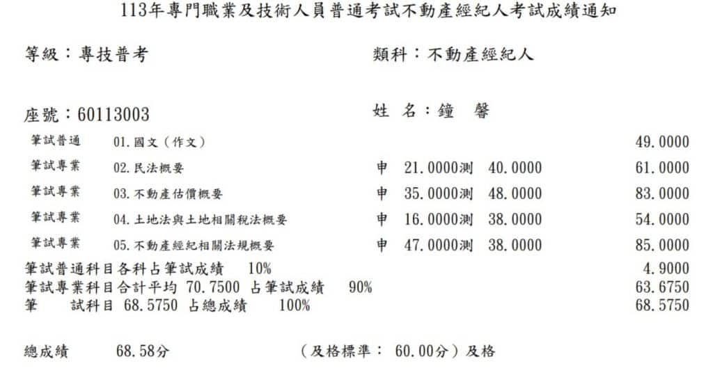

> 一、考生背景 目前是在建設公司上班約兩年

<h2 class="wp-block-heading">一、考生背景</h2>

目前是在建設公司上班約兩年多的員工，本身是非相關科系畢業（企管系），因公司建案未來有自售需求，以及了解到不動產經紀人證照在市場上的價值性，決定選擇邊上班邊準備考試的方式，這也是我出社會後第一次報考國考證照。

<h2 class="wp-block-heading">二、學習資源</h2>

因為平日要上班，基本上能唸書的時間相對有限，另外也考量到通勤時間和體力，所以沒有選擇到補習班。

但偶然在網路上發現有非常多人推薦Jasper地政士&amp;不動產經紀人考試輔導員，看完官網介紹後覺得非常專業且專一的在替考生們準備關於不動產經紀人相關考科的資料，還有提供一對一的諮詢服務。

關於讀書計畫、時間安排等不確定性的問題都可以提前詢問，加入後課程影片隨時都能上線觀看或回放複習，網站上還有分科統整的易混淆法律或比較表等，學習專欄的每一篇真的都是精華中的精華。

除此之外，覺得最棒的是有讀書會問答群組，基本上遇到任何困難或不懂的題目都能夠立即詢問，會有專科老師來解題，對於念書時間較零碎的我來說，真的是一大福音！群組的氛圍也時常激勵著大家，讓我們可以快速進入備考狀態，對於零經驗的我真的是最佳首選。

<h2 class="wp-block-heading">三、不動產經紀人各科準備方式</h2>

我覺得一開始最最重要的真的是Jasper的考試技巧課程，我自己完全就是一張白紙，非相關科系也第一次應考，看完L1的十堂課我像吃了定心丸一樣，那些原本內心擔憂的問題，害怕唸不完、法條看不懂、申論好可怕等等懷疑自我或恐懼的心態，頓然間好像找到了方向，讀書用對方法很重要，就像要先了解遊戲規則，闖關才會順利呀！

<h3 class="wp-block-heading">【民法概要】</h3>

範圍最廣條文最多也最難快速理解的一科，但其實也是最貼近生活時事的一科。可以多運用實例來理解，白話的舉例方式及情境模擬，來加深對於法條中的構成要件和法律效果的印象。

我自己是會依照Jasper的單元課程來安排讀書計畫，先念一遍參考書相同範圍的內容，再點開線上課程影片來看，可以更快速進入重點理解，不懂的地方就多聽幾遍或先做記號，課後複習時再從講義、參考書或到群組詢問。

民法至少先看過一遍參考書+課程影片，再開始刷歷屆試題（一定要好好訂正），從歷屆選擇題的詳解中，可以快速建立觀念，盡可能每個選項錯在哪或法源出處再哪都能整理清楚，尤其是搞清楚債權和物權的差異，抵押權等也是經紀人最常出題的部分，親屬、繼承篇又是相對親民好拿分的地方要看熟。

<h3 class="wp-block-heading">【土地法與土地相關稅法概要】</h3>

範圍也是相對較廣，但法條相對較死板直觀一些，強烈建議要先唸過民法後再來讀土地法，有些基本觀念和邏輯架構是相通的。

Jasper在這科的講義中有整理很多程序的比較，比如市地重劃和區段徵收的不同在哪，像是都更、徵收或土地使用等其實是日常比較少會經歷到的，透過統整好的表格，可以讓我們在第一次接觸這些法規時，更快速的抓到重點和考點。

此外，這科一定要好好把握住土地稅法的題目，每種稅的稅基、稅率、稽徵時間、程序或自住條件等，基本上只要條列清楚背熟，都能夠輕鬆得分。

<h3 class="wp-block-heading">【不動產估價概要】</h3>

範圍最小法條只有134條，基本上唸完一遍的時間相對快速，所以有時間就可以多看幾遍。

這一科真的要大大的推薦Jasper的教學課程，把大家可能會害怕看到的數學，變得輕鬆又有趣，從名詞定義的關鍵字解析，估價程序口訣條例的反覆背誦，真正理解什麼時候該使用哪種估價法，看到什麼關鍵字要代入哪個公式等，都能夠在課程中非常完整的學習到，最後再搭配歷屆試題的練習，這科相同觀念的考題重覆出題率也很高，好好熟讀一定可以拿高分！

<h3 class="wp-block-heading">【不動產經紀相關法規概要】</h3>

範圍是由公平交易法、消費者保護法、不動產經紀業管理條例和公寓大廈管理條例所組成，基本上法條相對白話好理解，也是生活中最容易有相關經驗的，基本上跟著Jasper的教學課程影片，理解每個立法的源由、被規範的對象、相對應的處理程序，以及罰鍰金額等，透過統整歸納，真的是相對好上手的一科，相比唸到民法或土地法，真的有來到天堂的感覺啊！

每一科的歷屆試題，都是最好的練習，近幾年有些題目較像在玩文字遊戲，但其實就是細心一點多看清楚題目的敘述，或利用刪去法來作答，相信自己這科真的是能拉高分的一科呀～

<h2 class="wp-block-heading">四、總結</h2>

「工欲善其事，必先利其器」真的要有好的工具，用對方法讀對方向，才能達到事半功倍的效果！

自己除了使用Jasper的線上教學課程以外，還有另外到書店購買蔡律師的參考書，我覺得每一科都至少一定要唸過一遍，再開始做歷屆試題，不要一開始就盲目的寫題目嚇自己。

凡事都先打好基礎，法條先求看得懂，漸漸地自己能夠舉例，再到重點法條能夠背誦寫得出來。

我準備大約半年的時間，過程中一定會遇到很多時候覺得好艱澀，或是下班後好累能不能就放過自己偷懶一下，甚至是要不要就放棄明年再來的念頭，但覺得唸不完什麼的都是正常的。

只要按照讀書計畫，一步一腳印，那些記憶都會慢慢地烙印在腦海中，多閱讀多複習培養法感，最後考前衝刺期真的很重要，不管前面自己哪邊偷懶哪邊還好像看不懂都先不要糾結了，歷屆試題搭配筆記訂正，每一科錯誤的地方好好訂正，睡前看一遍，申論也是一天至少看熟看懂兩題，堅持下去，到考場看到題目的瞬間，都會有種似曾相似的感覺，相信自己，這個考試是及格制，不求都要滿分，會寫的地方一定要好好把握住分數。

最後，很慶幸的能夠一次就考上，也謝謝去年努力的自己做到了！希望我的經驗分享可以幫助到其他想要準備參加不動產經紀人考試的同學～

<figure class="wp-block-image size-large"><noscript></noscript></figure>

  

<h3 class="wp-block-heading has-black-color has-text-color" id="免費諮詢" style="line-height:1.8">．延伸閱讀</h3>

<a href="https://www.jasper-realestate.com/01-%e4%b8%8d%e5%8b%95%e7%94%a2%e7%b6%93%e7%b4%80%e4%ba%ba-%e8%ad%89%e7%85%a7%e4%bb%8b%e7%b4%b9%e5%84%aa%e5%8b%a2/">01 不動產經紀人｜證照介紹 &amp; 優勢</a>

<a href="https://www.jasper-realestate.com/02-%e4%b8%8d%e5%8b%95%e7%94%a2%e7%b6%93%e7%b4%80%e4%ba%ba%e8%80%83%e8%a9%a6%e8%b3%87%e8%a8%8a%e5%85%a8%e4%bb%8b%e7%b4%b9/">02 不動產經紀人｜考試資訊全介紹</a>

<h4 class="wp-block-heading has-text-color has-link-color wp-elements-217661994d7d4a0f28ce2500f2d632d0" id="免費諮詢" style="color:#ffffff;font-size:9px"><a data-id="https://line.me/R/ti/p/%40851hgrwp" data-type="URL" href="https://line.me/R/ti/p/%40851hgrwp" rel="noreferrer noopener" target="_blank">Line 官方帳號</a>｜<a data-id="https://www.facebook.com/Jasper-%E4%B8%8D%E5%8B%95%E7%94%A2%E7%B6%93%E7%B4%80%E4%BA%BA%E8%80%83%E8%A9%A6%E8%BC%94%E5%B0%8E%E5%93%A1-104204235060276/" data-type="URL" href="https://www.facebook.com/Jasper-%E4%B8%8D%E5%8B%95%E7%94%A2%E7%B6%93%E7%B4%80%E4%BA%BA%E8%80%83%E8%A9%A6%E8%BC%94%E5%B0%8E%E5%93%A1-104204235060276/" rel="noreferrer noopener" target="_blank">Facebook 粉絲專頁</a></h4>

