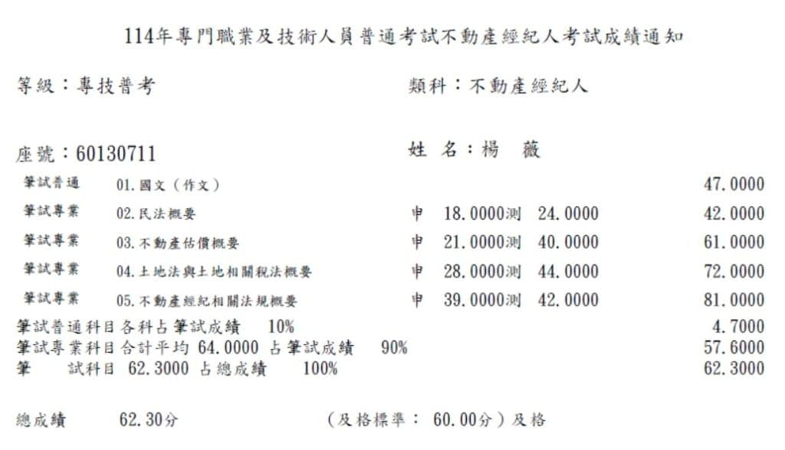

> 如果你是正要準備不動產經紀人考試的，希望

如果你是正要準備不動產經紀人考試的，希望這篇心得可以給你一點開始的方向喔～

<h2 class="wp-block-heading">一、考試動機及報名前準備</h2>

本身是都計系畢業，出社會後也持續從事本科相關工作，加上家中從事不動產行業，深知不動產經紀人證照的價值，對未來職涯也具有一定幫助，因此決定一邊上班、一邊準備考試，這也是我第一次準備國家考試證照。

在萌生考試念頭後，我開始搜尋各種準備方式與課程資訊，過程中發現了 Jasper 地政士＆不動產經紀人考試輔導員，並看到許多上榜生的推薦。由於我距離考試僅剩約四個月，加上需要兼顧工作，因此希望能以最精準、有效率的方式掌握考試重點。看完官網介紹後，發現與我的需求非常契合，並進一步查詢評價與學長姊的推薦後才決定報名。

在報名前也與Jasper考試輔導員進行一對一的諮詢服務，清楚掌握讀書計畫與時間安排，且輔導員會依據個人狀況提供建議，讓我在開始前就有完整方向。所有教學影片都可隨時觀看與回放複習，講義也幫助非常大，統整重點、節省了大量整理時間。另外，Jasper線上課程很特別的是有讀書會群組，讓備考過程不再是孤軍奮鬥，而是有一群戰友跟老師陪伴一起努力，任何問題都能獲得回應，同學之間也彼此協助，是一個收穫很多的學習平台！

這個課程非常適合念書時間零碎、需要彈性安排的考生，不用受限於上課時間，也能隨時獲得老師協助。

<h2 class="wp-block-heading">二、不動產經紀人各科準備方式</h2>

由於備考時間有限且需要上班，我依照Jasper課程的建議擬定了讀書計畫，的確會讓自己比較有方向且有步驟地去備考。

完整的上完一輪課程並複習後，大量練習歷屆試題是非常有用的，建議近五年試題至少要做三遍以上，有時間可延伸至十年。歷屆試題除了可以驗證自己的學習成果外，也是最有效的複習工具！

<h3 class="wp-block-heading">✅民法概要：</h3>

範圍最廣條文最多的一科，建議依照Jasper課程建議作課前預習、上課、課後複習的步驟，讓自己逐漸的理解法條，不懂的地方可以查找案例或到群組詢問，用講義搭配參考書+課程影片，再開始做歷屆試題，並將錯題確實訂正、整理成考前筆記，幫助會非常大！

民法念起來確實會比較枯燥，心態建議不要以考試的角度去念這科，而是補充自己的法律常識，會唸起來比較沒有壓力，當然免不了還是要努力記住常考的範圍。

<h3 class="wp-block-heading">✅土地法與土地相關稅法概要：</h3>

土地法建議唸完民法再來讀，搭配講義已整理好的架構與條文比較，能快速掌握邏輯。這科重點在於釐清程序、稅基、稅率與適用條件，掌握後就能穩定取得分數。

<h3 class="wp-block-heading">✅不動產估價概要：</h3>

剛聽到估價會擔心是否需要大量計算，但其實這科範圍最小法條也最少，完整上完一遍之後就是一直複習就對了，Jasper的課程也簡單的幫大家整理了口訣，在考試緊張的時候口訣真的可以派上用場，另外計算的部分，透過歷屆試題的練習基本上就已經足夠，這科出題重複率非常高，熟讀一定可以拿到不差的分數！

<h3 class="wp-block-heading">✅不動產經紀相關法規概要：</h3>

依照Jasper的課程及講義，就已經非常足夠，建議可以再整理成自己好記的筆記，特別是法條規範的對象、處理程序及罰緩金額等重點整理，考前反覆熟記，再透過歷屆試題加深記憶，幫助會非常大，這科真的一定要努力衝高分數！

<h3 class="wp-block-heading">✅國文：</h3>

其實沒有特別準備，除了考試卷不要寫錯頁外，就是努力多寫一點就可以囉～

<h2 class="wp-block-heading">三、讀書策略</h2>

📌依照課程建議擬定好讀書計畫！！！讓自己有條有理的準備考試，按部就班、不驚慌、不徬徨

📌先理解一遍觀念➡複習➡整理重點、考前筆記➡刷題（考前至少一個月時間）➡檢討修正

📌還是不理解➡善用Jasper LINE群組！老師及同學都會協助解惑

📌不動產經紀人考試是及格制！務必優先拉高自己有把握的科目分數！！！

📌如果是邊上班邊讀，建議考前三天請假好好做最後的衝刺、複習，並且調整考試心態！！

<h2 class="wp-block-heading">四、結語</h2>

雖然是本科生，也是壓線到最後四個月才準備，但沒有Jasper的課程及老師們的協助，肯定不會這麼順利一次考上，真的非常感謝有這個平台！！

以上小小的心得，祝所有考生都金榜題名！努力一定會有收穫的～加油💪

<figure class="wp-block-image size-large"><noscript></noscript></figure>

<h3 class="wp-block-heading has-black-color has-text-color" id="免費諮詢" style="line-height:1.8">．延伸閱讀</h3>

<a href="https://www.jasper-realestate.com/01-%e4%b8%8d%e5%8b%95%e7%94%a2%e7%b6%93%e7%b4%80%e4%ba%ba-%e8%ad%89%e7%85%a7%e4%bb%8b%e7%b4%b9%e5%84%aa%e5%8b%a2/">01 不動產經紀人｜證照介紹 &amp; 優勢</a>

<a href="https://www.jasper-realestate.com/02-%e4%b8%8d%e5%8b%95%e7%94%a2%e7%b6%93%e7%b4%80%e4%ba%ba%e8%80%83%e8%a9%a6%e8%b3%87%e8%a8%8a%e5%85%a8%e4%bb%8b%e7%b4%b9/">02 不動產經紀人｜考試資訊全介紹</a>

<h4 class="wp-block-heading has-text-color has-link-color wp-elements-217661994d7d4a0f28ce2500f2d632d0" id="免費諮詢" style="color:#ffffff;font-size:9px"><a data-id="https://line.me/R/ti/p/%40851hgrwp" data-type="URL" href="https://line.me/R/ti/p/%40851hgrwp" rel="noreferrer noopener" target="_blank">Line 官方帳號</a>｜<a data-id="https://www.facebook.com/Jasper-%E4%B8%8D%E5%8B%95%E7%94%A2%E7%B6%93%E7%B4%80%E4%BA%BA%E8%80%83%E8%A9%A6%E8%BC%94%E5%B0%8E%E5%93%A1-104204235060276/" data-type="URL" href="https://www.facebook.com/Jasper-%E4%B8%8D%E5%8B%95%E7%94%A2%E7%B6%93%E7%B4%80%E4%BA%BA%E8%80%83%E8%A9%A6%E8%BC%94%E5%B0%8E%E5%93%A1-104204235060276/" rel="noreferrer noopener" target="_blank">Facebook 粉絲專頁</a></h4>

