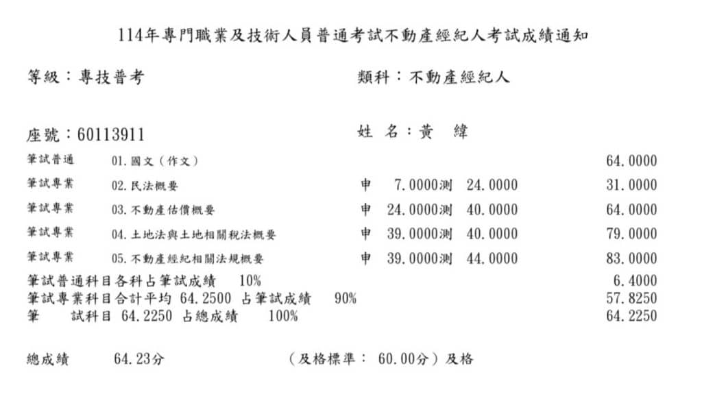

> 一、考生背景 大家好，這是我初次報名考試

<h2 class="wp-block-heading">一、考生背景</h2>

大家好，這是我初次報名考試，大約是9月初開始準備考試。

我非相關科系畢業，也沒有從事不動產行業，是個平常會需要帶小孩的上班族。

我的工作是在立法院擔任法案助理，但因爲工作的關係所以對一般法規架構和內政部主管的法規用語有基本的認識和理解。

想準備經紀人是想提升自己在工作上的專業能力，也因為工作多年了，想要在生活裡找點不一樣的重心和嘗試，所以覺得報考經紀人，希望透過架構化、系統化的方式認識不動產知識，精進自己的專業能力。

<h2 class="wp-block-heading">二、學習資源</h2>

在決定考試時，就決定要有補習班協助和要有空間能讓我即時討論的選擇。

在比較各種不同補習班後，最後選擇Jasper地政士&amp;不動產經紀人的線上課程方案，原因是他們把各科非常龐雜的資訊，用非常清楚的方式整理成一目了然的架構系統。

其實最後讓我做出決定的，也是他們有讀書會群組，那是最吸引我的點，因為讀書群組24小時都能提問，非常適合我，因為平常我自己也沒辦法確定到底什麼時候有時間讀書、有時間問問題。

讀書會群組除了自己的問題能隨時被解惑外，也能在日常沒有讀書的時候，透過觀察同學們的提問，順便複習自己不足的地方！

<h2 class="wp-block-heading">三、不動產經紀人各科準備方式</h2>

我在準備的時候把科目拆成兩部分，分別是「土法+土税」、「民法+估價+經紀」。

<h3 class="wp-block-heading">1. 土法、土稅</h3>

土地稅法是土地法的特別法，兩者本是同根生，兩科對照著吸收，會理解的比較順暢，也比較能比較出差異，因為有部分的規定在這兩科是重疊的，可以相互補充、相互檢視，一來一往的過程也能加深對考科的印象，加上這兩科在經紀人考試時是歸為同一科，簡直是大放送，如果一起讀，個人覺得有1+1&gt;2的效果！

<h3 class="wp-block-heading">2. 民法、估價、經紀法規</h3>

民法是考試裡範圍比較大的科目，準備起來會比較花時間，也因為民法條文的立法日期都距離現在生活比較遠，有些文字難免讀起來覺得離生活比較遠，也容易有咬文嚼字和枯燥乏味的感覺。

不過民法考試和估價一樣，都只是考「概要」，不會考到很細、也不至於太刁難，建議在準備的時候多想辦法套進自己生活裡的人、事、物，會比較有畫面和生活感，理解和起來會比較容易。

因為民法比較枯燥，所以我搭配相對簡單的經紀和估價概要準備。

經紀和估價概要這兩科大多是純背誦，要去推導的部分明顯較少，是一就是一、是二就是二，沒什麼灰色地帶的解釋空間，算是比較輕鬆的科目，有讀就有分數，所以我選擇這樣一難一易搭配著準備的方式，比較平衡。

<h2 class="wp-block-heading">三、考試準備過程</h2>

再來，因為我平常的工作時間很長，上下班通勤也都是開車，沒有什麼時間坐下來好好讀書。

我選擇的方式先快速的看過近十年考古題，整理出各科考點，會發現各科常考的考點都差不多。

接下來是把課程當成podcast在聽，開車的時候聽、做家事的時候聽、吃飯的時候聽、運動的時候聽，睡不著的時候放著聽到睡著，所以基本上自己一個人的時候就是一直打開Jasper的課程影片在聽，因為老師們的課程都講的很淺顯易懂，用簡單的話把複雜的法律概念講的清清楚楚。

另外，這邊也和各位分享，我如果單獨讀法律文字，有任何不理解的地方，例如：

「為什麼要這樣規範？」、「這種規範是要特別保護什麼、限制什麼？」等等類似問題的時候。

我會用全國法規網站，因為在裡面除了可以看到各個條文的規定外，也能找到立法目的、修改歷程以及理由，從立法目的和理由下手，會比較容易找到對前面所述疑問的答案，而立法目的也能成為申論題好用的資源，非常推薦各位考生參考。

最後，有任何疑問是翻書翻不到、查資料也看不懂的，線上群組也都能隨時提問、快速解答，問問題前，也嘗試整理自己的疑問在哪裡，是「構成要件」不明白？還是「法律效果」不明白？有時候在整理問題的過程就找到答案了，自己找到答案還是會是記憶最深的方式。

然而平常沒有讀書時，也能觀察同學們的提問，來補足自己的不足，偶爾發懶不想讀書的時候，也會因為群組持續有人在發問，就會想說「好吧，我來讀個書好了」

即時互動的讀書會群組真是個好點子，真的。

<h2 class="wp-block-heading">四、考場實戰經驗分享</h2>

我其實覺得考場實戰最重要的就是心態！

不管是準備多久、準備幾次的考生。

只要是考試當天能在假日早起，還坐在考場裡就已經是一件非常非常棒的事了！更是一件非常非常被值得鼓勵的事！

比起沒有參加考試的人，或是比起放棄考試沒來考場的人。

我在每科考試前，都會告訴自己「我很棒！」不去思考任何別的事。

用開心正向的心態去面對，在作答上自然也變的比較輕鬆自在。

就當作是特別的兩天去考場玩就好，這不是每個人都可以玩的遊戲欸！

<h2 class="wp-block-heading">五、結語</h2>

回顧準備不動產經紀人考試的過程，對我來說不只是為了一張證照，更像是一場重新整理自己專業能力與生活節奏的練習。

即使沒有不動產背景、工作繁忙、時間零碎，只要找到適合自己的學習方式，把知識拆解、反覆吸收，專業其實是可以一點一滴累積起來的。

這次考試讓我更確定，系統化的學習、即時有人可以討論與提問的環境，對上班族來說格外重要；而保持正向、相信自己，也是在考場上能走得穩、坐得住的關鍵。

不論結果如何，願意踏進考場、願意為自己多走這一步，本身就值得肯定。

希望分享這段經驗，也能成為各位考生的祝福，在此祝福未來各位考生都能順利！！！

<figure class="wp-block-image size-large"><noscript></noscript></figure>

<h3 class="wp-block-heading has-black-color has-text-color" id="免費諮詢" style="line-height:1.8">．延伸閱讀</h3>

<a href="https://www.jasper-realestate.com/01-%e4%b8%8d%e5%8b%95%e7%94%a2%e7%b6%93%e7%b4%80%e4%ba%ba-%e8%ad%89%e7%85%a7%e4%bb%8b%e7%b4%b9%e5%84%aa%e5%8b%a2/">01 不動產經紀人｜證照介紹 &amp; 優勢</a>

<a href="https://www.jasper-realestate.com/02-%e4%b8%8d%e5%8b%95%e7%94%a2%e7%b6%93%e7%b4%80%e4%ba%ba%e8%80%83%e8%a9%a6%e8%b3%87%e8%a8%8a%e5%85%a8%e4%bb%8b%e7%b4%b9/">02 不動產經紀人｜考試資訊全介紹</a>

<h4 class="wp-block-heading has-text-color has-link-color wp-elements-217661994d7d4a0f28ce2500f2d632d0" id="免費諮詢" style="color:#ffffff;font-size:9px"><a data-id="https://line.me/R/ti/p/%40851hgrwp" data-type="URL" href="https://line.me/R/ti/p/%40851hgrwp" rel="noreferrer noopener" target="_blank">Line 官方帳號</a>｜<a data-id="https://www.facebook.com/Jasper-%E4%B8%8D%E5%8B%95%E7%94%A2%E7%B6%93%E7%B4%80%E4%BA%BA%E8%80%83%E8%A9%A6%E8%BC%94%E5%B0%8E%E5%93%A1-104204235060276/" data-type="URL" href="https://www.facebook.com/Jasper-%E4%B8%8D%E5%8B%95%E7%94%A2%E7%B6%93%E7%B4%80%E4%BA%BA%E8%80%83%E8%A9%A6%E8%BC%94%E5%B0%8E%E5%93%A1-104204235060276/" rel="noreferrer noopener" target="_blank">Facebook 粉絲專頁</a></h4>

