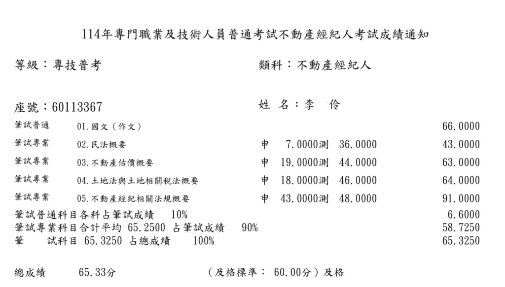

> 一、考生背景 目前是從事食品加工業，在二

<h2 class="wp-block-heading">一、考生背景</h2>

目前是從事食品加工業，在二年前（112年底）把工業區附近零售的擺攤（大腸包小腸）收起來，又因當時食品工廠需要，所以必須回學校就讀高中餐飲科假日班，因此只有平日下午有閒暇的時間，想利用下午的時間兼職打工增加收入。

透過朋友介紹就去做了租屋仲介，主要是時間彈性，且可以兼顧食品加工的工作以及餐飲科假日班，於是在113年1月去考了租屋仲介必備的不動產營業員證照，開啓了租屋仲介兼職之路。

兼職從事租屋仲介一年後（114年1月），會覺得自己對於不動產相關的資訊懂得很少，想透過考試了解更多不動產專業的知識，再加上租屋仲介的店長鼓勵我可以去考不動產經紀人的證照，就開始研究什麼是不動產經紀人，剛開始的時候其實只是抱著一種看看這場考試到底在搞什麼的心態，沒有很積極。

老公告訴我，竟然想考，就要盡全力，什麼叫做去考看看不動產經紀人是在考什麼東西，於是開始認真研究相關的資訊，清楚自己是額頭綁必勝苦讀型的學生，靠自己的讀書方式要考上應該是不可能，因此開始研究補習班。

網路上有很多補習班的資訊，主要會選擇Jasper 地政士&amp;不動產經紀人考試輔導員，除了課程費用相對親民之外，線上課程的方式也很適合像我這種沒有固定時間可以讀書的人，另外前輩們也很推Jasper老師安排的讀書計劃以及有群組問答，因此在114年5月繳費報名了。

<h2 class="wp-block-heading">二、不動產經紀人各科準備方式</h2>

<h3 class="wp-block-heading">1. 民法</h3>

先把民法線上課程先上過一遍，然後再買參考書整本讀過一遍，自覺知道大概的架構後，以及理解每個章節說的內容，並且用自己的方式把重點法條寫下來，就開始第一次做歷屆試題，做完第一遍歷屆試題，信心盡失，錯誤率極高，挫折滿滿。

當時有線上找Jasper老師詢問目前的狀態，Jasper輔導員跟我說把每一題重新檢視並且錯誤的題目法條寫下來，製作屬於自己的考前筆記，我每天都會刷題庫，然後寫法條，不停的寫，不斷地重複刷題，提升自己的法感，但民法的成績還是非常的不理想，代表我努力的方向還有待改進。

<h3 class="wp-block-heading">2. 土地法&amp;土地稅法</h3>

準備土地法前，有先聽前一年度上榜的學姐分享，她說這科相對生活化，在生活上比較會遇到的一個科目，讀起來相對有趣，於是開始上線上課程。

課程的Erin老師講解非常淺顯易懂，而且課程的講義是以架構式的整理，內容把相關的法條彙整在一起，讀起來有邏輯，當把全部的課程上完之後，再整理自己的考前筆記時，會慢慢有一個蜘蛛網的架構，理解上會相對容易許多。

至於土地稅法，因為身邊的人多少都會有土地買賣的一些相關問題，所以在這個部分的學習對於目前在從事兼職的租屋仲介非常有幫助，當房東在詢問一些稅務方面的問題，也能夠馬上回答，準備起來的動能增強了許多。

<h3 class="wp-block-heading">3. 不動產估價概要</h3>

不動產估價概要這個科目會有計算題，還要背公式，一開始準備確實會比較緊張一點，先把線上課程上完，才發現這科的法條只有133條，Jasper老師告知這是可以把握拿高分的一個科目，沒有任何捷徑就是把法條記熟，歷屆試題刷到爆，每天刷2-3年的歷屆試題，盡量把選擇題的分數把握好，考前最後一個月每天默寫公式。

申論題的部分就是盡量熟記法條，三大估價方法的程序、內容，背到晚上做夢都還在想估價的程序，考試當下看到申論的題目，突然腦袋一片空白，怎麼跟我背的東西完全搭不上線，當下就是把腦海中所有記得的東西都把它寫下來，雖然其中有一題申論只有4分（總分25分），但是就是不停地寫，其他的就聽天由命。

<h3 class="wp-block-heading">4. 不動產經紀相關法規</h3>

不動產經紀相關法規這科，是Jasper輔導員在了解我的狀況及背景後建議我第一個開始上的課程，只能說Jasper老師真的很厲害，清楚我的狀況，讓我從相對容易準備的科目開始上課，才比較不會信心重挫。

這科由四個小科組成，每個科目都可以跟生活結合在一起，非常有用，且課程的講義內容，整理的架構非常清晰，在考前的背誦幫助很大，這科沒有訣竅，就是背，不停的背，背到晚上睡覺會被法條驚醒的那一種覺悟，這科是最高分（91分）的一科，非常開心。

<h2 class="wp-block-heading">三、考場實戰經驗分享</h2>

考前兩個月，心情莫名的進入一種無法控制的壓力漩渦中，讀到最後感覺什麼都記不起來，背了又忘，且對於申論題的準備，一點方向都沒有，當時有找Jasper老師聊，他建議我可以再重新回去聽L1的課程。

L1的課程是在上課之前的考前注意事項，在最初上課前有聽，但其實在最初的時候有很多東西只是聽過而已，在準備考試的過程中，有點迷失方向的時候，再回去聽，有給到鼓舞的效果，然後告訴自己這是一場為自己而努力的考試戰役，就是盡全力，看一次不會，就看兩次，三次不斷地重複。

考試最後一週，就是依照Jasper老師告知的，把自己的考前筆記背熟，調整生活作息，飲食正常，在考場就是盡全力地不停的寫，並且把時間分配好很重要，選擇幾分鐘內要完成，申論一題寫20分鐘，就一定要做總結，然後換下一題。

<h2 class="wp-block-heading">四、結語</h2>

透過這一段準備考試的過程，我也認知到，當自己真的很想要一樣東西的時候，真的會莫名的拼盡全力，只想要完成這項給自己的挑戰。

在過程中也曾懷疑自己，畢竟不是年輕人，參考書的字體小到需要帶老花眼鏡來看，線上刷題的字體要放到最大，不然會看不清楚。

我是一個剛入不動產租屋仲介的新手，給自己的期許就是不管考幾年，一定要考到不動產經紀人的證照，這是給自己的一個目標，也是一個挑戰，「若要如何，全憑自己」。

<figure class="wp-block-image size-large"><noscript></noscript></figure>

　

<h3 class="wp-block-heading" id="免費諮詢" style="line-height:1.8">．延伸閱讀</h3>

<a href="https://www.jasper-realestate.com/01-%e4%b8%8d%e5%8b%95%e7%94%a2%e7%b6%93%e7%b4%80%e4%ba%ba-%e8%ad%89%e7%85%a7%e4%bb%8b%e7%b4%b9%e5%84%aa%e5%8b%a2/">01 不動產經紀人｜證照介紹 &amp; 優勢</a>

<a href="https://www.jasper-realestate.com/02-%e4%b8%8d%e5%8b%95%e7%94%a2%e7%b6%93%e7%b4%80%e4%ba%ba%e8%80%83%e8%a9%a6%e8%b3%87%e8%a8%8a%e5%85%a8%e4%bb%8b%e7%b4%b9/">02 不動產經紀人｜考試資訊全介紹</a>

<h4 class="wp-block-heading has-text-color has-link-color wp-elements-217661994d7d4a0f28ce2500f2d632d0" id="免費諮詢" style="color:#ffffff;font-size:9px"><a data-id="https://line.me/R/ti/p/%40851hgrwp" data-type="URL" href="https://line.me/R/ti/p/%40851hgrwp" rel="noreferrer noopener" target="_blank">Line 官方帳號</a>｜<a data-id="https://www.facebook.com/Jasper-%E4%B8%8D%E5%8B%95%E7%94%A2%E7%B6%93%E7%B4%80%E4%BA%BA%E8%80%83%E8%A9%A6%E8%BC%94%E5%B0%8E%E5%93%A1-104204235060276/" data-type="URL" href="https://www.facebook.com/Jasper-%E4%B8%8D%E5%8B%95%E7%94%A2%E7%B6%93%E7%B4%80%E4%BA%BA%E8%80%83%E8%A9%A6%E8%BC%94%E5%B0%8E%E5%93%A1-104204235060276/" rel="noreferrer noopener" target="_blank">Facebook 粉絲專頁</a></h4>

