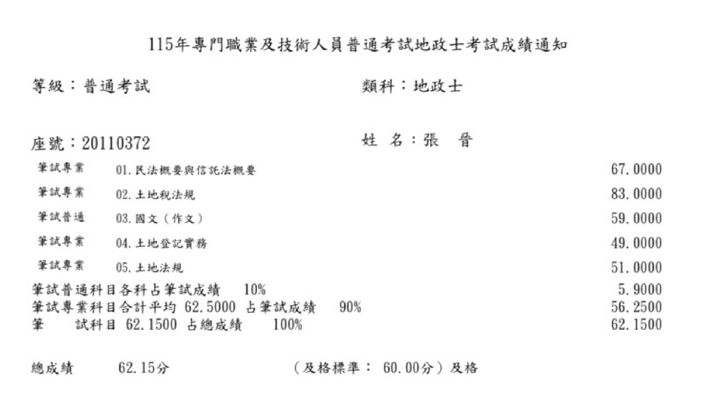

> 一、考生背景 我今年25歲，國立大學經管

<h2 class="wp-block-heading">一、考生背景</h2>

我今年25歲，國立大學經管系畢業，非本科，2年考上地政士和經紀人（經紀人一次過，地政士考兩次）。過去學生時代有去XX世紀不動產當過實習生，出社會後有在環X不動產估價師事務所待過。

會想準備地政士的原因是因為地政士是個非常實用的職業，不管是在不動產交易、遺產分配……等人生大事中皆有地政士的影子。

這次是選擇Jasper的課程方案，因為受夠了傳統補習班問個問題要等數週甚至月後才能得到回覆的問題。Jasper的問答群組能在1天內回覆問題，速度比傳統補習班快太多了～

<h2 class="wp-block-heading">二、各科準備方式</h2>

<h3 class="wp-block-heading">1. 民法</h3>

民法是地政士中的大魔王，這科我準備的方式是不求背下全部的法條，而是明白法條的內容並用自己的話說出來。若有不懂的法條就直接去Jasper的群組問老師。

民法分總則、債權、物權、親屬、繼承。這五編中我個人覺得債編、物權最難，所以要多注意。親屬、繼承則是和日常生活較為相近讀起來比較容易。總則是會和其他四編都有關聯到，但不會太難也蠻有趣的～

<h3 class="wp-block-heading">2. 土地法</h3>

土地法分地權、地籍、土地使用、土地稅、土地徵收。除此之外還有土地法34-1、73-1、104、107都是重點。

我自己的讀法是就跟著老師的腳步慢慢學習，遇到不會的就在群組向老師求救🆘，然後因為土地法範圍很廣，又疊床架屋，很多類似的規定在土地法和平均地權條例及其他法規你都能看到類似的規定

但有些類似的規定又因為特別法優先於普通法或其他因素不適用，而是適用另一個法條的類似規定，所以你兩邊都要知道且要知道考試要寫哪個

（像是土地法第208和土地徵收條例第3條皆有對土地徵收目的與範圍皆有規定，但土地徵收優先適用土地徵收條例）

<h3 class="wp-block-heading">3. 土地稅法</h3>

這科是我這次考的最好的一科，這科相對比較簡單，但就是需要背好各種稅的稅率、稅基及適用特別稅率的時機和稅率。然後把地價稅、田賦、土地增值稅、房地合一稅、房屋稅、契稅分清楚不要搞混。這一科也是比較有可能出現計算題的科目。計算題只要算對就是25分如果出現一定要把握。

<h3 class="wp-block-heading">4. 土地登記實務</h3>

這一科也是相對比較簡單的一科，也相對比較不需要理解背就好了。這科和民法及土地法相比比較簡單，一定要好好把握。這科我的讀法是跟著老師的腳步慢慢理解慢慢背。多看幾次多背幾次。

<h2 class="wp-block-heading">三、考場實戰經驗分享</h2>

我考試前有先到考場附近住，這是為了怕考試當天通車時間太長太累和睡過頭。

上考場時遇到不會寫的也絕對不要放棄，因為申論題只要有擦到邊就有分且你不會其他考生可能也不會，通常地政士考試4題中有2題會是基本題1題到1題半是中等偏難，剩下的半題到1題是困難基本上只要把握好基本題然後剩下的題目儘量寫就有機會上榜了

<h2 class="wp-block-heading">四、結語</h2>

地政士是個非常實用的職業，非常值得投資。

考試時最重要的是知道自己適合怎麼樣的讀書方式及目的，像是我雖然讀的很free壓力相比其他優秀考生可能較小，但我也見過在浴室貼便利貼洗澡也在讀且常讀到三更半夜的考生考上且成績非常優秀。

考試就是要確定自己的目標並用對方法就能順利上榜～祝所有考生都能心想事成～金榜題名～

<figure class="wp-block-image size-large"><noscript></noscript></figure>

　

<h3 class="wp-block-heading" id="免費諮詢" style="line-height:1.8">．延伸閱讀</h3>

<a href="https://www.jasper-realestate.com/01-%e4%b8%8d%e5%8b%95%e7%94%a2%e7%b6%93%e7%b4%80%e4%ba%ba-%e8%ad%89%e7%85%a7%e4%bb%8b%e7%b4%b9%e5%84%aa%e5%8b%a2/">01 不動產經紀人｜證照介紹 &amp; 優勢</a>

<a href="https://www.jasper-realestate.com/02-%e4%b8%8d%e5%8b%95%e7%94%a2%e7%b6%93%e7%b4%80%e4%ba%ba%e8%80%83%e8%a9%a6%e8%b3%87%e8%a8%8a%e5%85%a8%e4%bb%8b%e7%b4%b9/">02 不動產經紀人｜考試資訊全介紹</a>

<h4 class="wp-block-heading has-text-color has-link-color wp-elements-217661994d7d4a0f28ce2500f2d632d0" id="免費諮詢" style="color:#ffffff;font-size:9px"><a data-id="https://line.me/R/ti/p/%40851hgrwp" data-type="URL" href="https://line.me/R/ti/p/%40851hgrwp" rel="noreferrer noopener" target="_blank">Line 官方帳號</a>｜<a data-id="https://www.facebook.com/Jasper-%E4%B8%8D%E5%8B%95%E7%94%A2%E7%B6%93%E7%B4%80%E4%BA%BA%E8%80%83%E8%A9%A6%E8%BC%94%E5%B0%8E%E5%93%A1-104204235060276/" data-type="URL" href="https://www.facebook.com/Jasper-%E4%B8%8D%E5%8B%95%E7%94%A2%E7%B6%93%E7%B4%80%E4%BA%BA%E8%80%83%E8%A9%A6%E8%BC%94%E5%B0%8E%E5%93%A1-104204235060276/" rel="noreferrer noopener" target="_blank">Facebook 粉絲專頁</a></h4>

