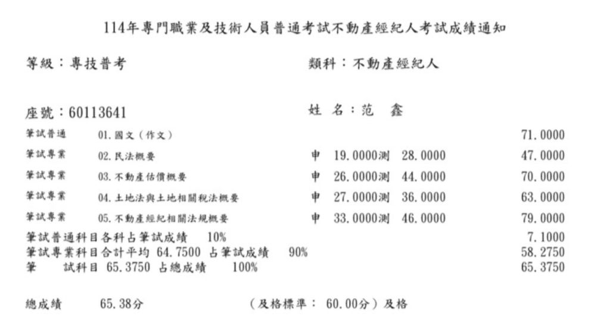

> 一、前言及背景 我不是相關科系，是教育心

<h2 class="wp-block-heading" id="免費諮詢">一、前言及背景</h2>

我不是相關科系，是教育心理輔導學系畢業，因親戚的公司需要不動產經紀人證照，所以決定報考不動產經紀人證照。這是人生第一次準備國考。

因是第一次準備，所以有找課程輔助，選擇的是Jasper 地政士&amp;不動產經紀人考試輔導員的線上課程，可以自己決定何時上課，較彈性自由，且試聽後覺得老師的講解足夠清楚，也很激勵人心，讓我即使第一次面對國考也不會感到無助與手足無措。

以下分享我各科的準備方式，希望能給也是第一次考的同學帶來些幫助：

<h2 class="wp-block-heading" id="免費諮詢">二、不動產經紀人各科準備方式</h2>

<h3 class="wp-block-heading" id="免費諮詢">1. 民法</h3>

先基礎大略的看過法條後，搭配民法課程影片逐步了解。民法的範圍很大，但跟生活息息相關，因此學習起來我個人覺得滿有趣的。

民法法條繁多，大約在考前9個月我就先開始慢慢地讀法條及觀看課程影片，直到考前3個月時再搭配額外自行購買的書（Jasper推薦的），重新複習一次（閱讀、解題、再看一次課程影片協助梳理邏輯）。

考古題一定要做，選擇題至少要做完十年份。申論題我只練習了最近的五年，但我覺得這樣其實不太足夠，能做滿十年份是更好的。

<h3 class="wp-block-heading" id="免費諮詢">2. 土地法&amp;土地稅法</h3>

土地法比民法更不生活化，法條也繁多，稅法相對之下比較好理解與記憶。

稅法的部分我會一直重複將各個不同的稅的比對表格默寫出來，確保不會混淆不同稅法之間的規定。

土地法我依照課程影片的進度，決定今天要先預習哪些法條，然後再搭配影片重新加深記憶。老師說要背的部分，我考前三個月就開始每周都重新默寫2-3次，確保自己在考試時可以寫出來。老師說不太重要的部分，我基本上就先直接放掉，因為範圍真的太大，但考前兩周還是有再稍微看一次確保不會完全沒印象。

考古題最近十年份的選擇題都有做，申論只練了近五年的。但還是建議能練十年份就練十年份。

<h3 class="wp-block-heading" id="免費諮詢">3. 不動產估價概要</h3>

範圍最小但是背誦起來最痛苦的一科。四大科裡面唯一一科讀完一輪後就決定要完整整理出心智圖，不然太容易混淆。

有很多口訣及公式，一開始背覺得很痛苦，衝刺的最後一個月堅持每周都至少完整默寫一次所有口訣、公式以及詳細內容，考前一周是每天都默寫一次。在考試時就發現自己居然可以自然而然的背出來了。

我有去查每個公式的英文字母是代表什麼單字，這樣對於公式的理解程度會更進一步，也更容易背下來。

計算的部分無他，就是要甘願一點每周都練習至少2-3次，在看到考題時就不會慌張。練習過程中也會對各個公式間的關係理解程度更高，對於背誦公式也有幫助。 

考古題選擇題的部分也是做完近十年。申論題近五年。考前有把其他年份的申論題大略看一遍。

<h3 class="wp-block-heading" id="免費諮詢">4. 不動產經紀相關法規</h3>

相當親切的一科，但罰則的部分滿容易混淆的，所以法條搭配影片一輪後，我除了用EXCEL表格整理各種不同罰則以外，也用整理心智圖的方式背誦，我是用手寫的方式整理心智圖，考前一個月也是每周都至少默寫一次。光是這一科就用完了兩本空白筆記本。

這一科分數最好把握！考前最後一周民法跟土地法我都只挑老師說要背的部分去複習，但不動產經紀相關法規我就是一直重複默寫自己整理的心智圖，也確實是四科裡面分數最高的。

考古題選擇題的部分也是做完近十年。申論題近五年。考前有把其他年份的申論題大略看一遍。

<h3 class="wp-block-heading" id="免費諮詢">5. 綜合考前提醒</h3>

考試前一周一定要調整作息，確保身心狀態都在舒服的狀態應考。我自己是滿容易因為緊張就腸胃不舒服的體質，所以我考前一整周都吃得很清淡，確保考試兩天不會被腸胃不適影響。

考試的時候一定要分配選擇題跟申論題的時間。我依照Jasper課程的建議去做分配，拿到考卷時先看完申論題目，然後就開始寫選擇題。

選擇題不會或困惑的題目就直接跳過，寫完全部選擇題後再回頭處理。分配給申論題的時間到了就要去做申論題，每個申論題除了回答問題以外，我也會將相關的法條都寫上去。每一科我都是寫到打鐘，因為有寫有機會得到筆墨分數，不寫就一定沒有。

以結果論來看這個策略是滿有效的，我確實有得到筆墨分數。

<h2 class="wp-block-heading" id="免費諮詢">三、總結</h2>

準備考試對我來說其實是滿痛苦的一件事，尤其剛開始讀法條覺得文字真的好艱澀，但因為Jasper一直有給予正向鼓勵，讓我相信自己堅持讀下去，法條總有一天會變得好讀，到最後我確實也不再覺得法條的文字有那麼艱澀難讀。

準備當下真的就是抱持著不想再重考的心去讀，所以不喝咖啡的我每天一大杯冰美式，讓自己有足夠的精神去讀書。Jasper的課程邏輯清楚好懂外，推薦的書也確實很實用。

線上課的好處就是可以重複觀看好幾次，即使中途不小心打瞌睡也不會錯過重要內容。我個人的筆記及心智圖都是考前最後兩個月才開始整理，在那之前就是乖乖讀法條、觀看影片、有練習題就跟著練習。

不要放棄！讀的時候不放棄，考試的時候也不要放棄，寫到最後一刻！

<figure class="wp-block-image size-large"><noscript></noscript></figure>

　

<h4 class="wp-block-heading has-black-color has-text-color" id="免費諮詢">．延伸閱讀</h4>

<a href="https://www.jasper-realestate.com/01-%e4%b8%8d%e5%8b%95%e7%94%a2%e7%b6%93%e7%b4%80%e4%ba%ba-%e8%ad%89%e7%85%a7%e4%bb%8b%e7%b4%b9%e5%84%aa%e5%8b%a2/">01 不動產經紀人｜證照介紹 &amp; 優勢</a>

<a href="https://www.jasper-realestate.com/02-%e4%b8%8d%e5%8b%95%e7%94%a2%e7%b6%93%e7%b4%80%e4%ba%ba%e8%80%83%e8%a9%a6%e8%b3%87%e8%a8%8a%e5%85%a8%e4%bb%8b%e7%b4%b9/">02 不動產經紀人｜考試資訊全介紹</a>

<h4 class="wp-block-heading has-text-color has-link-color wp-elements-217661994d7d4a0f28ce2500f2d632d0" id="免費諮詢" style="color:#ffffff;font-size:9px"><a data-id="https://line.me/R/ti/p/%40851hgrwp" data-type="URL" href="https://line.me/R/ti/p/%40851hgrwp" rel="noreferrer noopener" target="_blank">Line 官方帳號</a>｜<a data-id="https://www.facebook.com/Jasper-%E4%B8%8D%E5%8B%95%E7%94%A2%E7%B6%93%E7%B4%80%E4%BA%BA%E8%80%83%E8%A9%A6%E8%BC%94%E5%B0%8E%E5%93%A1-104204235060276/" data-type="URL" href="https://www.facebook.com/Jasper-%E4%B8%8D%E5%8B%95%E7%94%A2%E7%B6%93%E7%B4%80%E4%BA%BA%E8%80%83%E8%A9%A6%E8%BC%94%E5%B0%8E%E5%93%A1-104204235060276/" rel="noreferrer noopener" target="_blank">Facebook 粉絲專頁</a></h4>

