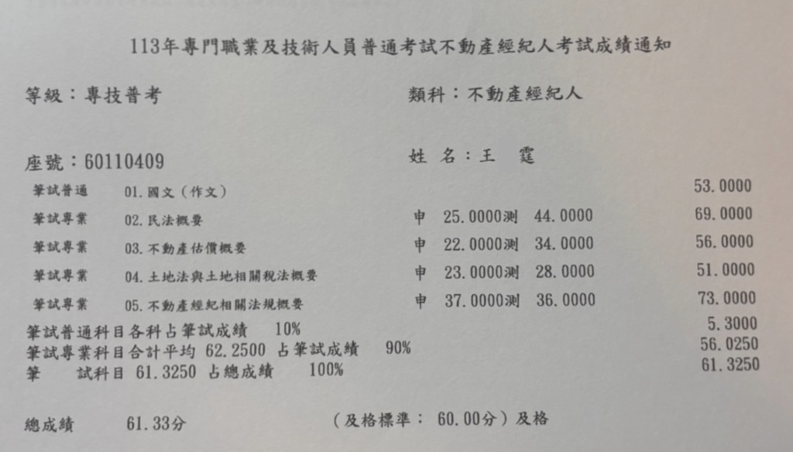

> 一、本身背景 本身在銀行業上班，比較單調

<h2 class="wp-block-heading" id="免費諮詢">一、本身背景</h2>

本身在銀行業上班，比較單調。對不動產有興趣，也覺得比較適合自己性格。在轉換跑道前想先有一些基礎的概念，很幸運在讀書與兼職中一次上榜。

教材部分我選擇 Jasper 地政士&amp;不動產經紀人考試輔導員，感謝該團隊的各科專業老師，在完全零基礎的狀況下能迅速進入狀況，這是我覺得這次上榜很關鍵的部分。

另外 Jasper 團隊不只是函授課程針對考點單元解說，在 Line 的官方、群組等都有學長姐隨時在線上討論問題，可以很即時的瞭解新修法、難度較高的單元。因為上班的關係，彈性利用時間真的很重要。有時留言，下午就有學長姐幫忙解答了。

<h2 class="wp-block-heading" id="免費諮詢">二、不動產經紀人各科準備方式</h2>

<h3 class="wp-block-heading" id="免費諮詢">1. 國文作文</h3>

這部分很需要平時的閱讀底子，會建議有心要考的人，平時要有閱讀或看報的習慣，養成語句表達通順即可。

<h3 class="wp-block-heading" id="免費諮詢">2. 民法</h3>

本科1200多的法條看似很多，但會考的就是那些單元，可參照Jasper 課程逐一擊破，另外考古題也是需要一練再練。該科測驗44、申論25、總分69

<h3 class="wp-block-heading" id="免費諮詢">3. 土地法與土地稅法</h3>

法條也是很多，且破碎。同樣需要單元式的學習，要特別注意平均地權、土地徵收法等特別法，是考試的重點。

<h3 class="wp-block-heading" id="免費諮詢">4. 不動產經紀法規</h3>

這科考的非常細，且為四部小法律組成，建議一定要看熟，屬於熟記型的法條，較無法理上的組成及比較，但會考得比較細，是拿分的重中之重。

<h3 class="wp-block-heading" id="免費諮詢">5. 不動產估價概要</h3>

這科比較抽象範圍小，考得細，但相對也是好拿分，建議講義、考古題有出現的公式全背，一些基礎規則要懂，申論才好掌握，這科我考得不算好，因為準備時間不足。

<h2 class="wp-block-heading" id="免費諮詢">三、總結</h2>

在備考的讀書計畫很重要，Jasper裡面有教。（幫助很大）以週計畫進行讓自己有伸縮的空間，備考期間也建議偶爾要出遊放鬆，心態很重要。尤其考前兩週，我已經讀不下去了，所以常出門走走（逛街、運動），挑一些大方向題目、小細節死記的東西看一看，放鬆心情，避免心態崩潰。

最後上考場前三天飲食、睡眠要注意。加油👏我資質不好，也一次上榜了，相信只要有心都可以成功的👌

希望大家都能順利上榜上岸，邊工作邊念書真的辛苦，認真一年選到適合自己的方法就上岸，很幸運，也很謝謝當初願意踏進考場的自己。

<figure class="wp-block-image size-large"><noscript></noscript></figure>

　

<h4 class="wp-block-heading has-black-color has-text-color" id="免費諮詢">．延伸閱讀</h4>

<a href="https://www.jasper-realestate.com/01-%e4%b8%8d%e5%8b%95%e7%94%a2%e7%b6%93%e7%b4%80%e4%ba%ba-%e8%ad%89%e7%85%a7%e4%bb%8b%e7%b4%b9%e5%84%aa%e5%8b%a2/">01 不動產經紀人｜證照介紹 &amp; 優勢</a>

<a href="https://www.jasper-realestate.com/02-%e4%b8%8d%e5%8b%95%e7%94%a2%e7%b6%93%e7%b4%80%e4%ba%ba%e8%80%83%e8%a9%a6%e8%b3%87%e8%a8%8a%e5%85%a8%e4%bb%8b%e7%b4%b9/">02 不動產經紀人｜考試資訊全介紹</a>

<h4 class="wp-block-heading has-text-color has-link-color wp-elements-217661994d7d4a0f28ce2500f2d632d0" id="免費諮詢" style="color:#ffffff;font-size:9px"><a data-id="https://line.me/R/ti/p/%40851hgrwp" data-type="URL" href="https://line.me/R/ti/p/%40851hgrwp" rel="noreferrer noopener" target="_blank">Line 官方帳號</a>｜<a data-id="https://www.facebook.com/Jasper-%E4%B8%8D%E5%8B%95%E7%94%A2%E7%B6%93%E7%B4%80%E4%BA%BA%E8%80%83%E8%A9%A6%E8%BC%94%E5%B0%8E%E5%93%A1-104204235060276/" data-type="URL" href="https://www.facebook.com/Jasper-%E4%B8%8D%E5%8B%95%E7%94%A2%E7%B6%93%E7%B4%80%E4%BA%BA%E8%80%83%E8%A9%A6%E8%BC%94%E5%B0%8E%E5%93%A1-104204235060276/" rel="noreferrer noopener" target="_blank">Facebook 粉絲專頁</a></h4>

