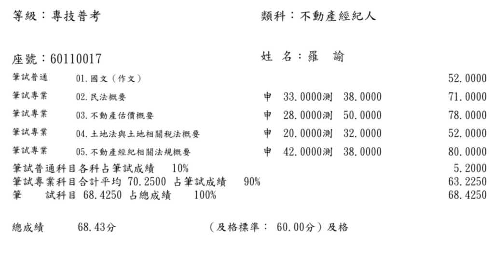

> 一、前言及背景 今年有幸可以不靠國文就順

<h2 class="wp-block-heading" id="免費諮詢">一、前言及背景</h2>

今年有幸可以不靠國文就順利及格，想說以往都是來這看一下前輩們的分享經驗讓自己有繼續念下去的動力。希望個人小小的經驗還是可以回饋到大家，再把好運傳承下去。

雖然本身已經從事土地仲介十餘年，但過往都覺得業績至上並沒有想考證照，是因為去年初想增加個人專業準備報考地政士，雖然最後差3分飲恨，想說既然都準備了。就連年底的不動產經紀人一起考，畢竟差異科目僅二科。

當初經過網路搜尋比較最後選擇Jasper地政士&amp;不動產經紀人考試輔導員的課程，主要就是能夠線上無時無刻的各種平台都能上課使用、讀書群組可以隨時發問老師都會親自回覆。這二個優勢蠻符合我的工作性質，畢竟業務就是跑來跑去時間不固定，彈性上課真的對我來說很重要。

<h2 class="wp-block-heading" id="免費諮詢">二、不動產經紀人各科準備方式</h2>

以下是各科的準備心得，當然我分數不是超高，但這考試真的只要求平均60分就能通過，我覺得廣度非常重要，每個考點都要把握不放過。

<h3 class="wp-block-heading" id="免費諮詢">1.  國文</h3>

就考前看一下佳句名言，考試時把能引經據典的名言適當的寫上去。50分應該是基本分。

<h3 class="wp-block-heading" id="免費諮詢">2. 民法概要</h3>

除了Jasper課程以外，還有另外買陳聰富老師、李淑明老師的民法課本來當參考書補充，不得不提上課的Josh律師上的內容也是淺顯易懂，這次的民法申論讓我拿到33分(19分、14分)

<h3 class="wp-block-heading" id="免費諮詢">3. 土地法與土地稅法</h3>

雖然有仲介的基礎，但其實實務經驗跟法條背誦記憶的差距還是有的，但上課後發現其實很多內容也都是實務會遇到的，所以上的還算順利。雖然選擇粗心崩掉，又遇到申論第一題的大魔王（公辦市地重劃），但考前老師都一再提點房屋稅的部分也有考出，讓我土法土稅分數不會太難看。

<h3 class="wp-block-heading" id="免費諮詢">4. 不動產估價概要</h3>

拿分的超重點項目，就像Jasper上課提到的配分建議，我也花很多心思並重複觀看課程超多次，務必把不懂的內容全部搞懂再進行下一階段。所以這科的選擇幸運地拿到滿分，雖然申論僅28分(14分、14分)個人真的建議估價一定要花時間搞懂。

<h3 class="wp-block-heading" id="免費諮詢">5. 不動產經紀相關法規概要</h3>

其實就是背多分的科目，個人是邊上課邊把法條用Goodnote紀錄記憶背誦。

因為其實這科是考國文跟法條熟悉程度，只要多念分數不會騙人。

<h2 class="wp-block-heading" id="免費諮詢">三、結語</h2>

因為有讀書群組所以基本上有不懂的問題或是寫考古題遇到瓶頸我就是直接發問，本著一定要搞懂才能前進下一題的想法來刷題練習。

希望大家都能順利上榜上岸，邊工作邊念書真的辛苦，認真一年選到適合自己的方法就上岸，很幸運，也很謝謝當初願意踏進考場的自己。

<figure class="wp-block-image size-large"><noscript></noscript></figure>

 

　

<h4 class="wp-block-heading has-black-color has-text-color" id="免費諮詢">．延伸閱讀</h4>

<a href="https://www.jasper-realestate.com/01-%e4%b8%8d%e5%8b%95%e7%94%a2%e7%b6%93%e7%b4%80%e4%ba%ba-%e8%ad%89%e7%85%a7%e4%bb%8b%e7%b4%b9%e5%84%aa%e5%8b%a2/">01 不動產經紀人｜證照介紹 &amp; 優勢</a>

<a href="https://www.jasper-realestate.com/02-%e4%b8%8d%e5%8b%95%e7%94%a2%e7%b6%93%e7%b4%80%e4%ba%ba%e8%80%83%e8%a9%a6%e8%b3%87%e8%a8%8a%e5%85%a8%e4%bb%8b%e7%b4%b9/">02 不動產經紀人｜考試資訊全介紹</a>

<h4 class="wp-block-heading has-text-color has-link-color wp-elements-217661994d7d4a0f28ce2500f2d632d0" id="免費諮詢" style="color:#ffffff;font-size:9px"><a data-id="https://line.me/R/ti/p/%40851hgrwp" data-type="URL" href="https://line.me/R/ti/p/%40851hgrwp" rel="noreferrer noopener" target="_blank">Line 官方帳號</a>｜<a data-id="https://www.facebook.com/Jasper-%E4%B8%8D%E5%8B%95%E7%94%A2%E7%B6%93%E7%B4%80%E4%BA%BA%E8%80%83%E8%A9%A6%E8%BC%94%E5%B0%8E%E5%93%A1-104204235060276/" data-type="URL" href="https://www.facebook.com/Jasper-%E4%B8%8D%E5%8B%95%E7%94%A2%E7%B6%93%E7%B4%80%E4%BA%BA%E8%80%83%E8%A9%A6%E8%BC%94%E5%B0%8E%E5%93%A1-104204235060276/" rel="noreferrer noopener" target="_blank">Facebook 粉絲專頁</a></h4>

