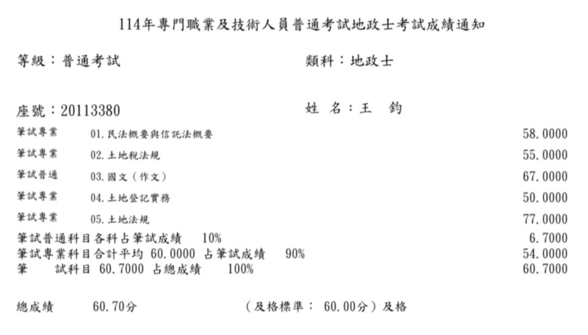

> 一、背景及動機 非從業人員的我，113年

<h2 class="wp-block-heading">一、背景及動機</h2>

非從業人員的我，113年的經紀人考取後心態有點飄，本來還在思考還有什麼考試是有興趣和可以增加額外收入，還是要順著繼續奮戰地政士。

今年二月帶著沈浸在經紀人上榜的喜悅和老婆一邊逛街一邊聊著這個話題，老婆提到不要好高騖遠，先連貫把地政士考到再說，什麼都想要可能什麼都做不好，老婆永遠是對的，乖乖開始裝備地政士考科。

<h2 class="wp-block-heading">二、課程選擇</h2>

<h3 class="wp-block-heading">（一）</h3>

如經紀人分享心得，因為最初考經紀人經紀人是踏著Jasper線上課程入門的，想想自己平常也是朝8晚5的上班族，扣除晚上家事顧小孩時間，有效率的吸收差異考科「土地登記」、「信託法」、「地政士法」這三大差異考科最重要，所以還是先選擇Jasper地政士課程先建立差異考科的架構。尤其登記這科沒有實務經驗所以較難理解，所幸老師口條清晰，快速讓我理解每種登記要件，差異。

<h3 class="wp-block-heading">（二）</h3>

每週都會於網站免費放上「三分鐘小教室」真的推薦瑣碎時間去閱讀吸收。

<h3 class="wp-block-heading">（三）</h3>

至於群組的問答與分享，我覺得還是很方便，真的有不懂就問，不過因為從二月下旬才開始繼續準備地政士，有點倉促，也可能是因為大部份考科框架概念有了，就沒花那麼多時間去看群組問答，但我覺得這個為問答群組的設立，表示老師們是真的熱心回答服務考生的誠意展現。

<h2 class="wp-block-heading">三、準備經過</h2>

攤開經紀人成績單，平均雖有七十來分，但是深知那是靠選擇題分數拉起來的，若只看申論題，平均只有60，申論的確是罩門，所以採取多看、多默寫的策略，讓自己遇到題型不會那麼害怕。

特別重要的題型例如土地法34-1、73條這種老師課堂上有提到，必須要有直覺反應背出來的程度。另外申論多有時事題、近期修法題納入，所以我還額外撥一點時間準備時事題。

準備經過大概是：

1. 2月下旬-4月初線上課程把差異課程補齊

2. 4月初-5月中，刷過1次近20年考古題

3. 5月中-考試刷第2次近20年考古題+背熟時事（修法）題型+熟記口訣

<h2 class="wp-block-heading">四、地政士各科實戰準備</h2>

<h3 class="wp-block-heading">1. 民法</h3>

範圍最大，盡量用法條和立法用意去充試題版面，可能是因為考經紀人時太怕民法所以有認真摧殘過自己，所以地政士這次考試民法花的時間比重下降，但是刷過考古題會發現，「繼承篇」比重很高，這部分一定要弄到最熟，信託法的考題題型很固定，所以繼承和信託法準備好，已經拿到民法的一半了。

<h3 class="wp-block-heading">2. 土地法</h3>

地政士法的25分一定要納入口袋，重劃和徵收和租約補償盡量背熟（一併徵收今年考了），土地法我觀察是做容易容易搭配時事題（實價登錄又考）。

<h3 class="wp-block-heading">3. 土地稅法</h3>

土地稅法：重點其實很固定

1.「減徵」和「免徵」最好整理自己一個版本的表格去熟記每種稅免徵減徵不課徵的時機

2.各種稅適用自用住宅條件

3.重購退稅

4.稅捐稽徵法刷考古題感覺很雞肋，但今年就是考了，我建議是考前一週花時間把核課期間和一些重點多看幾次，看到有印象，考出來憑印象盡量寫（用短期記憶去應付）。

<h3 class="wp-block-heading">4. 土地登記</h3>

這科我真的很弱，不太敢分享，我是盡量記各種登記要件和老師教導與自創一些口訣，我心態是放在背多分上，去背各種登記要件，盡力就好。

<h2 class="wp-block-heading">五、總結</h2>

請考生告訴自己「不要放棄」，這種考試本來就很難全部熟讀，去考場厚著臉皮考完全程都有機會上榜，今年地政士錄取率就那麼剛好算矯正回歸，在時間和準備心態都不如去年考經紀人的狀況下靠土地法救全家平均分數壓線上榜，真的感到幸運。感謝各科教導過的老師、群組戰友和家人，特別感謝Jasper親自打電話恭喜我上榜，還蠻驚喜的，祝Jasper團隊辦學越來越順利。

<figure class="wp-block-image size-large"><noscript></noscript></figure>

　

<h3 class="wp-block-heading" id="免費諮詢" style="line-height:1.8">．延伸閱讀</h3>

<a href="https://www.jasper-realestate.com/01-%e4%b8%8d%e5%8b%95%e7%94%a2%e7%b6%93%e7%b4%80%e4%ba%ba-%e8%ad%89%e7%85%a7%e4%bb%8b%e7%b4%b9%e5%84%aa%e5%8b%a2/">01 不動產經紀人｜證照介紹 &amp; 優勢</a>

<a href="https://www.jasper-realestate.com/02-%e4%b8%8d%e5%8b%95%e7%94%a2%e7%b6%93%e7%b4%80%e4%ba%ba%e8%80%83%e8%a9%a6%e8%b3%87%e8%a8%8a%e5%85%a8%e4%bb%8b%e7%b4%b9/">02 不動產經紀人｜考試資訊全介紹</a>

<h4 class="wp-block-heading has-text-color has-link-color wp-elements-217661994d7d4a0f28ce2500f2d632d0" id="免費諮詢" style="color:#ffffff;font-size:9px"><a data-id="https://line.me/R/ti/p/%40851hgrwp" data-type="URL" href="https://line.me/R/ti/p/%40851hgrwp" rel="noreferrer noopener" target="_blank">Line 官方帳號</a>｜<a data-id="https://www.facebook.com/Jasper-%E4%B8%8D%E5%8B%95%E7%94%A2%E7%B6%93%E7%B4%80%E4%BA%BA%E8%80%83%E8%A9%A6%E8%BC%94%E5%B0%8E%E5%93%A1-104204235060276/" data-type="URL" href="https://www.facebook.com/Jasper-%E4%B8%8D%E5%8B%95%E7%94%A2%E7%B6%93%E7%B4%80%E4%BA%BA%E8%80%83%E8%A9%A6%E8%BC%94%E5%B0%8E%E5%93%A1-104204235060276/" rel="noreferrer noopener" target="_blank">Facebook 粉絲專頁</a></h4>

