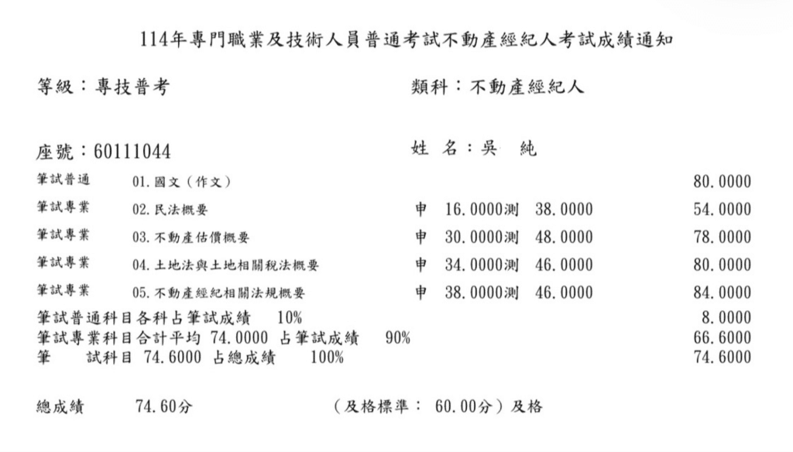

> 一、前言 haha又是我XD！！想看上次

<h2 class="wp-block-heading">一、前言</h2>

haha又是我XD！！想看上次地政士心得的可以看這篇：🔗 <a href="https://www.dcard.tw/f/exam/p/259591592" rel="noopener" target="_blank">114地政士全國第五名 ｜ 非本科一次考取心得分享</a>

從地政士放榜以後平復了很久終於有心思準備經紀人，因為剛考完地政士，勉勉強強可以說自己有相關學識，對於土地法規及各種稅法架構不算陌生。至於工作經歷，是自打地政士上榜了，工作性質才導向房地產。

目前也是受聘於他人事務所，下班回家了才開始讀書＋假日all day泡圖書館

關於不動產經紀人，依照不動產經紀業管理條例第11條第1項主文規範，經紀業設立之營業處所至少應置經紀人一人。白話文則是，一間房仲公司至少得有一位不動產經紀人；雖說證照無法直接與專業度掛上等號，然而在過往工作的經驗，還身為菜鳥的我有太多在與客戶努力推進，卻被一句「 請經理(或者副理、主管…)來與我談 」給拒之門外的經歷。

很多時候做得再多，好像都不比名片上的頭銜來的重要，似乎少了個頭銜，就比他人少了份話語權。當時考完地政士，對於之後想主攻的業務範疇還未明朗，想著或許未來有天能成為特約代書也未可知！但如果有那天，我也希望在客戶眼中的我，不只對於過戶、節稅有一套，對於房地相關知識亦是佼佼者～

<h2 class="wp-block-heading">二、不動產經紀人各科準備方式</h2>

<h3 class="wp-block-heading">1. 民法</h3>

民法的部分即便經歷了地政士考試的洗禮，我仍然覺得是困難的(也從這次的成績反應出來了….XD) 只能說物權編還是得熟讀，即便對於題目想問的相關考點不全然有把握，把重點法條給寫上，多多少少拿點筆墨分數！！另外重申 申論題考古題刷到滾瓜爛熟，對於不動產經紀人考試的民法申論部分絕對有非常大的幫助！！

<h3 class="wp-block-heading">2. 土地法&amp;土地稅法</h3>

土地法規及土地稅法的法規非常之多，若不是曾讀過真的會坐在書桌前大哭出來，但相對的考點不算發散，該科的測驗題我從102年寫到113年大概三遍，大概熟悉了考點方向後再針對常考條文去做背誦會是較為省時的～

推薦書單：蔡志雄律師的土地法與土地相關稅法概要(藍藍黃黃的一本)

<h3 class="wp-block-heading">3. 不動產估價概要</h3>

不動產估價概要的法條是所有考科裡面最少的，建議全部都背起來！！

計算的部分因為都是簡單的乘除並且可以使用計算機，還是建議各位考生不要輕言放棄。測驗題的部分大同小異，甚至有些年有考過完全一樣的考題(可見條文之少考到沒有新意可考)，只要將考古題做熟，基本上在考場上看到題目大概僅需0.02秒即可閃出答案，是認真的！！估價概要是我唯一提早交卷離場的科目～

<h3 class="wp-block-heading">4. 不動產經紀相關法規概要</h3>

不動產經紀相關法規概要包括了不動產經紀業管理條例、公寓大廈管理條例、公平交易法、消費者保護法，共四種法規，雖然看似繁雜，但均是日常生活中相對容易接觸的規範，法條生活化的關係在學習及背誦時是最容易理解和吸收的～～

測驗題的部分和不動產估價概要大致攻略相同，就是考古題重複刷題 申論的部分則是找出近15年重複率最高的法條做背誦小卡，時不時拿出來背，在不知不覺中法條就印入腦袋了～

<h2 class="wp-block-heading">二、實戰分享</h2>

最後想再次跟預計明年要進考場的學弟妹分享關於自己的考試心路歷程～

<h3 class="wp-block-heading">1. 進考場前不要再強迫自己背誦不熟悉的法條了！！</h3>

在踏入考場時能用的往往是已經內化的那些，關於不熟悉的條文在時間與環境的壓迫下，說實話更難完美輸出，反而會在當下花更多時間在強迫腦袋喚醒相關記憶，最後適得其反。

<h3 class="wp-block-heading">2. 不要再測驗題時就把自己耗死</h3>

做第一輪測驗題時只做自己有把握的，但凡有些遲疑的題目畫上記號後就跳過，控管在20分鐘內做完第一輪，待第一輪全做完了時間仍有剩才允許自己對於有疑問的題目再看一遍，或者直接進入申論題，寫完再回頭來看！

<h3 class="wp-block-heading">3. 時間分配</h3>

實際上考場一定會有審題審到發慌、某題突然卡住了、腦袋突然空白的情況發生，在平時自己計時練習考古題時，除了幫自己留約莫10分鐘的檢查時間外，我甚至在申論題的部分練習過放棄：如果某題卡頓太久超過一定時間，接受自己寫出最簡略的架構及標準就繼續往下面的題目進行。

<h3 class="wp-block-heading">4. 情緒管理</h3>

 切莫在考場中檢討自己(考完單科也不准！！)不要回想自己上一科寫得夠不夠好、不預設自己完蛋了，把狀態撐到考完兩天，絕對比提早焦慮重要得多～

<h2 class="wp-block-heading">三、結語</h2>

考試的過程絕對是辛苦的，尤其下了班自己一個人默默推掉娛樂邀約關起來讀書時更容易感到孤單和疲憊，但準備考試某種層面來說其實就像人在生活中的縮影，必須捨棄些什麼去換得自己想要的，或者在每一次練習中越來越強大。但當所付諸之努力換來了亮眼的成績時，心中的喜悅亦不是當時多喝了一頓酒或者多看一場電影就能比擬的！

願每一位正在備考的學弟妹，都能找到自己的節奏，在這條不太好走的路上勇往直前～～～

<figure class="wp-block-image size-large"><noscript></noscript></figure>

　

<h4 class="wp-block-heading has-black-color has-text-color" id="免費諮詢">．延伸閱讀</h4>

<a href="https://www.jasper-realestate.com/01-%e4%b8%8d%e5%8b%95%e7%94%a2%e7%b6%93%e7%b4%80%e4%ba%ba-%e8%ad%89%e7%85%a7%e4%bb%8b%e7%b4%b9%e5%84%aa%e5%8b%a2/">01 不動產經紀人｜證照介紹 &amp; 優勢</a>

<a href="https://www.jasper-realestate.com/02-%e4%b8%8d%e5%8b%95%e7%94%a2%e7%b6%93%e7%b4%80%e4%ba%ba%e8%80%83%e8%a9%a6%e8%b3%87%e8%a8%8a%e5%85%a8%e4%bb%8b%e7%b4%b9/">02 不動產經紀人｜考試資訊全介紹</a>

<h4 class="wp-block-heading has-text-color has-link-color wp-elements-217661994d7d4a0f28ce2500f2d632d0" id="免費諮詢" style="color:#ffffff;font-size:9px"><a data-id="https://line.me/R/ti/p/%40851hgrwp" data-type="URL" href="https://line.me/R/ti/p/%40851hgrwp" rel="noreferrer noopener" target="_blank">Line 官方帳號</a>｜<a data-id="https://www.facebook.com/Jasper-%E4%B8%8D%E5%8B%95%E7%94%A2%E7%B6%93%E7%B4%80%E4%BA%BA%E8%80%83%E8%A9%A6%E8%BC%94%E5%B0%8E%E5%93%A1-104204235060276/" data-type="URL" href="https://www.facebook.com/Jasper-%E4%B8%8D%E5%8B%95%E7%94%A2%E7%B6%93%E7%B4%80%E4%BA%BA%E8%80%83%E8%A9%A6%E8%BC%94%E5%B0%8E%E5%93%A1-104204235060276/" rel="noreferrer noopener" target="_blank">Facebook 粉絲專頁</a></h4>

