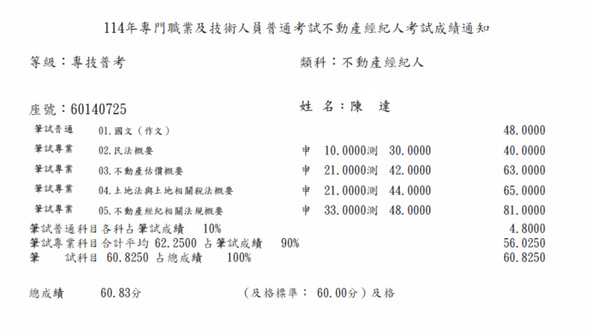

> 一、前言 身為一名歷史系的文科畢業生，在

<h2 class="wp-block-heading">一、前言</h2>

身為一名歷史系的文科畢業生，在我想著能考什麼試或取得什麼證照而焦頭爛額之時，我看到了不動產經紀人這個考科，它不限制科系、學分與學歷，只要有心準備然後報名，每年都有機會，而且它是及格制只要分數達標即可上榜。

哥哥在估價師事務所工作，會和我講一些業界遇到的案例，加上家裡人也鼓勵考國家考試(做其他事比較容易被講話)，自身對房地產也算有興趣想到業界做做看。

一開始我也在紛繁的函授與書籍選擇中迷航，我也在網上爬各種文，最後是看到有人在PTT上分享「Jasper 地政士＆不動產經紀人考試輔導員」這個專為地政士與不動產經紀人考試而創立的課程，我就信用卡刷下去買了課程。

我自己覺得課程價格非常實惠，而且這些精心而投入的教學課程不僅能隨時線上重複觀看，還有線上的LINE群組傳道授業解惑，考生們也能隨時提問，老師們更會不厭其煩地為我們回應和解答，真的很有心帶領我們這群考生們。所以我很推薦「Jasper 地政士＆不動產經紀人考試輔導員」的課程。

大學的時候我也沒上完過法律系的課(有修過但最後退選了)，可以說我就是個法律小白，很多基礎概念是完全沒有的。而我就照著Jasper老師課程裡的事前準備所講，一步一步學習慢慢打下基礎，前面的過程是枯燥與乏味的，但目的是為了把網給織起來。

<h2 class="wp-block-heading">二、不動產經紀人各科準備方式</h2>

我用最笨最慢的方法：照抄老師們的板書，邊聽邊抄邊理解，不懂就查、查到會、查到懂。隨著那些基本的法律概念一個一個地理解，我漸漸能把他們融會貫通，或是見到這個便能推演到另一個，把覆蓋的牌一張張地翻開。

我覺得在學過第一輪以後，對已經學過但仍有疑惑與不解的地方做第二、三或更多次的研讀與查找也相當重要，很多時候看過去是看過去了，但其實還有很多地方並未理解透徹或真正弄懂，所以把不懂的問題記下來也很關鍵。

我還建議時間不夠的考生，可以準備歷屆考古題的詳解，可以方便查找解答與法條，對最後衝刺時間緊迫之下會友善得多。我做考古題也有一本自己的訂正筆記，我拿它在考場做最後的短期記憶或是預防陷阱題的題型。

我總共花大概9個月當全職考生，白天時間幾乎都在念書、寫習題或訂正，讀累了可以去運動或冥想能緩解壓力。接下來的各科準備方式我寫得比較簡要，還敬請指教。

<h3 class="wp-block-heading">1. 民法</h3>

我覺得可以先花時間把民法專心念過幾遍，再去碰其他科目會比較好，因為它有很多很多的基礎概念，當還不清楚這些概念就去念其他科，可能會有更多疑問或卡關，但我覺得有疑問並不是壞事，把他們記下來好好搞懂都是好的。

一開始我在作答書本裡的例題也是錯得滿江紅，也是感受到許多挫折，但我會想辦法從老師的課程裡或是自己在網路尋找答案的過程中理解民法的許多概念，民法很生活化但也很常是反直覺的，搞懂立法精神、目的和債權物權的優先性、相對性等概念會比較好理解。

<h3 class="wp-block-heading">2. 土地法&amp;土地稅法</h3>

土地法&amp;土地稅法有蠻多法條、金額、日期要去記的，但課程中老師有提供很多記法和表格整理，上完課自己還有再整理一份關於各土地稅法的記憶表格，把相同相異的地方好好比較並整理下來，沒事情就拿這些筆記資料不停默背就對了。

<h3 class="wp-block-heading">3. 不動產估價概要</h3>

最基本的三大估價法：比較法、收益法、成本法，還有不動產估價的用詞定義與經濟原則名詞解釋都要牢記，老師也有提供許多好記的順口溜，沒事也是不停默背就對了。

計算的題型把歷屆考古題做熟就不用怕了，偶爾申論題也會考計算。我覺得這一科也是最常玩文字遊戲與陷阱題的，記得把論述好好看清楚再作答。

<h3 class="wp-block-heading">4. 不動產經紀相關法規</h3>

不動產經紀業管理條例、公寓大廈管理條例、消費者保護法、公平交易法，條文、罰金、特定的事件要適用什麼法律都記好，要拿分不會太難。我覺得這一科很推薦考生讀熟並牢記，不管是選擇題或申論題都是衝分的關鍵，高CP值的考科。（誠如Jasper老師所言哈哈哈 =D）

<h2 class="wp-block-heading">三、實戰分享與結語</h2>

這是我第一次考國家考試，第一天考試前一晚是真的睡不太著，東西前一晚全部準備好(兩套文具、計算機、筆記、身分證、列印准考證)，早點起床早點到考場。列印准考證通常作為進入試場(學校大門)的證明文件，電子版的應該也行，看入口工作人員。

身分證是考場內的重要證明文件一定要記得帶。我的考場餐食就是選擇簡單方便的超商飯糰+綠茶，早上買兩份，早餐一份然後中餐一份，不用出考場去擠或去排隊等待。衛生紙也可以記得準備，冷氣太冷可以擦鼻涕或是有內急也可以做使用。

千萬不要讓自己給緊張綁架了，心跳加速、噁心反胃都會影響到正常發揮，我自己會在掌心比劃個緊張然後假裝吞下去就不緊張了，考前太緊張筆記讀不下去，閉上眼睛什麼都不要想，進入冥想狀態也是個方法，一定要給自己打氣、加油、鼓勵。

只要把昨日不懂的觀念弄懂，你就勝過昨日的自己了，共勉之。

<figure class="wp-block-image size-large"><noscript></noscript></figure>

　

<h4 class="wp-block-heading has-black-color has-text-color" id="免費諮詢">．延伸閱讀</h4>

<a href="https://www.jasper-realestate.com/01-%e4%b8%8d%e5%8b%95%e7%94%a2%e7%b6%93%e7%b4%80%e4%ba%ba-%e8%ad%89%e7%85%a7%e4%bb%8b%e7%b4%b9%e5%84%aa%e5%8b%a2/">01 不動產經紀人｜證照介紹 &amp; 優勢</a>

<a href="https://www.jasper-realestate.com/02-%e4%b8%8d%e5%8b%95%e7%94%a2%e7%b6%93%e7%b4%80%e4%ba%ba%e8%80%83%e8%a9%a6%e8%b3%87%e8%a8%8a%e5%85%a8%e4%bb%8b%e7%b4%b9/">02 不動產經紀人｜考試資訊全介紹</a>

<h4 class="wp-block-heading has-text-color has-link-color wp-elements-217661994d7d4a0f28ce2500f2d632d0" id="免費諮詢" style="color:#ffffff;font-size:9px"><a data-id="https://line.me/R/ti/p/%40851hgrwp" data-type="URL" href="https://line.me/R/ti/p/%40851hgrwp" rel="noreferrer noopener" target="_blank">Line 官方帳號</a>｜<a data-id="https://www.facebook.com/Jasper-%E4%B8%8D%E5%8B%95%E7%94%A2%E7%B6%93%E7%B4%80%E4%BA%BA%E8%80%83%E8%A9%A6%E8%BC%94%E5%B0%8E%E5%93%A1-104204235060276/" data-type="URL" href="https://www.facebook.com/Jasper-%E4%B8%8D%E5%8B%95%E7%94%A2%E7%B6%93%E7%B4%80%E4%BA%BA%E8%80%83%E8%A9%A6%E8%BC%94%E5%B0%8E%E5%93%A1-104204235060276/" rel="noreferrer noopener" target="_blank">Facebook 粉絲專頁</a></h4>

