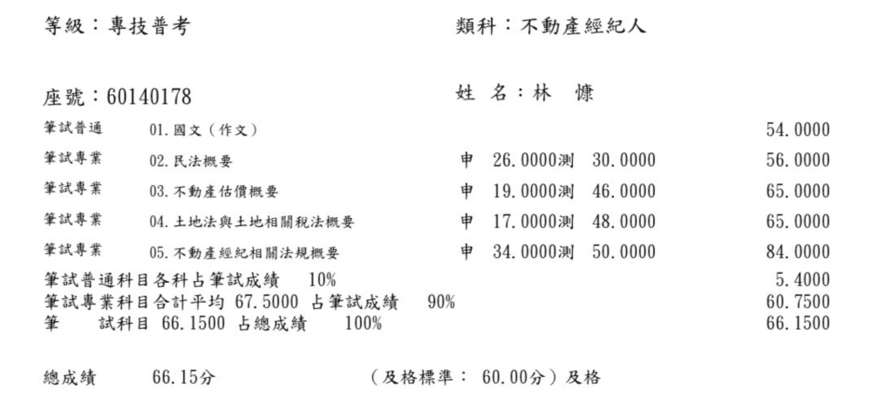

> 一、背景 我是職涯諮詢師，協助工作上想要

<h2 class="wp-block-heading">一、背景</h2>

我是職涯諮詢師，協助工作上想要更上層樓的人，或者在工作上遇到瓶頸而迷惘的人，找到自己人生發展的方向

在討論職涯發展、生涯規劃的過程中，也常常會談論到「財務」的規劃，不論是升職加薪、創業、結婚、買房、買車，都是在我們的人生中會遇到的事情，而這些事情，「稅務」與「法律」的觀念非常重要，但是大部分的人，在還沒遇到這些事情前，都沒有意識到稅務與法律的重要性

為了讓我自己完整了解這些重要的稅務與法規，並且擁有專業能夠提供更完整的生涯、職涯諮詢，我想要考取一些相關的證照執照，而不動產經紀人與地政士，正好能讓我獲得相關的專業知識

一開始是想準備地政士考試，但在過程中發現，經紀人有部分的科目重疊，可以作為考地政士前的練習與經驗，所以開始準備經紀人的考試

<h2 class="wp-block-heading">二、選擇補習班的過程</h2>

搜尋了許多補習班課程後，我發現這些課程都不適合我，因為我的工作模式不是固定的朝九晚五，要我固定時間到教室裡聽課，真的非常困難，很容易就會缺課或精神不濟，而且我也知道自己不是能夠持續專注3、4小時的人，無法一心二用邊聽課邊作筆記，因此補習班的傳統模式實在不適合我

後來看到了Jasper 地政士&amp;不動產經紀人考試輔導員的課程，課程是線上的，而線上課程的好處就是能夠自己安排讀書學習的時間，可以不斷重聽與複習，這都讓我可以依照自己的步調來準備考試，非常適合工作時間不固定，有許多碎片時間的我來學習

當然，價格更加親民，也是我考慮 Jasper 課程的重要因素，一開始也會擔心，比其他課程便宜許多的價格，會不會有品質上的疑慮，但在仔細看過 Jasper 的網站、社群平台，以及網路許多篇 Jasper 課程的評價後，我對 Jasper 課程品質開始有了信心，因為我認為，會在網站上持續更新小教室、小知識、新修法內容，而且願意開Line群組隨時回答同學問題的團隊，一定也會不斷調整課程內容，把最專業的知識帶給學生

事實也證明我的想法正確！Jasper 課程內容詳細、全面、淺顯易懂，隨時問問題，都會有老師詳細耐心的解答，給了我非常大的幫助！

<h2 class="wp-block-heading">三、不動產經紀人各科準備方式</h2>

<h3 class="wp-block-heading">1. 民法</h3>

民法是我覺得最有趣，但也最挫折的一科，範圍很大，選擇題又會考非常細節的內容，在練習許多考古題後，我決定放寬對這科的執念，以考到50分為目標，把更多時間留給其他的科目

有了這樣的心態與策略後，允許自己暫時放掉一些細節內容，把心力放在題目常考的意思表示、債務不履行、買賣、租賃、共有、抵押權、地上權以及繼承編上，等自己掌握了這些大主題，有力氣再去補其他的內容，反而讓我在民法上，可以掌握更多的基本分

<h3 class="wp-block-heading">2. 土地法&amp;土地稅法</h3>

土地法多是死背硬記的內容，因為我不擅長這樣的考題，所以需要不斷的複習與重聽課程，在通勤的路上，我都會放土地法課程當背景音樂，然後用口訣、聯想來幫助自己記憶

土地稅法在經紀人考試比較多是計算的部分，所以整理好每個稅的意義、稅基、稅率與納稅義務人後，就把心力放在計算上，熟悉每種稅的基本稅率計算、自住稅率計算、重購退稅的計算後，再透過選擇題，補足法規上細節的概念

<h3 class="wp-block-heading">3. 不動產估價概要</h3>

一開始，我以為估價這科要著重在計算上，因此試著去理解每個估價方法的意義與計算方式，但開始練習題目後才發現，這科其實也是記憶背誦的科目，「背出公式」比「理解公式」還要好拿分，所以放棄去理解如何計算，改成注重記憶公式、代入公式與法規記憶

<h3 class="wp-block-heading">4. 不動產經紀相關法規</h3>

經紀法規雖然看起來不少，但我認為是最貼近日常的法律，在記憶與理解的時候，可以套用生活的情境，不僅可以增加理解，也真的能夠實際運用，實際用過的法條，或有套用到新聞時事中的法條，就更不容易忘記，甚至可以再延伸聯想到民法、稅法上，一次複習更多的法規

<h2 class="wp-block-heading">四、結語</h2>

到考場後，真的已經沒辦法再複習更多的內容，但因為有照著老師的分享，做好自己的「考前筆記」，看到自己錯過的東西，而且知道自己不會再錯，會讓自己很安心，把該拿到的基本分數都安穩拿下來

我認為花錢上課，是要快速獲得老師已經整理好的知識架構，同時在我有疑問時可以得到解答，如果我選擇的是傳統補習班模式，那我可能光是每天晚上跑教室上課，就已經精疲力盡

因此，如果你和我一樣是上班不固定時間、常常有碎片時間的工作模式，Jasper 的課程一定能讓你更彈性的安排自己的學習時間，讓學習更有效果！

<figure class="wp-block-image size-large"><noscript></noscript></figure>

　

<h4 class="wp-block-heading has-black-color has-text-color" id="免費諮詢">．延伸閱讀</h4>

<a href="https://www.jasper-realestate.com/01-%e4%b8%8d%e5%8b%95%e7%94%a2%e7%b6%93%e7%b4%80%e4%ba%ba-%e8%ad%89%e7%85%a7%e4%bb%8b%e7%b4%b9%e5%84%aa%e5%8b%a2/">01 不動產經紀人｜證照介紹 &amp; 優勢</a>

<a href="https://www.jasper-realestate.com/02-%e4%b8%8d%e5%8b%95%e7%94%a2%e7%b6%93%e7%b4%80%e4%ba%ba%e8%80%83%e8%a9%a6%e8%b3%87%e8%a8%8a%e5%85%a8%e4%bb%8b%e7%b4%b9/">02 不動產經紀人｜考試資訊全介紹</a>

<h4 class="wp-block-heading has-text-color has-link-color wp-elements-217661994d7d4a0f28ce2500f2d632d0" id="免費諮詢" style="color:#ffffff;font-size:9px"><a data-id="https://line.me/R/ti/p/%40851hgrwp" data-type="URL" href="https://line.me/R/ti/p/%40851hgrwp" rel="noreferrer noopener" target="_blank">Line 官方帳號</a>｜<a data-id="https://www.facebook.com/Jasper-%E4%B8%8D%E5%8B%95%E7%94%A2%E7%B6%93%E7%B4%80%E4%BA%BA%E8%80%83%E8%A9%A6%E8%BC%94%E5%B0%8E%E5%93%A1-104204235060276/" data-type="URL" href="https://www.facebook.com/Jasper-%E4%B8%8D%E5%8B%95%E7%94%A2%E7%B6%93%E7%B4%80%E4%BA%BA%E8%80%83%E8%A9%A6%E8%BC%94%E5%B0%8E%E5%93%A1-104204235060276/" rel="noreferrer noopener" target="_blank">Facebook 粉絲專頁</a></h4>

