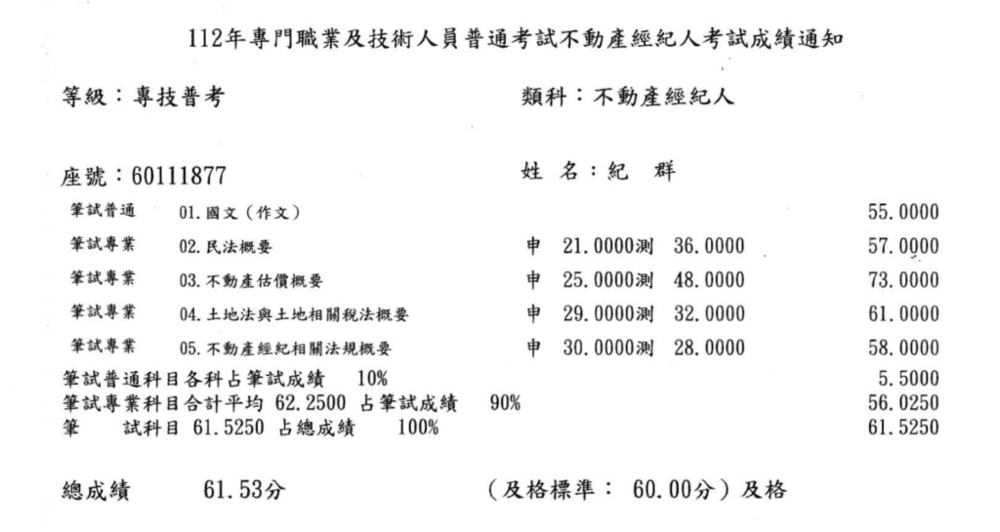

> 一、考生背景 我是紀O群，今年42歲，是

<h2 class="wp-block-heading">一、考生背景</h2>

我是紀O群，今年42歲，是房仲從業人員，非本科系。

因為從事房仲業已經有很長一段時間，總覺得好像需要有這張證照，但因為平時工作忙碌，實在沒時間讀書，直到自己的學弟靠自學考上後，才激發了我想要考取證照的決心。

<h2 class="wp-block-heading">二、學習資源</h2>

一套參考書 &amp; 學弟介紹的 Jasper 地政士 &amp; 不動產經紀人考試輔導員，裡面有一對一的諮詢服務、讀書會群組問答，和線上課程教學等等。線上的每個老師會用影片來教你按步就班的學習，幫助你有效率的擬定個人讀書計畫。

<h2 class="wp-block-heading">三、不動產經紀人各科準備方式</h2>

我個人準備分四階段：

<h3 class="wp-block-heading">1. 摸索期</h3>

設定半個月讀完一科目，2個月就能讀完全部科目，力求讀完不一定要理解，有概念就好。

<h3 class="wp-block-heading">2. 理解期</h3>

這時設定一天上網看2課程，務必求理解到70~80%，不懂的地方就要馬上群組詢問老師，老師都會在第一時間回答。

<h3 class="wp-block-heading">3. 實戰期</h3>

至少要拿5~6屆的歷年考題出來測試自己，錯誤的地方要想辦法理解，不懂一樣問老師。這時也要開始練習寫申論題。

<h3 class="wp-block-heading">4. 背誦期</h3>

最後考前一個月，把老師發的筆記本，盡量全部背起來，基本上看到申論題，就算不能完全懂也寫得出筆墨分數，這樣每科的平均分數也不會落差太大，對上榜很重要。

<h2 class="wp-block-heading">四、給準備考試的學弟妹建議</h2>

準備考試真的是一件很辛苦的事情，尤其是有正常工作或有小孩要照顧的情況下準備，會顯得格外辛苦。但就是因為辛苦，千萬不要抱著明年再來一次的心態，痛苦一次就好，這樣才能全心投入，增加讓自己考一次就上的機率，祝福準備考試的你(妳)也能金榜題名。

<figure class="wp-block-image size-large"><noscript></noscript></figure>

　

<h4 class="wp-block-heading has-black-color has-text-color" id="免費諮詢">．延伸閱讀</h4>

<a href="https://www.jasper-realestate.com/01-%e4%b8%8d%e5%8b%95%e7%94%a2%e7%b6%93%e7%b4%80%e4%ba%ba-%e8%ad%89%e7%85%a7%e4%bb%8b%e7%b4%b9%e5%84%aa%e5%8b%a2/">01 不動產經紀人｜證照介紹 &amp; 優勢</a>

<a href="https://www.jasper-realestate.com/02-%e4%b8%8d%e5%8b%95%e7%94%a2%e7%b6%93%e7%b4%80%e4%ba%ba%e8%80%83%e8%a9%a6%e8%b3%87%e8%a8%8a%e5%85%a8%e4%bb%8b%e7%b4%b9/">02 不動產經紀人｜考試資訊全介紹</a>

<h4 class="wp-block-heading has-text-color has-link-color wp-elements-217661994d7d4a0f28ce2500f2d632d0" id="免費諮詢" style="color:#ffffff;font-size:9px"><a data-id="https://line.me/R/ti/p/%40851hgrwp" data-type="URL" href="https://line.me/R/ti/p/%40851hgrwp" rel="noreferrer noopener" target="_blank">Line 官方帳號</a>｜<a data-id="https://www.facebook.com/Jasper-%E4%B8%8D%E5%8B%95%E7%94%A2%E7%B6%93%E7%B4%80%E4%BA%BA%E8%80%83%E8%A9%A6%E8%BC%94%E5%B0%8E%E5%93%A1-104204235060276/" data-type="URL" href="https://www.facebook.com/Jasper-%E4%B8%8D%E5%8B%95%E7%94%A2%E7%B6%93%E7%B4%80%E4%BA%BA%E8%80%83%E8%A9%A6%E8%BC%94%E5%B0%8E%E5%93%A1-104204235060276/" rel="noreferrer noopener" target="_blank">Facebook 粉絲專頁</a></h4>

