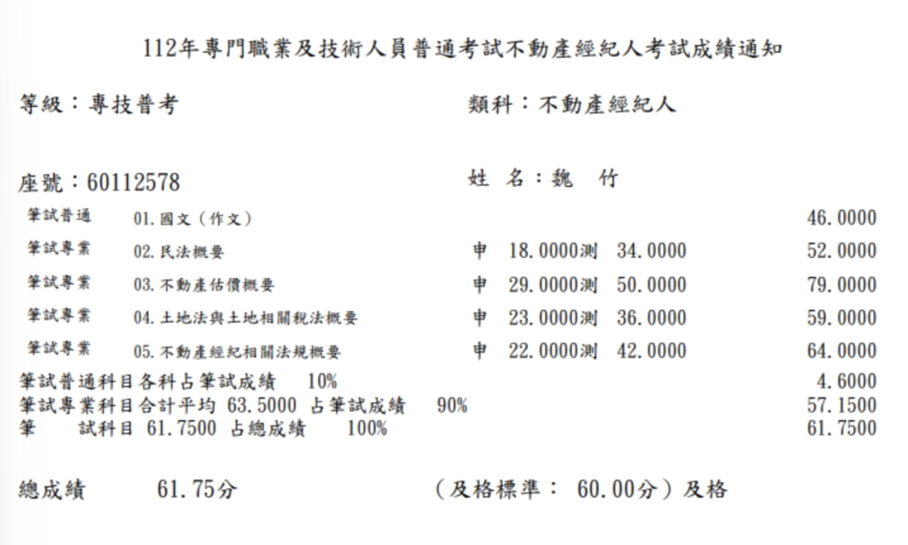

> 一、前言 先介紹下我的背景，本身是商科相

<h2 class="wp-block-heading">一、前言</h2>

先介紹下我的背景，本身是商科相關科系畢業，只有做過租賃的經驗，當初下決心要考的時候真的蠻困擾自己的，因為完全沒有買賣工作經驗，幾乎可以說是零基礎的準備這個國考，但我的動機非常明確，也知道自己讀書時的缺點在哪，這次國考真的花了很大的心力在準備。

我自認為不是個聰明的學生，知道自己不是個可以靜下心來念書的孩子，必須同時兼顧工作的狀況下，我自認對我來說一年算是比較剛好的準備期，也知道自己並沒有耐心準備兩三年，不想抱持著 「第一年先試試看」的心態去考試，因為我就是要一次考過，才會有認命的動力XD

<h2 class="wp-block-heading">二、學習資源</h2>

一開始我先找了傳統補習班，第一次聽課時真的很多都聽不懂，但我就是用平板先做好筆記跟查法條直接放在筆記旁邊，這樣可以配合老師的體系圖直接看，我其實會建議平板整理一遍，下課之後手寫在整理一遍，這樣才能真的有效消化上課的內容。

另外參加了 Jasper 地政士 &amp; 不動產經紀人考試輔導員的線上課程方案，我很慶幸這次我有加入這個課程團隊，，我主要利用 Jasper 的線上課程來加強我的主架構邏輯，而且他們的主題式分段可以讓我只上我想加強的部分，且像傳統補習班的估價、經紀條例這兩科我都覺得沒有 Jasper 老師上的清晰有邏輯，我覺得念法條是非常注重架構跟邏輯有沒有清晰的。

另外還有線上問到飽服務！不用怕問題是基本還是困難，老師真的都會想盡辦法來回答你的問題，甚至唸到後期還會有許多同學來回答你的問題，彼此幫助讀書上的困難，我也會試著回答我會的問題來加強印象。

<h2 class="wp-block-heading">三、不動產經紀人各科準備方式</h2>

<h3 class="wp-block-heading">1. 民法</h3>

前期重點基本上都在民法上，民法一開始念的很沒有成就感，但隨著越念越清楚，配合老師的案例教學之後，其實唸到後面民法反而變成我的興趣了，因為自從念過土地法之後就真的覺得民法的法條好懂多了XDDD

我覺得民法非常需要配合案例來學習，單純念法條真的會不知道重點是什麼，在群組內通常也會有同學針對自己不懂的法條請老師來舉例

例如今天如果不懂甚麼是普通抵押權以及最高限額抵押權的差別在哪，就可以請群組內老師透過簡單生活化的例子讓你更能知道這詳細的差別還不用怕例子不正確!其實認真讀起來之後會發現民法是個蠻好玩的科目的～我到後期基本上都沒甚麼在念民法（所以成績也不是很好XD）

<h3 class="wp-block-heading">2. 土地法及土地稅法</h3>

這科真的是最艱難困苦的科目押QQQ這科完全是靠土地稅法衝起來的XD

因為土地法範圍真的很龐大，但也是我花了最多心思在念的，土地法這科其實不只考土地法，還包含了平均地權條例、土地徵收條例、區域計畫法、都市計畫法、非都土計畫還有各種施行細則要讀，範圍之大我光是搞懂都市計畫、國土計畫、市地重劃、照價收買、徵用、徵收這幾個差別人都快沒了XD

土地稅法大概也是實務中最有用的法條之一，光是房屋稅、地價稅、土增稅、房地合一稅、重購退稅這幾個名詞常常在新聞也是很容易聽到，但就是不知道內容是甚麼，直到備考了才了解了詳細內容。

在念土地法時一定要跟著老師的主架構去念！因為毫無章法的念真的會不知道在讀甚麼，而且會整個腦袋打結在一起。我建議先分別去了解各法規幾個主架構名詞的意義跟差別之後，再去詳細的讀內容才不會慌亂。

<h3 class="wp-block-heading">3. 不動產估價</h3>

唸完一次基本內容都清楚了解課程後，就是不斷刷題刷題刷題！

我記得我當時後選擇題歷屆做了15年XD而且後面越做越上癮，因為分數越來越高XD所以這次也幸運的選擇題全拿，這科絕對是拿分的關鍵！

一定要拚起來，但這是我四科唸起來覺得最空泛最學術的科目，我覺得從名詞解釋開始背起再去了解內容，並詳細了解三大估價法的目的還有土開法的意義，就會輕鬆許多！然後，去刷考古題吧～～～

<h3 class="wp-block-heading">4. 不動產經紀管理條例</h3>

這科也是考了四種法規，其實念起來也是很吃力的因為會考很多小細節，但總結就是名詞解釋、條文內容有架構式學習這科蠻好拿分數的，架構式學習這個反而傳統補習班的老師沒上好。

我是去上了 Jasper 老師的課之後才搞懂這科的主架構，而且 Jasper 比較能用平凡人的角度去解釋條文內容，傳統補習班老師有時會用你有相關工作經驗的角度來解釋，這真的很困擾我，因為我就真的不懂Q

<h2 class="wp-block-heading">四、結語</h2>

總結，念書的建議能給的真的不多，但心態建設方面或許能給些建議，國考是個長期抗戰，必須清楚自己考試的目的跟目標，你才會有動力拚下去，一定要穩住心態、平心靜氣，找到自己最舒服的讀書環境唸下去

套一句老師說的話，國考不是拚誰記的多，而是考誰忘的少，我覺得最困難的地方在於吸收知識之後必須內化成自己的再想辦法有條理的寫出來，給也正在準備國考的你一個加油！

<figure class="wp-block-image size-large"><noscript></noscript></figure>

　

<h4 class="wp-block-heading has-black-color has-text-color" id="免費諮詢">．延伸閱讀</h4>

<a href="https://www.jasper-realestate.com/01-%e4%b8%8d%e5%8b%95%e7%94%a2%e7%b6%93%e7%b4%80%e4%ba%ba-%e8%ad%89%e7%85%a7%e4%bb%8b%e7%b4%b9%e5%84%aa%e5%8b%a2/">01 不動產經紀人｜證照介紹 &amp; 優勢</a>

<a href="https://www.jasper-realestate.com/02-%e4%b8%8d%e5%8b%95%e7%94%a2%e7%b6%93%e7%b4%80%e4%ba%ba%e8%80%83%e8%a9%a6%e8%b3%87%e8%a8%8a%e5%85%a8%e4%bb%8b%e7%b4%b9/">02 不動產經紀人｜考試資訊全介紹</a>

<h4 class="wp-block-heading has-text-color has-link-color wp-elements-217661994d7d4a0f28ce2500f2d632d0" id="免費諮詢" style="color:#ffffff;font-size:9px"><a data-id="https://line.me/R/ti/p/%40851hgrwp" data-type="URL" href="https://line.me/R/ti/p/%40851hgrwp" rel="noreferrer noopener" target="_blank">Line 官方帳號</a>｜<a data-id="https://www.facebook.com/Jasper-%E4%B8%8D%E5%8B%95%E7%94%A2%E7%B6%93%E7%B4%80%E4%BA%BA%E8%80%83%E8%A9%A6%E8%BC%94%E5%B0%8E%E5%93%A1-104204235060276/" data-type="URL" href="https://www.facebook.com/Jasper-%E4%B8%8D%E5%8B%95%E7%94%A2%E7%B6%93%E7%B4%80%E4%BA%BA%E8%80%83%E8%A9%A6%E8%BC%94%E5%B0%8E%E5%93%A1-104204235060276/" rel="noreferrer noopener" target="_blank">Facebook 粉絲專頁</a></h4>

