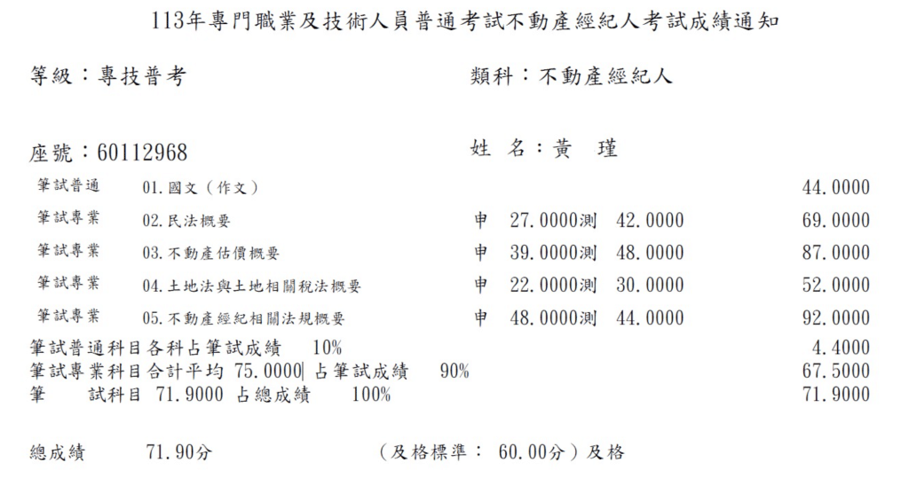

> 一、前言 本身為不動產相關從業人員，雖然

<h2 class="wp-block-heading">一、前言</h2>

本身為不動產相關從業人員，雖然非本科但算是有相關工作經驗。因想要有一份被動收入，加上以前營業員考試成績近滿分，當時的主管一直有鼓勵我以後有機會一定要考經紀人。

<h2 class="wp-block-heading">二、學習資源</h2>

因為本身工作關係，常常會接觸法條，故對法條有一定的熟悉度。但因為這次是第一次考經紀人考試，故還是希望可以找補習班輔助。上網搜尋後，發現Jasper 地政士&amp;不動產經紀人考試輔導員是最適合的，因為僅需線上看課程，且還有讀書會群組及真的念到瓶頸時導師也會一對一的輔導，讓我信心倍增。

<h2 class="wp-block-heading">三、不動產經紀人考試準備方式</h2>

因本身就是做相關產業，不動產經紀相對來說不算太難，一開始比較會碰到瓶頸的大概是估價及土地法。

七月才確定要考經紀人考試，加上還在職就先照著Jasper的讀書計畫去執行，上班閒暇時也會不斷看法條及搭配時事去做搭配。估價準備技巧真的就是多做考古題，用考古題去運用公式，準備到後來真的是最輕鬆，且也整理一套屬於自己的筆記，憑印象去寫出整個法條架構，其他科亦同。

民法準備方式建議可以多搭配時事去記法條，讀起來會比較得心應手，真的不太需要去懼怕民法，而且我覺得Jasper的好處是隨時24小時老師們都會在線上解答，同學們也會熱心解釋。讀書群組的好處是不論這題自己是否會，若能一起思考都是讓自己增強記憶。

<h2 class="wp-block-heading">四、結語</h2>

我覺得有好的讀書資源及照著老師教的步驟去走，幫助真的很大。平常該放鬆時放鬆，該念書時念書，就會發揮到最好狀態。即使不是本科或第一次考，只要找到對的方法就能讓自己事半功倍。

<figure class="wp-block-image size-large"><noscript></noscript></figure>

　

<h4 class="wp-block-heading has-black-color has-text-color" id="免費諮詢">．延伸閱讀</h4>

<a href="https://www.jasper-realestate.com/01-%e4%b8%8d%e5%8b%95%e7%94%a2%e7%b6%93%e7%b4%80%e4%ba%ba-%e8%ad%89%e7%85%a7%e4%bb%8b%e7%b4%b9%e5%84%aa%e5%8b%a2/">01 不動產經紀人｜證照介紹 &amp; 優勢</a>

<a href="https://www.jasper-realestate.com/02-%e4%b8%8d%e5%8b%95%e7%94%a2%e7%b6%93%e7%b4%80%e4%ba%ba%e8%80%83%e8%a9%a6%e8%b3%87%e8%a8%8a%e5%85%a8%e4%bb%8b%e7%b4%b9/">02 不動產經紀人｜考試資訊全介紹</a>

<h4 class="wp-block-heading has-text-color has-link-color wp-elements-217661994d7d4a0f28ce2500f2d632d0" id="免費諮詢" style="color:#ffffff;font-size:9px"><a data-id="https://line.me/R/ti/p/%40851hgrwp" data-type="URL" href="https://line.me/R/ti/p/%40851hgrwp" rel="noreferrer noopener" target="_blank">Line 官方帳號</a>｜<a data-id="https://www.facebook.com/Jasper-%E4%B8%8D%E5%8B%95%E7%94%A2%E7%B6%93%E7%B4%80%E4%BA%BA%E8%80%83%E8%A9%A6%E8%BC%94%E5%B0%8E%E5%93%A1-104204235060276/" data-type="URL" href="https://www.facebook.com/Jasper-%E4%B8%8D%E5%8B%95%E7%94%A2%E7%B6%93%E7%B4%80%E4%BA%BA%E8%80%83%E8%A9%A6%E8%BC%94%E5%B0%8E%E5%93%A1-104204235060276/" rel="noreferrer noopener" target="_blank">Facebook 粉絲專頁</a></h4>

