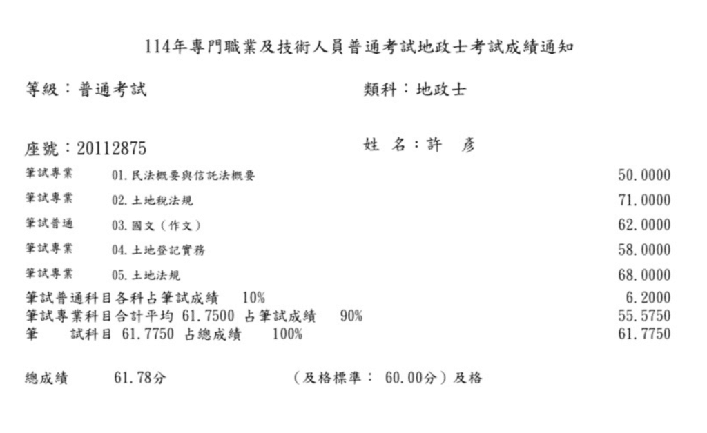

> 一、前言 非本科系畢業，在學期間補習考上

<h2 class="wp-block-heading">一、前言</h2>

非本科系畢業，在學期間補習考上經紀人，但沒考上地政士，之後到知名房仲當代書助理，因工作繁忙斷斷續續考了七年。

因為大三在估價師事務所實習，因此對於地政相關感興趣，上網研究一下地政方面很吃證照，於是打算先從經紀人、地政士、估價師一路準備下去。

有參加過傳統函授課程，所以基礎觀念都有，但是缺少一些讀書的軟實力，在網路上偶然看到Jasper 團隊的課程廣告，一開始是被價格吸引，於是跟客服了解，跟老師討論了一番後，我認為 Jasper 或是我需要的，他們的課程風格和其他補習班不同，是用統整資料的方式抓出考試重點，對於已經有基礎觀念的學生很有幫助，加上會開群組可以隨時有問題就跟老師詢問。

<h2 class="wp-block-heading">二、地政士各科準備方式</h2>

<h3 class="wp-block-heading">1. 民法</h3>

民法著重在觀念的理解，如果有在練歷屆試題的學生會發現，近幾年的民法題目越來越長、越來越生活，所以更要耐心的把題目看完，再來要大大感謝Josh律師，老師的民法課程教導的觀念受益良多，我對於民法這科的解讀，法條只是一個工具，要先搞懂題目需要用哪一個工具很重要。

<h3 class="wp-block-heading">2. 土地法</h3>

土地法就真的比較頭痛了，不斷修法增加法條，幾乎每一年準備都會有需要重新整理的部分，所以這一科目我是藉由老師的圖表來理解跟記憶。

<h3 class="wp-block-heading">3. 土地稅法</h3>

土地稅法沒有什麼訣竅，就是背背背，從立法意旨、稅率、稅基、不課徵、免徵、特別部分、各稅科關聯性的比較等等來去記憶。

<h3 class="wp-block-heading">4. 土地登記實務</h3>

土地登記讓我偏頭痛的一科，尤其近幾年的登記考試題目越來越活，已經不是死背條文就可以拿分的，所以在這一科目的準備上，我認為是需要跟土地法以及民法結合一起，需要去了解每一條登記規則的起源是來自哪一條。

<h2 class="wp-block-heading">三、結語</h2>

考試前一天早早睡很重要️，考試當天穿著最舒適的衣服，我是穿拖鞋以及運動衣去，不是去約會，所以不用穿太帥太美。

考完每一科目之後就趕快拿出下個科目的考前筆記出來看，第一天結束之後回家就先洗澡，再把隔天要考的考前筆記拿出來、掃一遍之後就可以睡覺了，第二天同樣的做法，中午考完就去吃一頓考試前一直很想吃的餐廳好好休息。

有報名Jasper 課程的學弟妹們，課程裡面的考試準備三階段一定要照做，尤其是最後的考前筆記，我是在第二階段唸書後開始製作，考試當天就是帶著四本筆記本去考場而已，然後歷屆試題一定要寫，不要抄。

<figure class="wp-block-image size-large"><noscript></noscript></figure>

　

<h4 class="wp-block-heading has-black-color has-text-color" id="免費諮詢">．延伸閱讀</h4>

<a href="https://www.jasper-realestate.com/01-%e4%b8%8d%e5%8b%95%e7%94%a2%e7%b6%93%e7%b4%80%e4%ba%ba-%e8%ad%89%e7%85%a7%e4%bb%8b%e7%b4%b9%e5%84%aa%e5%8b%a2/">01 不動產經紀人｜證照介紹 &amp; 優勢</a>

<a href="https://www.jasper-realestate.com/02-%e4%b8%8d%e5%8b%95%e7%94%a2%e7%b6%93%e7%b4%80%e4%ba%ba%e8%80%83%e8%a9%a6%e8%b3%87%e8%a8%8a%e5%85%a8%e4%bb%8b%e7%b4%b9/">02 不動產經紀人｜考試資訊全介紹</a>

<h4 class="wp-block-heading has-text-color has-link-color wp-elements-217661994d7d4a0f28ce2500f2d632d0" id="免費諮詢" style="color:#ffffff;font-size:9px"><a data-id="https://line.me/R/ti/p/%40851hgrwp" data-type="URL" href="https://line.me/R/ti/p/%40851hgrwp" rel="noreferrer noopener" target="_blank">Line 官方帳號</a>｜<a data-id="https://www.facebook.com/Jasper-%E4%B8%8D%E5%8B%95%E7%94%A2%E7%B6%93%E7%B4%80%E4%BA%BA%E8%80%83%E8%A9%A6%E8%BC%94%E5%B0%8E%E5%93%A1-104204235060276/" data-type="URL" href="https://www.facebook.com/Jasper-%E4%B8%8D%E5%8B%95%E7%94%A2%E7%B6%93%E7%B4%80%E4%BA%BA%E8%80%83%E8%A9%A6%E8%BC%94%E5%B0%8E%E5%93%A1-104204235060276/" rel="noreferrer noopener" target="_blank">Facebook 粉絲專頁</a></h4>

