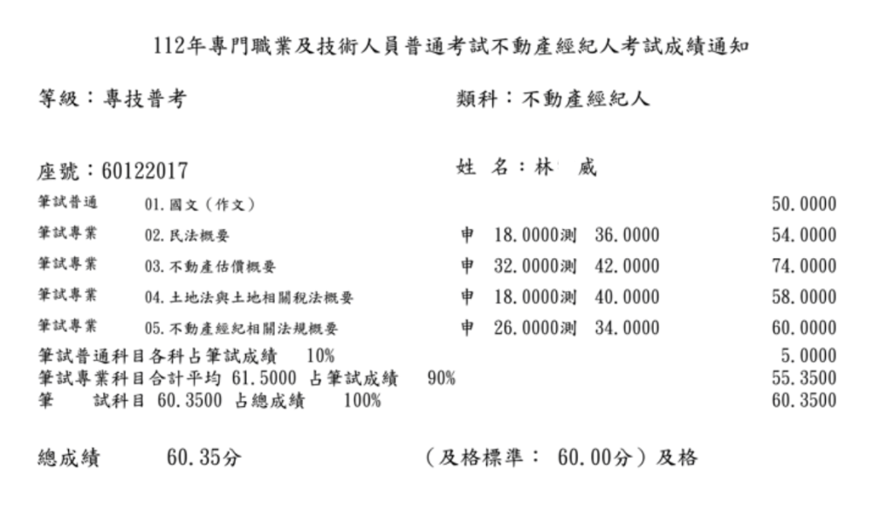

> 一、前言及背景 我本身是二寶爸，非本科系

<h2 class="wp-block-heading">一、前言及背景</h2>

我本身是二寶爸，非本科系，是一名流行歌唱教練（酷吧！），因為工作關係我只用了兩個多月，就讓成績剛好考在60.35分，極致低空飛過及格邊緣線，很符合我的行事準則：「效率」

我同時也在最近斜槓了社會住宅的包租代管，包租代管的工作需要「不動產營業員」及「租賃管理師」兩份證照，過程中又得知較難考的「不動產經紀人」證照，抱持著證照的出租租金也是一份不無小補的收入（貪財～），以及用考證照來作為開發身體潛能的一種驗證（包含運動、歌唱、學習、唸書等），於是也就報考了。

<h2 class="wp-block-heading">二、不動產經紀人學習資源</h2>

自從斜槓之後，我的工作時間就被填滿，回家還要顧小孩，也因此我真的無法再花時間每週去上補習班好幾小時，於是在找資源時，有注意到Jasper地政士 &amp; 不動產經紀人考試輔導員的課程方案，它有很多模組化的商品，像是線上函授課程、問到飽群組、練筆團等，我覺得對我最有幫助的就是問到飽的群組！尤其我要盡量以最低的成本，去考取到證照（符合我行事風格，效率）。

因為我本身非常奉行「效率」，以下就開始談到「戰略」，也就是方法，如何去達標的方法：

<h2 class="wp-block-heading">三、時刻檢討：我的每一個動作是否都跟「目標」（融會貫通）有關？</h2>

<h3 class="wp-block-heading">1. 唸書時期（一刷）</h3>

i.「設定檢查點」有效：

例如「設定鬧鐘」，很常會聽到「坐在書桌前盯著書本上的字，就以為有在唸書，然後時間過了3個小時後，回頭才發現剛剛看過去的每一個字其實都只有部分理解」，上面這個狀況要怎麼破解？

我的作法是設定鬧鐘，以20分鐘（或自定義也許30分鐘或其他）為一個循環，每20分鐘鬧鐘響起，就停止手邊動作，開始回顧，我這20分鐘在幹嘛？思考有沒有哪裡是在放空，可以避免的？檢討完畢後，下一個20分鐘再計算一次出神的次數，有減少就表示更有效率。這裏主要是因為在「企圖」上，你設定鬧鐘就是要避免這件事發生，所以潛意識會讓你開始減少念書中打擾自己的一些不相關的想法。

ii. 「檢討」有效：

檢討的重點，在於「誠實面對自己」，確定有要檢討的點就檢討，沒有要檢討不要硬要檢討，有就有，沒有就沒有；另外，也很常發生，明明有卻不檢討，或者故意或習慣性忽略；重點只在於「誠實面對自己」。

iii. 「小測驗」有效：

對我而言，考試是寫考古題或做考題這種稱之為考試；小測驗則是像剛剛的20分鐘後回顧「我現在可以在不看課本的狀況下，把剛剛唸的東西用大白話講出來嗎？」這一步也非常重要（尤其對於一刷來說），重點在於「融會貫通」，透過這一步，可以確認自己的思考邏輯是否正確。

<h3 class="wp-block-heading">2. 考試時期（一刷後至五刷）</h3>

i. 當天的考試當天檢討完畢，檢討完立即重做一遍加深印象（專技考試題庫app可以針對錯的題目進行重做，真的很讚！），接著隔天或隔幾天再考，流程：「考試－檢討－重考－檢討－隔天或隔幾天再考－之後打游擊戰隨機遇到再考，不要戀戰。」

ii. 選擇題不要只是做對答案，例如「以下何者正確」要確認除了正確選項之外的其他每個選項，你的思考邏輯是否都可以破解得掉它！

iii.「用講的」有效：「選擇題」及「申論題」皆適用（尤其申論題可以節省非常多時間），還可以邊整理思路，講到卡住表示思路還沒有「慣性」，一樣不要在一刷就完美主義，一刷能講得出來7788就可以

iv.「態度肯定的」有效：當你在「講」申論題的當下，語氣要用「說服對方」的口吻，即便不知道是否正確，也要煞有其事地講；這裡注意到，請減少「應該、也許、大概、可能、左右、約」等含糊詞彙

v.「詳查」有效：不懂的請務必詳查，查不到時就仰賴Jasper的群組老師了，我真的在當中問了超多問題，超高CP！

vi.「詳列自己的思考邏輯」有效：向Jasper群組中的老師請教時，我會將自己錯的地方的思考邏輯一起提問出來，請老師挑出我想法上的謬誤，而不會只是問「這題怎麼解？」「這題哪裡錯了？」

<h2 class="wp-block-heading">四、常見的無效行為</h2>

1.  完美主義：一定要背到一字不差、一定不能犯錯。

2. 不求甚解：明明有不理解的，卻因為選擇題反正答對了，而裝沒看到。

3. 筆記狂：有些人會投入在「製作精美筆記」勝過「真正讀懂」，這樣你的目標是「筆記達人」而不是「融會貫通」，用製作筆記去變相逃避「融會貫通」這件事。

4. 心情緊繃，這個則要專心感受，並且不斷向底層探求，我在緊張什麼？我害怕考試沒過的原因是什麼？會被看不起嗎？會被同事恥笑嗎？金錢壓力嗎？一旦發現原因，就可以反問「我的這個擔心，會讓我進步嗎？」你大概就知道後面要放下了，那種放下是心裡踏實的，不是講講的那種放下，因為你找到根本原因了，所以這裡的核心觀念是「誠實面對自己」。

<h2 class="wp-block-heading">五、結語</h2>

以上這些都是我很常碰到的一些心法，把它放在其他面向上，諸如歌唱、烹飪、做研究等都還蠻能微調後適用的，有幫助的話也請靈活運用。其實考生只是在跟自己玩遊戲而已，能夠超越昨天的自己便是進步，希望大家都能夠「贏」得比賽，真正考取不動產經紀人證

<figure class="wp-block-image size-large"><noscript></noscript></figure>

　

<h3 class="wp-block-heading has-black-color has-text-color" id="免費諮詢">．延伸閱讀</h3>

<a href="https://www.jasper-realestate.com/01-%e4%b8%8d%e5%8b%95%e7%94%a2%e7%b6%93%e7%b4%80%e4%ba%ba-%e8%ad%89%e7%85%a7%e4%bb%8b%e7%b4%b9%e5%84%aa%e5%8b%a2/">01 不動產經紀人｜證照介紹 &amp; 優勢</a>

<a href="https://www.jasper-realestate.com/02-%e4%b8%8d%e5%8b%95%e7%94%a2%e7%b6%93%e7%b4%80%e4%ba%ba%e8%80%83%e8%a9%a6%e8%b3%87%e8%a8%8a%e5%85%a8%e4%bb%8b%e7%b4%b9/">02 不動產經紀人｜考試資訊全介紹</a>

<h3 class="wp-block-heading has-text-color has-link-color wp-elements-d10c350b558dd32c6d9de8a3a9846b08" id="免費諮詢" style="color:#ffffff;font-size:9px"><a data-id="https://line.me/R/ti/p/%40851hgrwp" data-type="URL" href="https://line.me/R/ti/p/%40851hgrwp" rel="noreferrer noopener" target="_blank">Line 官方帳號</a>｜<a data-id="https://www.facebook.com/Jasper-%E4%B8%8D%E5%8B%95%E7%94%A2%E7%B6%93%E7%B4%80%E4%BA%BA%E8%80%83%E8%A9%A6%E8%BC%94%E5%B0%8E%E5%93%A1-104204235060276/" data-type="URL" href="https://www.facebook.com/Jasper-%E4%B8%8D%E5%8B%95%E7%94%A2%E7%B6%93%E7%B4%80%E4%BA%BA%E8%80%83%E8%A9%A6%E8%BC%94%E5%B0%8E%E5%93%A1-104204235060276/" rel="noreferrer noopener" target="_blank">Facebook 粉絲專頁</a></h3>

