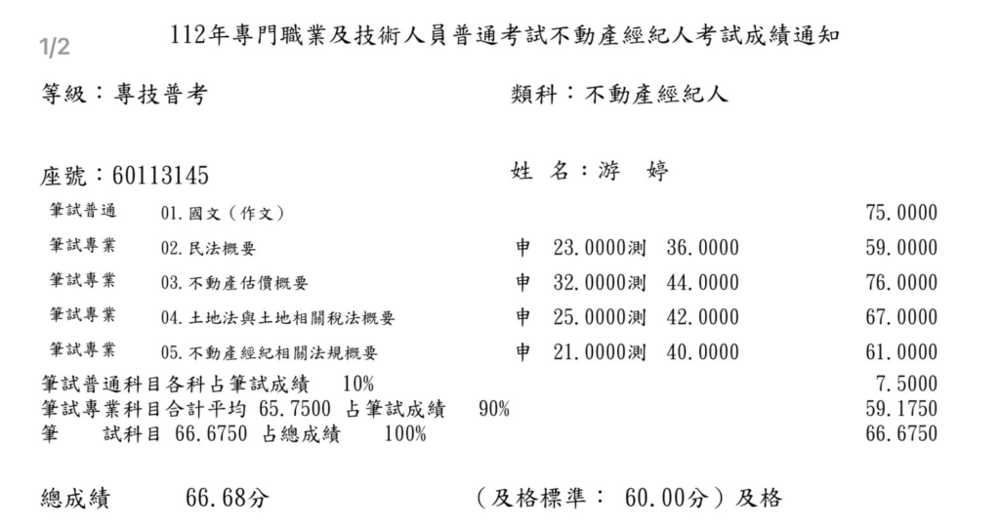

> 一、前言 挑戰第二次終於合格了，雖然不是

<h2 class="wp-block-heading">一、前言</h2>

挑戰第二次終於合格了，雖然不是前幾名但名字還在第一頁上XD

沒有最棒的唸書方式，只有最適合自己的方式。以下分享供參考～

本身背景非本科系畢業，只是一個日文講得還不錯的普通上班族。工作上跟房地產有相關，但平常工作不會在那邊看法條，想著除了日文專長以外也想多一個可以拿出手的證照，所以開始踏上備考之路。

<h2 class="wp-block-heading">二、在職備考與時間安排</h2>

兩次準備考試都是邊上班邊準備，在職準備考試時間分配很重要，上班族就9個小時都綁在公司了。

因為第一次考試只準備了3個月，也不是很認真準備，有點試試看的心態，後來決定再考第二次，決心一定要及格考上。又再次上網找了許多資訊，因緣際會找到Jasper團隊，6月底左右買了課程後，大概到出國玩回來7月中旬開始準備11月的考試，差不多4個月的時間。

唸書準備方式則是依照Jasper團隊一對一諮詢後排了一版讀書計畫，邊上班，下班後或假日還要轉換成考生模式不能出門吃喝玩樂，或是在家裡看劇發呆耍廢真的滿痛苦的（畢竟上班就很痛苦了啊！）

所以一開始的一個月，我是只有六日其中一天拿來唸書，另一天給自己放鬆。然後慢慢每天增加唸書時間，從下班後唸1小時，到2小時，假日只唸一天，調整到連假通通都在唸書。從只有下班通勤時30分鐘複習聽課程到連上班30分鐘也在聽，或是用APP多複習幾次選擇題，甚至在健身房跑步時、一個人吃早餐或午餐時也在複習聽課程，變成生活的一部分，就比較沒那麼痛苦。

<h2 class="wp-block-heading">三、筆記整理與讀書會問答</h2>

我第一次聽課程時，我是每頁每頁PPT都用手抄下來到自己的筆記本，日後複習都發揮了很大的功效。在求學過程中其實我就知道自己屬於要透過寫字這個時間好好讓大腦慢慢理解的類型，我覺得這是一個讓自己靜下心消化吸收的時間（雖然不是一個高效率的方式）。

所以我光上完4個考科我就花費很多時間，因為我需要一直暫停抄寫。但這也有個好處，因為後期我開始練習申論題時，就覺得自己寫字速度有練上來，還有就是比較耐寫，可以寫比較多比較久。（跟群組的同學們比較）

練習歷屆選擇題 Jasper 的線上LINE問答群組也發揮了很大的幫助，除了24小時給你問以外，也可以藉由別人問問題自己試著回答，老師除了回答原本提問的同學，也會確認協助回答的同學回答內容是否正確。運用零碎的時間看讀書會社群其實對複習考試也有很大的幫助，老師們都超有耐心，還真的24小時，因為半夜回答問題的都有XD

<h2 class="wp-block-heading">四、弱科加強與考前複習</h2>

第一年民法跟土法是弱科，所以我第二年比較加強心力在這邊，零碎複習時間通常都是聽民法或土法。聽膩了累了才拿來背誦估價公式或是經紀法規口訣等等，真的太累就休息！

選擇題錯誤的、自認這題是矇對的，也通通把解析抄到筆記本，甚至線上老師解題額外說明我也通通寫進去，所以後期衝刺階段跟考試當天我都是在看自己的筆記本，不帶任何參考書。

<h2 class="wp-block-heading">五、結語</h2>

套句老師們說的：準備考試很辛苦，但這場考試是及格制而且是普考。只要考到60分，大家都可以拿證照！你的決心有多大，自制力就會有多強，希望大家也能夠順利金榜題名！

<figure class="wp-block-image size-large"><noscript></noscript></figure>

　

<h3 class="wp-block-heading has-black-color has-text-color" id="免費諮詢">．延伸閱讀</h3>

<a href="https://www.jasper-realestate.com/01-%e4%b8%8d%e5%8b%95%e7%94%a2%e7%b6%93%e7%b4%80%e4%ba%ba-%e8%ad%89%e7%85%a7%e4%bb%8b%e7%b4%b9%e5%84%aa%e5%8b%a2/">01 不動產經紀人｜證照介紹 &amp; 優勢</a>

<a href="https://www.jasper-realestate.com/02-%e4%b8%8d%e5%8b%95%e7%94%a2%e7%b6%93%e7%b4%80%e4%ba%ba%e8%80%83%e8%a9%a6%e8%b3%87%e8%a8%8a%e5%85%a8%e4%bb%8b%e7%b4%b9/">02 不動產經紀人｜考試資訊全介紹</a>

<h3 class="wp-block-heading has-text-color has-link-color wp-elements-d10c350b558dd32c6d9de8a3a9846b08" id="免費諮詢" style="color:#ffffff;font-size:9px"><a data-id="https://line.me/R/ti/p/%40851hgrwp" data-type="URL" href="https://line.me/R/ti/p/%40851hgrwp" rel="noreferrer noopener" target="_blank">Line 官方帳號</a>｜<a data-id="https://www.facebook.com/Jasper-%E4%B8%8D%E5%8B%95%E7%94%A2%E7%B6%93%E7%B4%80%E4%BA%BA%E8%80%83%E8%A9%A6%E8%BC%94%E5%B0%8E%E5%93%A1-104204235060276/" data-type="URL" href="https://www.facebook.com/Jasper-%E4%B8%8D%E5%8B%95%E7%94%A2%E7%B6%93%E7%B4%80%E4%BA%BA%E8%80%83%E8%A9%A6%E8%BC%94%E5%B0%8E%E5%93%A1-104204235060276/" rel="noreferrer noopener" target="_blank">Facebook 粉絲專頁</a></h3>

