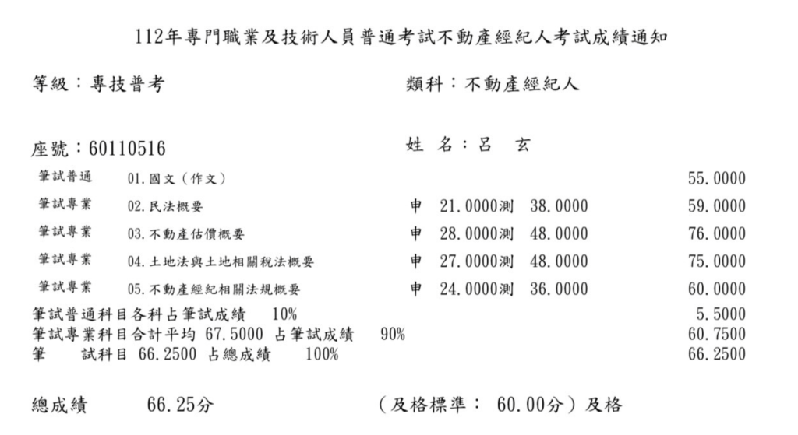

> 一、前言 我是一個非本科系的考生，對於不

<h2 class="wp-block-heading">一、前言</h2>

我是一個非本科系的考生，對於不動產也是一個小白，但是自從買房子後為了要了解自己要繳的稅，跟如何才能節稅，才開始注意到地政士及不動產經紀人的考試，才發現這真的是一門大學問，也有幸在第一次考不動產經紀人考試就上榜，真的非常幸運！在這邊分享一些心得，也分給大家我的運氣！

去年我有考過地政士，但被教訓的非常慘…

<h2 class="wp-block-heading">二、學習資源與讀書計畫</h2>

八月放榜時直接學乖了，直接決定上網找補習班幫助，後來看到比較了幾家後，選擇了找Jasper 地政士&amp;不動產經紀人考試輔導員幫助，還記得地政士剛放完榜，我瘋狂在網路上搜尋，聯絡官方LINE後，馬上就有人回應，那可是晚上10點阿！後來Jasper本人來跟我聯繫，還親自通話跟我分析我該如何做，在那個不安的狀況下真的是盞明燈，本來只打算報名地政士的課程，想說自己可以自學考過不動產經紀人考試，但現在的我真的很慶幸有一起準備！

對我來說最大的幫助就是讀書計畫的安排，因為我其實根本沒安排過讀書計畫，正確來說是不知道怎麼安排，老師給了我很多方向，讓我一步一步學習如何規劃，真的在知道每天要做什麼的時候，照著進度推進，會進步得很快，而且配合作息也可以自己調整狀況

像我自己就有本筆記本，記錄我每天要做什麼，如果完成我就會打勾，這樣也可以提醒自己有沒有達成每天的進度，當然也會有做不完的時候，就是要分配到後面的時間，但盡量不要脫超過一個禮拜，不然會直接拖延症發作…

另外我覺得讀書會群組也幫助很大，一開始不太敢發問，但是看到上面都會有老師立刻幫忙解答，重點是就算很笨的問題老師也不會嫌棄，一樣很有耐心解答，而剛開始學習也一定有很多問題，只要你敢問就會有人回答，到後期可以自己試著回答其他同學的問題，我想這才是檢視自己有沒有讀通的方式，而且如果別人的問題自己也不會，也是賺到！

<h2 class="wp-block-heading">三、不動產經紀人各科準備方式</h2>

這次我的申論題自認為沒有很理想，唯一可分享的是選擇題，下面一一分享我的準備方式：

<h3 class="wp-block-heading">1. 民法</h3>

本身沒有什麼民法基礎，這次我是聽從老師的意見，先從老師分享的書單找，再配合課程及講義，效率會好很多，如果有不懂的還可以群組發問，民法申論題真的需要長期累積，選擇題的部分就是理解概念後再多做考古題，就會知道考點。

<h3 class="wp-block-heading">2. 不動產估價概要</h3>

理解公式並背好，計算題就會是送分題，然後考古題一定是必寫的，最好寫近10年，考點都大同小異。

<h3 class="wp-block-heading">3. 不動產經紀相關法規概要</h3>

這科也是一樣背就對了，總共四個主要法規，但一定要注意考選部的考綱，有的會考細則，也要一併準備，還有要記得看不動產說明書及相關契約書之應記載及不得記載事項。

<h3 class="wp-block-heading">4. 土地法與土地稅法</h3>

Erin老師的講義及課程裡面其實架構跟關係都很詳細，土地法一定要理解架構，再來背誦，每一個法規都是環環相扣的，土地稅法就是背熟，還有一定要注意時事，譬如今年的房屋稅修正。

<h2 class="wp-block-heading">四、結語</h2>

最後還是要給大家幸運及信心，認不認真只有自己知道，要非常努力才會顯得豪不費力！我相信大部分成功的人背後一定有我們看不到的努力，用盡全力才能不辜負當初努力的自己，祝福大家未來都能金榜題名！

<figure class="wp-block-image size-large"><noscript></noscript></figure>

　

<h3 class="wp-block-heading has-black-color has-text-color" id="免費諮詢">．延伸閱讀</h3>

<a href="https://www.jasper-realestate.com/01-%e4%b8%8d%e5%8b%95%e7%94%a2%e7%b6%93%e7%b4%80%e4%ba%ba-%e8%ad%89%e7%85%a7%e4%bb%8b%e7%b4%b9%e5%84%aa%e5%8b%a2/">01 不動產經紀人｜證照介紹 &amp; 優勢</a>

<a href="https://www.jasper-realestate.com/02-%e4%b8%8d%e5%8b%95%e7%94%a2%e7%b6%93%e7%b4%80%e4%ba%ba%e8%80%83%e8%a9%a6%e8%b3%87%e8%a8%8a%e5%85%a8%e4%bb%8b%e7%b4%b9/">02 不動產經紀人｜考試資訊全介紹</a>

<h3 class="wp-block-heading has-text-color has-link-color wp-elements-d10c350b558dd32c6d9de8a3a9846b08" id="免費諮詢" style="color:#ffffff;font-size:9px"><a data-id="https://line.me/R/ti/p/%40851hgrwp" data-type="URL" href="https://line.me/R/ti/p/%40851hgrwp" rel="noreferrer noopener" target="_blank">Line 官方帳號</a>｜<a data-id="https://www.facebook.com/Jasper-%E4%B8%8D%E5%8B%95%E7%94%A2%E7%B6%93%E7%B4%80%E4%BA%BA%E8%80%83%E8%A9%A6%E8%BC%94%E5%B0%8E%E5%93%A1-104204235060276/" data-type="URL" href="https://www.facebook.com/Jasper-%E4%B8%8D%E5%8B%95%E7%94%A2%E7%B6%93%E7%B4%80%E4%BA%BA%E8%80%83%E8%A9%A6%E8%BC%94%E5%B0%8E%E5%93%A1-104204235060276/" rel="noreferrer noopener" target="_blank">Facebook 粉絲專頁</a></h3>

