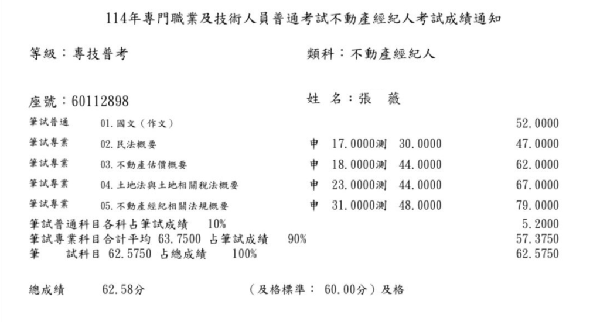

> 一、背景及動機 我原來只是對租賃市場有興

<h2 class="wp-block-heading">一、背景及動機</h2>

我原來只是對租賃市場有興趣，而去參加租賃住宅管理人員專業訓練並取得證照，從周遭同學的背景—有不動產經紀人、地政士及律師等等，進而讓我動心起念想取得不動產經紀人證照，上網搜尋在 Dcard 看到前輩們推薦的 Jasper 地政士&amp;不動產經紀考試輔導員線上課程，於是一口氣買了雙課程。

<h2 class="wp-block-heading">二、備考過程—不去想考不考得上，只專心在當下</h2>

在購課當下（113年10月份）因不動產經紀人早已結束報名，所以改從地政士課程開始看，也只有在買下的前兩個月看課，後來因事務繁忙，備考生活呈現放棄狀態，整個放空超過半年，努力說服自己太難了，不要考了．．．一直到不動產經紀人考試開始接受報名的新聞出現，才驚覺應該先報名，再考慮要不要考，於是報了名也繳了報名費，再告訴自己什麼都不要想，專心看課，起碼不要浪費課程費用，於是打開電腦，認真備考的日子正式起動。

距離考試日期算算只剩三個月，點進 Jasper 網站開始努力看不動產經紀人課程，所有科目都調加速，計劃兩個月看完，最後一個月做題目，但經過約一個月，還是一直心荒，覺得什麼都沒唸進去，很不踏實，於是先買了近十年的選擇題題庫邊上課、邊練習做題目，一開始挫折很大，因大部分沒唸過，答案都是錯的。

後來慢慢上到後面的課程，發現老師講的內容，題目都曾出現，印象就會加深一點，就這樣邊上課、邊做題目又經過一個月，將整整十年的選擇題做了兩遍，最後一個月則買了阿摩線上測驗，用隨機測驗合併解題功能，紮紮實實地練習到看到題目大概就知道答案的程度，並將錯題Key word及觀念手寫下來記在便條本上。

這個小本本在考場上，發揮極大效益，將容易搞混、常忘及熱門的法條或內容，在複習的短時間內補進腦袋，這樣的成果也反映在除了民法的選擇題分數上，最多只被扣6分。

<h2 class="wp-block-heading">三、不動產經紀人各科準備心得—從選擇題出發</h2>

<h3 class="wp-block-heading">1. 民法</h3>

因我的分數不算高，只能大概說一下我的方式，給各位參考，申論題部分，主要是用看的，先掌握內容大綱，各篇再用實例題看熟重點題目解法，Jasper推薦給初學者的–陳聰富老師民法概要是很棒的工具書；選擇題部分，雖然近十年題目做得很熟，還是不抵今年的題目刁鑽，但基本分數還是有的。

<h3 class="wp-block-heading">2. 土地法與土地相關稅法概要、不動產估價概要、不動產經紀相關法規概要</h3>

主要專注在做選擇題，從選擇題及題解去唸去背法條，往往從一題選擇題可以延伸許多重要內容，申論題部分雖沒練習，但基礎完全是從這裡來的。

<h3 class="wp-block-heading">3. 國文</h3>

平時看小說的養分，能用的全用上了，分數不高也不低，就剛剛好可以助我及格。從考試中到考完，一直覺得自己會考不上，明年得再重來，所以考完仍持續做選擇題，怕好不容易練習成『看到題目就知答案』的功力會消失，雖然一個月後還是怠惰了！

<h2 class="wp-block-heading">三、結語</h2>

所幸成績發表通過了，心中很雀躍也很意外，感謝 Jasper 團隊全體老師的幫助，讓我可以從不動產的門外漢，進而有踏實的基礎，短時間進入狀態！

希望我這小小的分享，可以幫助到其他同學們。

<figure class="wp-block-image size-large"><noscript></noscript></figure>

　

<h3 class="wp-block-heading has-black-color has-text-color" id="免費諮詢">．延伸閱讀</h3>

<a href="https://www.jasper-realestate.com/01-%e4%b8%8d%e5%8b%95%e7%94%a2%e7%b6%93%e7%b4%80%e4%ba%ba-%e8%ad%89%e7%85%a7%e4%bb%8b%e7%b4%b9%e5%84%aa%e5%8b%a2/">01 不動產經紀人｜證照介紹 &amp; 優勢</a>

<a href="https://www.jasper-realestate.com/02-%e4%b8%8d%e5%8b%95%e7%94%a2%e7%b6%93%e7%b4%80%e4%ba%ba%e8%80%83%e8%a9%a6%e8%b3%87%e8%a8%8a%e5%85%a8%e4%bb%8b%e7%b4%b9/">02 不動產經紀人｜考試資訊全介紹</a>

<h3 class="wp-block-heading has-text-color has-link-color wp-elements-d10c350b558dd32c6d9de8a3a9846b08" id="免費諮詢" style="color:#ffffff;font-size:9px"><a data-id="https://line.me/R/ti/p/%40851hgrwp" data-type="URL" href="https://line.me/R/ti/p/%40851hgrwp" rel="noreferrer noopener" target="_blank">Line 官方帳號</a>｜<a data-id="https://www.facebook.com/Jasper-%E4%B8%8D%E5%8B%95%E7%94%A2%E7%B6%93%E7%B4%80%E4%BA%BA%E8%80%83%E8%A9%A6%E8%BC%94%E5%B0%8E%E5%93%A1-104204235060276/" data-type="URL" href="https://www.facebook.com/Jasper-%E4%B8%8D%E5%8B%95%E7%94%A2%E7%B6%93%E7%B4%80%E4%BA%BA%E8%80%83%E8%A9%A6%E8%BC%94%E5%B0%8E%E5%93%A1-104204235060276/" rel="noreferrer noopener" target="_blank">Facebook 粉絲專頁</a></h3>

