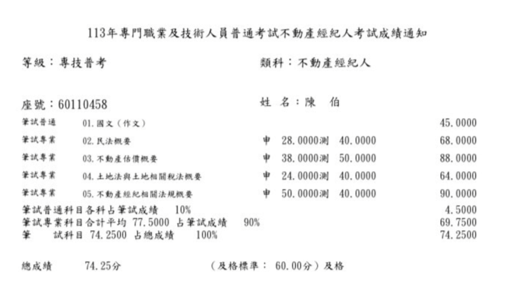

> 一、前言 不曉得大家知不知道這張證照的「

<h2 class="wp-block-heading">一、前言</h2>

不曉得大家知不知道這張證照的「含金量」有多高呢？

領照後出租以及加薪的行情，現在一個月約莫在8000~12000不等，而以每年計算的話，這張證照至少能夠讓你在每年加薪10萬元

說實話，考取這張證照不外乎就是想增加自己的收入，而另一方面也可以讓公司以及客戶更信賴你，讓你在生活上以及職場上過得更順利。因此我認為，只要是相關行業的人士，都非常適合來考取這張證照，讓自己的生活順利、專業加分

<h2 class="wp-block-heading">二、個人背景</h2>

私立大學財金系畢業（非本科）、零基礎，由於本身在求學時期，並沒有很努力、只顧著及時行樂，也因此沒有一個好的大學學歷

但在即將步入社會的前幾年，逐漸意識到學歷是塊敲門磚，若是沒有好的學歷，自然而然會在剛進入職場的階段被打上一個大大的問號，因此我決定用「證照」來證明自己並不是個笨蛋

讀書這件事很重要，尤其是在房地產這個充滿專業知識以及法規的市場上，如果不喜歡讀書，那請用其他方式證明自己，可以是專業技能的培養，也可以是多元證照的考取，或者是做到他人不想做、懶得做，甚至做不到的服務內容

<h2 class="wp-block-heading">三、學習資源</h2>

這次陪伴我度過考試的是 Jasper 地政士&amp;不動產經紀人考試輔導員的線上課程，當初選擇的理由有以下幾點：

<h3 class="wp-block-heading">1. 課程內容較多為重點章節</h3>

這一點可以幫助我聚焦在這場考試當中真正重要的章節上面，而並非雜亂無章的死嗑全部的內容，或許有些人會認為內容太過簡略，但我並不那樣覺得，反而很喜歡這樣的教學方式

不曉得大家有沒有聽過80/20法則？往往20%的因素，才是影響80%結果的關鍵

而近期剛好在閱讀《成功，從聚焦一件事開始》這本書，剛好也有提到這個概念，所以內容的多寡並非是選擇的重點，而是在於你能不能夠把這些內容讀到滾瓜爛熟

<h3 class="wp-block-heading">2. 讀書會群組</h3>

Jasper另一個廣為人知的特色，就是擁有一個「隨時問到飽」的讀書會群組，由於特別耗時、耗人力，因此我相信這是目前市面上所有補習班都沒辦法做到的一個項目

在群組提問時，會有許多老師隨時解答你的問題，無論是有關於考試或是延伸於考試外的問題，基本上老師都會運用實務上的經驗以及教學的能力，去詳盡的解答

而待在群組也能時常知道，與你相同的備考生，現在正面臨著什麼問題，也能藉由別人不熟悉的問題來增添自己的印象

在此也要特別感謝讀書會的老師們，我朝九晚五的詢問問題，至少長達了6個月&gt;&lt;

<h3 class="wp-block-heading">3. 一對一的諮詢服務</h3>

這對我來說，真的是受益最大的特色了，我自己本身在備考時，由一開始的充滿鬥志變為中途的焦慮恐慌，再到後來的堅信自己一定會上榜，這段過程都擁有老師陪伴著，真的很感謝

我自己利用諮詢服務做了以下的事情，可以供給你們參考：

(1)確認當前目標、擬定屬於自己的讀書計畫

這一點我認為非常重要，因為如果你沒有一個合適的讀書計畫，甚至不知道當月、當週、當天的目標是什麼的時候，就等同於盲目的在看書，這樣沒有明確目標的方式，會導致你花費更多的時間和精力，卻只換到相同或是較差的結果。因此我建議所有考生，都要確實擬定好概略方向的讀書計畫，然後在實際執行過程中，再慢慢進行微調

(2)心態調適，讓自己的情緒穩定，持續努力

備考的過程中，難免會經歷很多情緒上的問題，可以透過諮詢服務來尋求老師的建議或是鼓勵，我認為這對我來說也是非常重要的一件事

<h2 class="wp-block-heading">四、不動產經紀人各科準備方式</h2>

好啦！前面的廢話很多、很囉唆，來進入重點吧！

我每個科目至少地毯式複習3遍，而重要的章節複習了至少10遍以上。我打從一開始就沒有想要把任何一個科目拋棄的念頭，，因為我認為拋棄了一個地方，這個習慣可能就會一直持續下去，抱持著一次就要上榜的心態，每一個科目、每一個章節，對於我來說都同等重要

<h3 class="wp-block-heading">1. 民法概要（大魔王）</h3>

民法範圍較廣、較深，對於我們這種零基礎的小白來說特別吃力，尤其是一開始我在準備的時候，不過我認為備考的同學也不需要太過擔憂，只要好好的讀，把該釐清的觀念搞懂，在面對考試時也能獲得基本的分數

<h3 class="wp-block-heading">2. 土地法與土地相關稅法概要（小魔王）</h3>

土地法的範圍次廣，且概念與民法多有關連，因此也並不是太輕鬆，而且稅法也有分很多種，而我在備考過程當中，花最多時間以及精力的就是在這，但最後的成績卻並非如我預期，不過也因為觀念與民法類似，因此多屬於背誦科目

而稅法雖然很多種類，但只要釐清觀念，稅法反而是能夠取分的關鍵

<h3 class="wp-block-heading">3. 不動產估價概要（啦啦隊1號）</h3>

由於我本人是財金系畢業的，而自己也對投資非常有興趣，但剛開始接觸這個科目的時候，反而很想放棄，一大堆的專有名詞以及估價程序，讓當時的我想跑回去民法以及土地法的懷抱&gt;&lt;

我那時候告訴自己：「不要給我在那邊想東想西，全部都給我背起來就對了！」最簡單的事情，莫過於是全部都給我背起來？因為只要知道全部都很重要，那就沒有其他理由和藉口了(づ￣ 3￣)づ

雖然「全部背起來」聽起來很像在講廢話，沒什麼幫助，但這個科目真的是Cp值最高的，全部的法規也就133條（相當於民法的1/10），那麼少的內容，卻可以獲得與民法、土法相同的分數，難道這樣的科目你不全部背起來嗎？內容對於多數人來說不一定很討喜，但這也卻是最值得花時間以及心力的地方，加油！

<h3 class="wp-block-heading">4. 不動產經紀相關法規概要（啦啦隊2號）</h3>

經紀法規，由於法條內容在實務上也會常常碰到，甚至一些營業員證書、經紀業應揭示的文件，以及公平交易法、消費者保護法的程序，都與生活息息相關，我相信這是大多數人最喜愛的一個科目，該怎麼準備呢？也是老樣子，大多數都是需要背誦

但我這邊非常推薦在遇到複雜的程序辦法、處理過程時，把這些順序〈自己畫圖〉，以圖片的方式去做記憶，我自己認為會非常有幫助，簡單來說，這個科目也是保持著”全部背起來”的概念

<h2 class="wp-block-heading">五、檢討的方式</h2>

我特別想把關於「檢討」這件事拉出來說，我認為這是我最後能夠考到好成績的關鍵因素，所以想把這個經驗分享給大家，這個方式在Jaspe的課程當中有提到，也就是”製作專屬於自己的考前筆記”

在讀完課程過後，我們一定要去練習歷屆試題，而在練習題目的時候，一定要把每個題目、每個選項都搞懂，並且搞清楚每一個題目是要考哪些概念

而自己錯誤的題目，都一定要把它好好地記錄在自己的考前筆記上，並且「每天」都要重新複習一次！我自己是建議把選項抄下來，並且附上正確的答案，然後再把相關的法條、概念寫在一旁，甚至你也可以寫下自己當初為什麼會寫錯

這個過程在一開始的時候會比較輕鬆，而隨著寫的題目越來越多的時候，你會發現這根本是一場惡夢b(￣▽￣)d

由於寫下來的筆記，每天都需要重新翻閱過一遍，我到考前一個月左右的時候，每個科目至少記錄了將近150題，而每天都需要複習一遍，相當於每天要重新複習150*4個題目，也就是600題，這樣的方式將會花費你非常大量的時間和精神，但成效卻顯而易見

讀書不是比誰當下記得快、記得多，而是比誰可以記得久、堅持得久

<h2 class="wp-block-heading">六、總結</h2>

不動產經紀人這張證照，我認為背誦的占比非常大，因此我相信只要肯花時間、花心力去好好準備，每個人一定都有上榜的能力，不需要為自己找藉口，合格的前輩們也有許多人都早已成家立業且年紀較長，因此過去在求學時期考取的成績以及年齡，都不該成為逃避的藉口。

真的想要獲得甜美的果實，就從現在開始好好栽種屬於你自己的小苗，好好地想清楚自己的目標，並且用盡全力地達成與目標關聯的每一件小事

明年的這個時候，就是換你來發文了！

<figure class="wp-block-image size-large"><noscript></noscript></figure>

　

<h3 class="wp-block-heading has-black-color has-text-color" id="免費諮詢">．延伸閱讀</h3>

<a href="https://www.jasper-realestate.com/01-%e4%b8%8d%e5%8b%95%e7%94%a2%e7%b6%93%e7%b4%80%e4%ba%ba-%e8%ad%89%e7%85%a7%e4%bb%8b%e7%b4%b9%e5%84%aa%e5%8b%a2/">01 不動產經紀人｜證照介紹 &amp; 優勢</a>

<a href="https://www.jasper-realestate.com/02-%e4%b8%8d%e5%8b%95%e7%94%a2%e7%b6%93%e7%b4%80%e4%ba%ba%e8%80%83%e8%a9%a6%e8%b3%87%e8%a8%8a%e5%85%a8%e4%bb%8b%e7%b4%b9/">02 不動產經紀人｜考試資訊全介紹</a>

<h3 class="wp-block-heading has-text-color has-link-color wp-elements-d10c350b558dd32c6d9de8a3a9846b08" id="免費諮詢" style="color:#ffffff;font-size:9px"><a data-id="https://line.me/R/ti/p/%40851hgrwp" data-type="URL" href="https://line.me/R/ti/p/%40851hgrwp" rel="noreferrer noopener" target="_blank">Line 官方帳號</a>｜<a data-id="https://www.facebook.com/Jasper-%E4%B8%8D%E5%8B%95%E7%94%A2%E7%B6%93%E7%B4%80%E4%BA%BA%E8%80%83%E8%A9%A6%E8%BC%94%E5%B0%8E%E5%93%A1-104204235060276/" data-type="URL" href="https://www.facebook.com/Jasper-%E4%B8%8D%E5%8B%95%E7%94%A2%E7%B6%93%E7%B4%80%E4%BA%BA%E8%80%83%E8%A9%A6%E8%BC%94%E5%B0%8E%E5%93%A1-104204235060276/" rel="noreferrer noopener" target="_blank">Facebook 粉絲專頁</a></h3>

