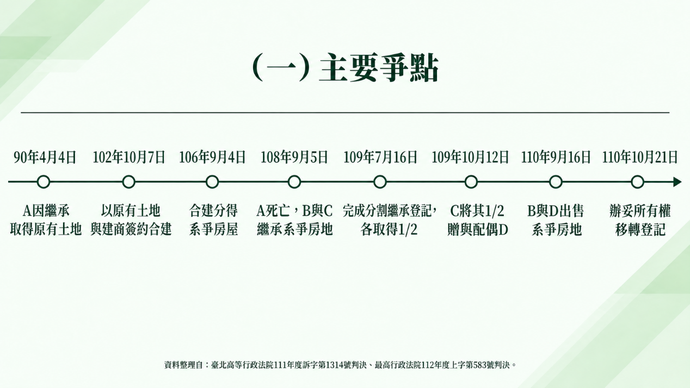
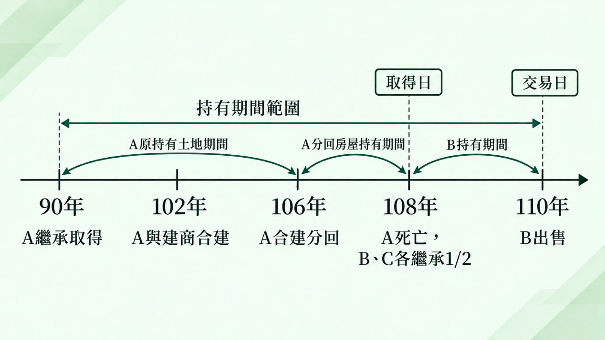

# 主題精選：合建分屋

共收錄 1 篇文章。

## 1. 繼承合建分回的房屋，為何房地合一稅可從35%降為15%？—合建分屋與繼承之持有期間計算
*發布日期: 2026-10-13* 

## 內文
各位同學好

本週專欄整理一個最高行政法院有關房地合一所得稅的判決，其涉及「合建分屋＋繼承」之持有期間計算問題。究竟繼承人出售被繼承人與建商合建分得的房屋時，能否將被繼承人原有土地的持有期間一併計算？最高行政法院對此有重要見解，非常值得瞭解及釐清觀念，茲整理如下：

• (一) 案例事實與爭點 90年4月4日，A因繼承取得土地 → 102年10月7日，A以該土地與建商簽約合建 → 106年9月4日，A因合建取得新建房屋 → 108年9月5日，A死亡，由子女B、C繼承房地 → 109年7月16日，B、C辦理分割繼承登記，各取得1/2 → 110年9月16日，B與另一共有人出售系爭房地，並於110年10月21日完成所有權移轉登記。

[圖片1]

本案房地出售總價為1,825萬元。其中，B出售其繼承取得的1/2持分，申報房地合一所得稅時，依持有期間超過10年，適用15%稅率，繳納稅額339,296元。然而，國稅局認為：

1. 土地部分：A於90年4月4日取得原有土地，雖然後來參與合建，仍可認定為原有土地的延伸，適用舊制，土地交易所得免納所得稅。

2. 房屋部分：A於106年9月4日才因合建取得新建房屋，B於108年9月5日繼承取得。因此，縱使合併A持有該房屋的期間，至110年10月21日出售時，仍屬持有超過2年、未逾5年，應適用35%稅率。

因此核定B出售房屋的課稅所得為2,260,453元，按35%計算應納稅額791,158元，扣除原已繳納稅額後，要求補稅451,862元。

綜上，本案主要爭點在於：B繼承的雖然是A於106年合建取得的房屋，但A原有土地早於90年即已取得，而且該土地亦係繼承而來。B能否主張，合建分屋本質上是原土地的替代或變形，故計算房屋持有期間時，應將A原有土地的持有期間，以及前手因繼承而可合併的期間，一併計算，適用超過10年的15%稅率？

• (二) 重要規定

1. 所得稅法第14條之4第4項：第4條之5第1項第1款及前項有關期間之規定，於繼承或受遺贈取得者，得將被繼承人或遺贈人持有期間合併計算。

2. 房地合一課徵所得稅申報作業要點第5點第2項：依本案適用規定，個人出售以自有土地與其他營利事業合建分屋所取得的房屋，依所得稅法第14條之4第3項計算房屋持有期間時，應以該土地的持有期間為準。 換言之，地主以原有土地與建商合建分得房屋，雖然房屋是後來才興建完成，但計算房地合一稅持有期間時，並非一律以新建房屋的取得日為起算點，而得以原有土地的持有期間為準。

3. 房地合一課徵所得稅申報作業要點第4點有關取得日之認定（本案行為時為第2款第7目、第9目；現行條文為第9款、第14款）：(1)原土地所有權人以自有土地與營利事業合建分屋，分配取得的土地，原則上以原取得合建前土地之日為取得日。(2)繼承取得的房屋、土地，以繼承開始日為取得日。

4. 財政部112年11月2日台財稅字第11204619060號令：個人交易105年1月1日以後繼承或受遺贈取得的房地，依所得稅法第14條之4第4項計算持有期間，如屬連續繼承或受遺贈取得，得將連續各次繼承或受遺贈之被繼承人或遺贈人的持有期間合併計算。

5. 財政部104年8月19日台財稅字第10404620870號令：交易之房屋、土地係被繼承人於104年12月31日以前取得，且納稅義務人於105年1月1日以後繼承取得者，以目的性限縮解釋排除適用新制。

• (三) 法院判決理由

1. 臺北高等行政法院111年度訴字第1314號判決 原審法院認為，A於106年9月4日因合建取得系爭房屋，B則於108年9月5日因繼承取得。依房地合一課徵所得稅申報作業要點第5點第1項第1款規定，B固然得合併計算被繼承人A的持有期間，但該期間應以A實際取得系爭房屋之日，即106年9月4日起算。 至於合建分屋可以原有土地持有期間計算之規定，原審認為係針對參與合建的地主本人，B並非原參與合建者，不能直接主張適用。因此，原審認定B出售系爭房屋的持有期間為超過2年、未逾5年，國稅局適用35%稅率並無違誤，判決駁回B之訴。

2. 最高行政法院112年度上字第583號判決 最高行政法院則採取不同見解，其理由主要如下：(1)合建分得的房屋，具有原有土地替代或變形的性質 地主以自有土地與建商合建，通常係以部分土地交換建商興建完成的房屋。因此，合建所分得的房屋，實質上是以原有土地交換而來，具有原土地替代或變形的性質，學說上亦有稱為「代位物」者。基於此種性質，地主取得合建分回的房屋，並非短期炒作不動產，故計算房屋持有期間時，應以其原有土地的持有期間為準。(2)繼承人應得承受被繼承人的持有期間利益 所得稅法第14條之4第4項允許繼承人合併計算被繼承人的持有期間，係因繼承並非人為控制所得實現的行為，原則上不存在短期炒作房地產的疑慮。同時，依民法第1148條第1項及概括繼承法理，繼承人原則上承受被繼承人財產上的權利義務，因此亦應得承受被繼承人生前持有房地的期間利益。(3)合建分屋與繼承的持有期間計算規定，應予結合適用 最高行政法院認為，雖然房地合一課徵所得稅申報作業要點未明定「地主合建分屋後死亡，由繼承人出售該房屋」的持有期間應如何計算，但依所得稅法第14條之4第4項，以及申報作業要點第5點第1項第1款、第2項的規範意旨，應允許繼承人合併計算被繼承人原有土地的持有期間。因此，國稅局主張只有原地主本人出售合建分屋才能適用，而繼承人不得適用，與前述規範意旨不符，難以採納。

• (四) 曾老師整理說明 首先，本案要區分「取得日」與「持有期間」二個不同的概念。本案A原有土地於90年4月4日繼承取得，而合建分得的房屋則於106年取得。嗣後B於108年因繼承取得系爭房屋，故B在稅法上的房屋取得日，仍為108年9月5日的繼承開始日。 然而，房屋取得日為108年，並不代表計算持有期間時，只能從108年起算。其次，如果A於106年取得合建分回的房屋後自行出售，依申報作業要點第5點第2項規定，計算房屋持有期間時，得以其原有土地的持有期間為準，也就是可以追溯至90年4月4日，而非僅從106年取得新建房屋時開始計算。 本案較特殊之處，在於A並未出售房屋，而是死亡後由B繼承，再由B出售。依最高行政法院見解，既然B是概括繼承A的財產，而A持有合建分屋的期間原本即可追溯至原有土地的持有期間，則B也應承受這項持有期間利益，不應因為A死亡、改由B繼承出售，就將持有期間重新限縮至106年取得房屋之日。 再者，本案A於90年取得原有土地，本身也是因繼承而來。最高行政法院並進一步參酌財政部112年令有關連續繼承持有期間得合併計算的意旨，認為尚得併計A於90年繼承土地以前，被繼承人的持有期間（此部分對本案結論並非必要，但顯示法院認為合建代位與連續繼承兩項規定可以疊加適用）。因此，本案在持有期間的計算，包含以下二個重要觀念，且二項規定可以結合適用，而非相互排斥：

1. 合建分屋：以原有土地的持有期間計算新建房屋的持有期間。

2. 繼承取得：繼承人得合併計算被繼承人的持有期間，並承受前述合建分屋所形成的期間利益。

不過，仍須注意，本案最高行政法院並非認定B繼承取得的房屋可直接改按90年的取得日適用舊制。系爭房屋仍屬房地合一稅新制的課稅範圍，只是計算新制稅率所需的「持有期間」時，可以往前合併計算。

[圖片2]

• (五) 結果 最高行政法院認定，系爭房屋雖然是A於106年合建取得，B於108年繼承取得，但計算房地合一稅持有期間時，應合併計算A原有土地的持有期間，以及依法得併計的連續繼承期間。 依此計算，截至110年10月21日出售時，B的房屋持有期間已超過20年（單以A於90年4月4日取得原有土地起算，至110年10月21日出售時已逾20年；若再依112年令併計A繼承前被繼承人的持有期間，期間更長。無論如何均超過10年，適用15%稅率），符合所得稅法第14條之4第3項第1款第4目持有期間超過10年、適用15%稅率的規定，不必補繳451,862元。

資料來源：最高行政法院114年2月12日112年度上字第583號判決；臺北高等行政法院111年度訴字第1314號判決

## 文章圖片

---
*注：本文圖片存放於 ./images/ 目錄下*

