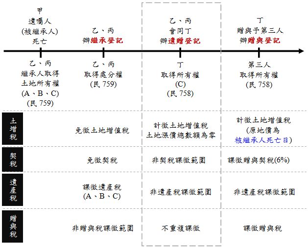

# 主題精選：遺產及贈與稅法

共收錄 4 篇文章。

## 1. 死亡前2年內贈與併計遺產，受贈人改按比例負擔遺產稅
*發布日期: 2026-10-20* 

## 內文
一名年僅6歲的女童，實際繼承約1,567萬元遺產，卻遭國稅局核定高達5,735萬元的遺產稅！原因是父親生前將價值3億餘元的股票贈與配偶，死亡後配偶及其他子女均拋棄繼承，導致未取得該筆股票的女童，反而須承擔因股票併計遺產所產生的稅負。

這起爭議最終促成憲法法庭113年憲判字第11號判決，並推動《遺產及贈與稅法》修正。

總統於115年9月11日修正公布《遺產及贈與稅法》部分條文，其中一項重要變革，就是明定被繼承人死亡前2年內贈與特定親屬、依法併入遺產總額課稅之財產，其對應的遺產稅額應由受贈人按比例負擔，不再全部由繼承人承擔。亦即重新劃分生前受贈人與繼承人的納稅義務。

此一修正對於不動產生前贈與、財產傳承與繼承稅務規劃，具有重要的實務意義。

• 一、舊制問題：擬制遺產的稅，究竟由誰負擔？依《遺產及贈與稅法》第15條第1項規定，被繼承人死亡前2年內贈與下列個人之財產，應於死亡時視為被繼承人之遺產，併入遺產總額課稅：

1. 被繼承人之配偶。

2. 民法第1138條及第1140條規定之各順序繼承人。

3. 前款各順序繼承人之配偶。

此即一般所稱的「擬制遺產」，主要目的在防止被繼承人於死亡前透過贈與移轉財產，規避遺產稅負擔。

惟應注意，財產被擬制為遺產，並不表示該財產在民法上重新成為被繼承人死亡時遺留的財產。擬制遺產係稅法上計算遺產總額的規定，與民法上的財產歸屬及繼承標的仍應區別。

問題在於，修法前第6條第1項規定，有遺囑執行人者，以遺囑執行人為遺產稅納稅義務人；無遺囑執行人者，則以繼承人及受遺贈人為納稅義務人。受贈人並不因受贈該財產，即當然成為遺產稅納稅義務人。

尤其配偶間相互贈與財產，依同法第20條第1項第6款規定，不計入贈與總額，因此可能發生：

1. 被繼承人生前將鉅額財產贈與配偶，配偶不因該筆贈與負擔贈與稅。

2. 被繼承人於贈與後2年內死亡，該筆財產依法併計遺產總額。

3. 倘受贈配偶又拋棄繼承，即可能使其他繼承人須以其繼承之財產，負擔因配偶受贈財產而增加的遺產稅。

換言之，取得財產者與負擔稅捐者並非同一人，形成租稅負擔與財產利益歸屬不一致的問題。

• 二、修法緣由：113年憲判字第11號揭示兩項違憲爭議憲法法庭於113年10月28日公告113年憲判字第11號判決，涉及兩個不同層次的擬制遺產課稅問題。

（一）受贈配偶與其他繼承人的遺產稅負擔不公平第一起案件中，陳姓被繼承人生前將價值3億餘元的股票贈與配偶，於贈與後2年內死亡。其配偶及三名婚生子女均拋棄繼承，最後由一名6歲非婚生女兒繼承遺產。該女童實際繼承財產約1,567萬元，但因前述股票須併入遺產總額，國稅局核定遺產稅高達5,735萬元。

憲法法庭認為，死亡前2年贈與配偶之財產，雖得依法擬制為遺產課稅，但對於受贈配偶與其他繼承人應如何負擔遺產稅，法律欠缺明確規範，致其他繼承人須以其繼承之財產，就配偶受贈所產生的財產增益負擔稅捐，在此範圍內不符憲法第7條保障平等權之意旨。其使繼承人繼承權之經濟價值嚴重減損者，並侵害憲法第15條保障之財產權。

（二）擬制遺產欠缺配偶剩餘財產差額分配請求權的相應扣除另一案件中，被繼承人於105年5月3日將土地贈與配偶，同年5月14日即死亡，死亡後該筆土地依法併入遺產總額課稅。然而，稅捐機關在計算配偶剩餘財產差額分配請求權扣除額時，並未相應將該筆擬制遺產納入計算，引發爭議。

憲法法庭認為，法律既將死亡前2年贈與配偶之財產視為遺產課稅，卻欠缺相當於《遺產及贈與稅法》第17條之1的剩餘財產差額分配請求權扣除規定，在此範圍內亦不符憲法第7條平等權保障意旨。

因此，本號判決實際揭示兩項重要問題：一是「擬制遺產產生的稅額應由誰負擔」，二是「擬制遺產應如何計算配偶剩餘財產差額分配請求權扣除額」。

需強調的是，憲法法庭並未否定死亡前2年贈與財產應併計遺產課稅的制度本身，而是要求立法者補足稅負分配及扣除額計算的規範。憲法法庭要求立法機關於判決公告日起2年內檢討修正，財政部先於114年7月28日發布稽徵作業處理原則，作為修法前的過渡措施，其後完成修法。

• 三、修法重點：受贈人按財產比例負擔遺產稅115年9月11日修正公布的《遺產及贈與稅法》，將第6條重新調整，增訂受贈人負擔擬制遺產稅額的規定，並另將原本納稅義務人之一「遺囑執行人」刪除，而改為得代辦相關稅務事項：

1. 第6條第1項：「遺產稅之納稅義務人為繼承人及受遺贈人，無繼承人者，為遺產管理人，並以被繼承人之遺產為限負繳納義務，遺產已移轉或滅失者，按被繼承人死亡時之時價負繳納義務。」

2. 第6條第3項：「依第十五條第一項併入被繼承人遺產總額課稅之受贈財產，按各受贈財產占遺產總額比例計算之遺產稅額，應以受贈人為納稅義務人，並以受贈財產為限負繳納義務，受贈財產已移轉或滅失者，按被繼承人死亡時之時價負繳納義務，不適用第一項規定。」

3. 第17條之1第2項：「依第15條第1項第1款併入遺產總額之配偶受贈財產，於計算剩餘財產差額分配請求權扣除數額時，視為被繼承人現存財產。同條第3項並規定，不得以該受贈財產作為履行給付義務之財產。」

這項規定並非僅限配偶，而是適用於第15條第1項所列的全部受贈對象，包括民法第1138條、第1140條所定各順序繼承人及其配偶。因此，父母死亡前2年贈與子女、孫子女或其他符合第15條規定的親屬，亦可能適用此一稅負分擔制度。

新法既然以受贈人身分作為課稅依據，受贈人即使拋棄繼承、喪失繼承權，或者本來就不是實際繼承遺產的人，也不因此免除第6條第3項的納稅義務。

此外，縱使受贈人於贈與人死亡前已將受贈不動產出售，仍須按被繼承人死亡時之時價負繳納義務。依第10條第3項，時價就土地為公告土地現值，房屋為評定標準價格，而非市價。

• 四、試算範例為具體說明新法，以下以配偶受贈土地為例（甲於115年死亡，依第12條之1規定，適用財政部公告115年發生之繼承案件適用金額）。

甲於115年11月死亡，遺有配偶乙，以及兩名成年子女丙、丁。甲死亡時，尚有其他遺產價值8,000萬元；另於死亡前1年，曾將一筆土地贈與配偶乙，該土地於甲死亡時的公告土地現值為2,000萬元。

依《遺產及贈與稅法》第15條規定，該筆土地須併入遺產總額課稅，因此： 遺產總額＝8,000萬元＋2,000萬元＝1億元。 配偶乙受贈財產占遺產總額的比例為： 2,000萬元÷10,000萬元＝20%。

以下採115年度遺產稅適用金額：免稅額1,333萬元、配偶扣除額553萬元、直系血親卑親屬扣除額每人56萬元、喪葬費扣除額138萬元。另為簡化計算，假設無其他財產、債務、扣除或稅額扣抵事項，且不考慮配偶剩餘財產差額分配請求權扣除額。比較乙未拋棄繼承及拋棄繼承兩種情形：

• T. ABLE_PLACEHOLDER_1

本例之情形B，因乙拋棄繼承，依第17條第2項規定，不得扣除配偶扣除額553萬元。乙仍以受贈人身分負擔擬制遺產稅額。

遺產稅額按115年度適用的累進稅率計算，課稅遺產淨額超過5,621萬元至1億1,242萬元部分，適用15%稅率 情形A：5,621×10%＋(7,864－5,621)×15%＝562.1＋336.45＝898.55萬元。 情形B：562.1＋(8,417－5,621)×15%＝562.1＋419.4＝981.5萬元。

情形A：配偶未拋棄繼承全案遺產稅額為898.55萬元，其中乙以受贈人身分負擔179.71萬元；其餘718.84萬元，由乙、丙、丁以繼承人身分共同負擔納稅義務。因此，乙具有受贈人與繼承人雙重身分，並不是只須繳納179.71萬元。

情形B：配偶拋棄繼承全案遺產稅額為981.50萬元，其中乙須以受贈人身分負擔196.30萬元；其餘785.20萬元，則由丙、丁以繼承人身分共同負擔。

若以修法前的一般納稅義務架構作制度比較，在沒有遺囑執行人的情況下，配偶乙拋棄繼承後，原可能由丙、丁共同承擔全案981.50萬元稅額（惟113年10月28日判決公告後，此一情形已不得再由其他繼承人負擔）；新法則將其中196.30萬元明定由受贈配偶乙負擔。

綜上，最重要的觀念：遺產稅仍先依整體遺產計算，再按照擬制遺產與其他遺產占遺產總額的比例，劃分受贈人及繼承人的納稅義務。

參考資料

1. 憲法法庭113年憲判字第11號判決，113年10月28日。

2. 財政部臺北國稅局：死亡前2年內贈與財產併計遺產課稅，已修法由「受贈人」按比例負擔稅額，115年10月16日。

3. 立法院法制局：生前贈與之擬制遺產課稅問題研析，113年11月。

4. 遺產及贈與稅法（115年9月11日修正公布）。

5. 財政部114年7月28日台財稅字第11404557320號令。

---
*注：本文圖片存放於 ./images/ 目錄下*

## 2. 遺產稅與贈與稅之信託權利價值計算
*發布日期: 2021-04-29* 

## 內文
各位同學好

遺產及贈與稅法第10條之1規定有信託利益之價值計算，本期專欄茲就「遺產稅」部分說明如下：

• 一、享有全部信託利益之權利者，該信託利益為金錢時，以信託金額為準，信託利益為金錢以外之財產時，以受益人死亡時信託財產之時價為準。

例如：

1. 甲信託給乙1000萬元，約定信託期間5年，全部信託利益交付給丙，則信託關係存續中當受益人丙死亡時，應就其享有信託利益之權利未領受部分，課徵遺產稅，其財產價值為1000萬元。

2. 甲信託給乙一筆土地，約定信託期間5年，並指定全部信託利益給丙，則當信託後第二年丙死亡，則應就該筆土地當年公告土地現值(假設500萬)課徵遺產稅。

• 二、享有孳息以外信託利益之權利者，該信託利益為金錢時，以信託金額按受益人死亡時起至受益時止之期間，依受益人死亡時郵政儲金匯業局一年期定期儲金固定利率複利折算現值計算之；信託利益為金錢以外之財產時，以受益人死亡時信託財產之時價，按受益人死亡時起至受益時止之期間，依受益人死亡時郵政儲金匯業局一年期定期儲金固定利率複利折算現值計算之。

例如：

甲信託給乙一棟房屋，約定信託期間5年，期間租金給甲，最後房屋移轉給丙（即丙享有孳息以外信託利益），假設信託後第三年丙死亡，亦即尚有兩年信託才到期，則丙死亡時的尚未領受的信託利益權利如下（假設當年房屋現值1000萬元、1年定期儲金利率為2%）：1000/（1+2%）2＝961萬元

• 三、享有孳息部分信託利益之權利者，以信託金額或受益人死亡時信託財產之時價，減除依前款規定所計算之價值後之餘額為準。但該孳息係給付公債、公司債、金融債券或其他約載之固定利息者，其價值之計算，以每年享有之利息，依受益人死亡時郵政儲金匯業局一年期定期儲金固定利率，按年複利折算現值之總和計算之。

例如：

甲信託給乙一棟房屋，約定信託期間5年，期間租金部分給丙，最後房屋移轉給甲，假設信託後第三年丙死亡，亦即尚有兩年信託才到期，則丙死亡時的尚未領受的信託利益權利如下（假設當年房屋現值1000萬元、1年定期儲金利率為2%：1000－（1000/（1+2%）2）＝1000－961＝39萬元

• 四、享有信託利益之權利為按期定額給付者，其價值之計算，以每年享有信託利益之數額，依受益人死亡時郵政儲金匯業局一年期定期儲金固定利率，按年複利折算現值之總和計算之；享有信託利益之權利為全部信託利益扣除按期定額給付後之餘額者，其價值之計算，以受益人死亡時信託財產之時價減除依前段規定計算之價值後之餘額計算之。

例如：

甲信託給乙1000萬元，約定信託期間5年，期間約定每年定額給丙100萬元，假設信託後第三年丙死亡（已領300萬元），則丙死亡時尚有2年未領受的信託利益權利，計算如下（假設1年定期儲金利率為2%）：（100/（1+2%））+（100/（1+2%）2）＝98 + 96＝194萬元
---
*注：本文圖片存放於 ./images/ 目錄下*

## 3. 遺贈之稅負
*發布日期: 2017-10-12* 

## 內文
遺贈之稅負,曾榮耀老師

各位同學雙十連假愉快

剛好有同學問到遺贈相關稅負問題，本週專欄就幫各位予以釐清觀念：

試擬考題：甲死亡留有A、B、C三筆不動產，其遺囑當中寫明其中C不動產贈與給丁，且該遺贈不影響繼承人乙、丙之特留分。試問如何辦理遺贈登記？以及所涉及之相關稅負為何？

• 一、遺贈之意義（民法考試範圍）

首先，遺贈係遺囑人以遺囑方式，將其財產無償給予受遺贈人之法律行為，其性質為單獨行為、死後行為、要式行為，且最重要是不得侵害特留分。

依民法第1199條規定，遺囑自遺囑人死亡時發生效力，以及民法第759條，遺囑人同時為被繼承人，因繼承人於繼承時登記前已取得不動產物權，應經登記，始得處分其物權。因此，乙、丙繼承時取得A、B、C三筆不動產所有權，但應辦理繼承登記後，方能再作另一處分行為，即遺贈，並完成遺贈登記後，丁才取得所有權（民758登記生效）。

• 二、遺贈登記（土登考試範圍）

遺贈登記係於遺囑人死亡辦理繼承登記後檢附遺囑，以及其他相關文件，向該管登記機關申辦土地權利移轉所為之登記。

根據土地登記規則第123條之規定，受遺贈人申辦遺贈之土地所有權移轉登記，應由繼承人先辦繼承登記後，由繼承人會同受遺贈人申請之；如遺囑另指定有遺囑執行人時，應於辦畢遺囑執行人及繼承登記後，由遺囑執行人會同受遺贈人申請之。前項情形，於繼承人因故不能管理遺產亦無遺囑執行人時，應於辦畢遺產清理人及繼承登記後，由遺產清理人會同受遺贈人申請之。第一項情形，於無繼承人或繼承人有無不明時，仍應於辦畢遺產管理人登記後，由遺產管理人會同受遺贈人申請之。倘若繼承人（乙、丙）遲遲不辦繼承登記，將影響受遺贈人丁之權益，丁得以訴訟方式促使繼承人辦理之。

此外，遺贈登記應備文件：

1. 登記申請書

2. 登記原因證明文件：遺囑

3. 權利書狀

4. 申請人身份證明文件：遺贈人死亡時之戶籍謄本及受遺贈人現在之身分證明

5. 其他：如委託書、土地增值稅繳納或免稅或不課徵證明

• 三、遺贈登記之稅負（土稅考試範圍）

遺贈相關之土地所有權變動情形如下圖所示，至少有四個時機點要注意，其中稅負發生於辦理登記的三個時點。以下特別說明，繼承人乙、丙於辦完繼承登記後，會同丁去辦遺贈登記時之相關稅負。

[圖片1]

• (一) 土地增值稅：零

應以受遺贈人為納稅義務人申報土地增值稅。

1. 本次移轉現值：繼承人乙、丙與丁會同辦遺贈登記時，其所申報之移轉現值。其標準係按遺贈之土地，以遺贈人死亡日當期之公告土地現值為準（土稅§30）。

2. 前次移轉現值：繼承開始時該土地之公告土地現值。（土稅§31II）

由於兩者為同一日，故土地漲價總數額為0，土地增值稅應納稅額為0。

• (二) 契稅：非課稅範圍

依財政部60年財稅第36479號令釋，因遺贈而取得不動產所有權，已依遺產稅法之規定申報繳納遺產稅，為免就同一移轉財產行為重複課徵，故免徵契稅。此外，契稅條例第2條規定，不動產之買賣、承典、交換、贈與、分割或占有而取得所有權者，均應申報繳納契稅。而遺贈取得房屋所有權，並非上述六種之情形，自非屬契稅課稅對象。

• (三) 贈與稅：屬遺產稅課徵範圍，不重複課稅

遺贈之財產仍屬於遺產，故應就遺贈財產課徵遺產稅。根據遺產及贈與稅法第6條第一項第二款規定，遺產稅之納稅義務人，無遺囑執行人者，為繼承人及受遺贈人，顯示該遺贈不動產已為遺產稅課徵對象。因此，贈與稅既為遺產稅的補充稅，而C不動產已課徵過遺產稅，故遺贈登記時不再針對該不動產課徵贈與稅。

## 文章圖片

## 4. 最新法律修正，先睹為快
*發布日期: 2017-04-27* 

## 內文
• (一) 修正平均地權條例第十四條及第十七條條文 (106年4月21日立法院三讀通過)

第十四條規定地價後，每二年重新規定地價一次。但必要時得延長之。重新規定地價者，亦同。

第十七條已規定地價之土地，應按申報地價，依法徵收地價稅。應納地價稅額因公告地價調整致納稅義務人繳納困難者，得於規定繳納期間內，向稅捐稽徵機關申請延期或分期繳納，延期繳納期間不得逾六個月，分期繳納期間不得逾一年。前項延期或分期繳納辦法，直轄市及縣（市）政府得依社會經濟情況及實際需要定之。

• (二) 增訂遺產及贈與稅法第五十八條之二條文；並修正第十二條之一、第十三條及第十九條條文(106年4月25日立法院三讀通過)

第十二條之一本法規定之下列各項金額，每遇消費者物價指數較上次調整之指數累計上漲達百分之十以上時，自次年起按上漲程度調整之。調整金額以萬元為單位，未達萬元者按千元數四捨五入：一、免稅額。二、課稅級距金額。三、被繼承人日常生活必需之器具及用具、職業上之工具，不計入遺產總額之金額。四、被繼承人之配偶、直系血親卑親屬、父母、兄弟姊妹、祖父母扣除額、喪葬費扣除額及身心障礙特別扣除額。財政部於每年十二月底前，應依據前項規定，計算次年發生之繼承或贈與案件所應適用之各項金額後公告之。所稱消費者物價指數，指行政院主計總處公布，自前一年十一月起至該年十月底為止十二個月平均消費者物價指數。

第十三條遺產稅按被繼承人死亡時，依本法規定計算之遺產總額，減除第十七條、第十七條之一規定之各項扣除額及第十八條規定之免稅額後之課稅遺產淨額，依下列稅率課徵之：一、五千萬元以下者，課徵百分之十。二、超過五千萬元至一億元者，課徵五百萬元，加超過五千萬元部分之百分之十五。三、超過一億元者，課徵一千二百五十萬元，加超過一億元部分之百分之二十。

第十九條贈與稅按贈與人每年贈與總額，減除第二十一條規定之扣除額及第二十二條規定之免稅額後之課稅贈與淨額，依下列稅率課徵之：一、二千五百萬元以下者，課徵百分之十。二、超過二千五百萬元至五千萬元者，課徵二百五十萬元，加超過二千五百萬元部分之百分之十五。三、超過五千萬元者，課徵六百二十五萬元，加超過五千萬元部分之百分之二十。一年內有二次以上贈與者，應合併計算其贈與額，依前項規定計算稅額，減除其已繳之贈與稅額後，為當次之贈與稅額。

第五十八條之二本法中華民國一百零六年四月二十五日修正之條文施行後，依第十三條及第十九條第一項規定稅率課徵之遺產稅及贈與稅，屬稅率超過百分之十至百分之二十以內之稅課收入，撥入依長期照顧服務法設置之特種基金，用於長期照顧服務支出，不適用財政收支劃分法之規定。

• (三) 上述修正內容，將於本班總複習時詳細講解。
---
*注：本文圖片存放於 ./images/ 目錄下*

