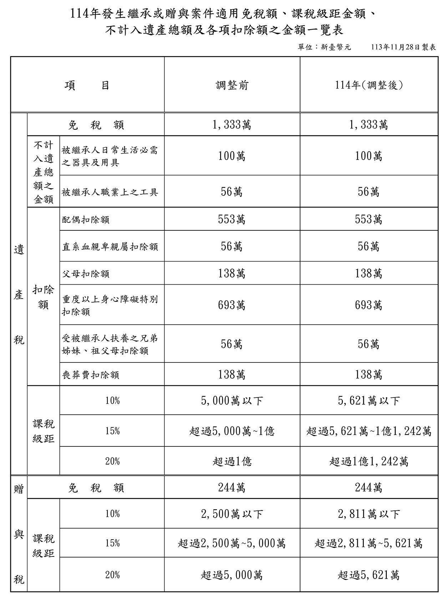

# 主題精選：遺產稅

共收錄 12 篇文章。

## 1. 死亡前2年內贈與併計遺產，受贈人改按比例負擔遺產稅
*發布日期: 2026-10-20* 

## 內文
一名年僅6歲的女童，實際繼承約1,567萬元遺產，卻遭國稅局核定高達5,735萬元的遺產稅！原因是父親生前將價值3億餘元的股票贈與配偶，死亡後配偶及其他子女均拋棄繼承，導致未取得該筆股票的女童，反而須承擔因股票併計遺產所產生的稅負。

這起爭議最終促成憲法法庭113年憲判字第11號判決，並推動《遺產及贈與稅法》修正。

總統於115年9月11日修正公布《遺產及贈與稅法》部分條文，其中一項重要變革，就是明定被繼承人死亡前2年內贈與特定親屬、依法併入遺產總額課稅之財產，其對應的遺產稅額應由受贈人按比例負擔，不再全部由繼承人承擔。亦即重新劃分生前受贈人與繼承人的納稅義務。

此一修正對於不動產生前贈與、財產傳承與繼承稅務規劃，具有重要的實務意義。

• 一、舊制問題：擬制遺產的稅，究竟由誰負擔？依《遺產及贈與稅法》第15條第1項規定，被繼承人死亡前2年內贈與下列個人之財產，應於死亡時視為被繼承人之遺產，併入遺產總額課稅：

1. 被繼承人之配偶。

2. 民法第1138條及第1140條規定之各順序繼承人。

3. 前款各順序繼承人之配偶。

此即一般所稱的「擬制遺產」，主要目的在防止被繼承人於死亡前透過贈與移轉財產，規避遺產稅負擔。

惟應注意，財產被擬制為遺產，並不表示該財產在民法上重新成為被繼承人死亡時遺留的財產。擬制遺產係稅法上計算遺產總額的規定，與民法上的財產歸屬及繼承標的仍應區別。

問題在於，修法前第6條第1項規定，有遺囑執行人者，以遺囑執行人為遺產稅納稅義務人；無遺囑執行人者，則以繼承人及受遺贈人為納稅義務人。受贈人並不因受贈該財產，即當然成為遺產稅納稅義務人。

尤其配偶間相互贈與財產，依同法第20條第1項第6款規定，不計入贈與總額，因此可能發生：

1. 被繼承人生前將鉅額財產贈與配偶，配偶不因該筆贈與負擔贈與稅。

2. 被繼承人於贈與後2年內死亡，該筆財產依法併計遺產總額。

3. 倘受贈配偶又拋棄繼承，即可能使其他繼承人須以其繼承之財產，負擔因配偶受贈財產而增加的遺產稅。

換言之，取得財產者與負擔稅捐者並非同一人，形成租稅負擔與財產利益歸屬不一致的問題。

• 二、修法緣由：113年憲判字第11號揭示兩項違憲爭議憲法法庭於113年10月28日公告113年憲判字第11號判決，涉及兩個不同層次的擬制遺產課稅問題。

（一）受贈配偶與其他繼承人的遺產稅負擔不公平第一起案件中，陳姓被繼承人生前將價值3億餘元的股票贈與配偶，於贈與後2年內死亡。其配偶及三名婚生子女均拋棄繼承，最後由一名6歲非婚生女兒繼承遺產。該女童實際繼承財產約1,567萬元，但因前述股票須併入遺產總額，國稅局核定遺產稅高達5,735萬元。

憲法法庭認為，死亡前2年贈與配偶之財產，雖得依法擬制為遺產課稅，但對於受贈配偶與其他繼承人應如何負擔遺產稅，法律欠缺明確規範，致其他繼承人須以其繼承之財產，就配偶受贈所產生的財產增益負擔稅捐，在此範圍內不符憲法第7條保障平等權之意旨。其使繼承人繼承權之經濟價值嚴重減損者，並侵害憲法第15條保障之財產權。

（二）擬制遺產欠缺配偶剩餘財產差額分配請求權的相應扣除另一案件中，被繼承人於105年5月3日將土地贈與配偶，同年5月14日即死亡，死亡後該筆土地依法併入遺產總額課稅。然而，稅捐機關在計算配偶剩餘財產差額分配請求權扣除額時，並未相應將該筆擬制遺產納入計算，引發爭議。

憲法法庭認為，法律既將死亡前2年贈與配偶之財產視為遺產課稅，卻欠缺相當於《遺產及贈與稅法》第17條之1的剩餘財產差額分配請求權扣除規定，在此範圍內亦不符憲法第7條平等權保障意旨。

因此，本號判決實際揭示兩項重要問題：一是「擬制遺產產生的稅額應由誰負擔」，二是「擬制遺產應如何計算配偶剩餘財產差額分配請求權扣除額」。

需強調的是，憲法法庭並未否定死亡前2年贈與財產應併計遺產課稅的制度本身，而是要求立法者補足稅負分配及扣除額計算的規範。憲法法庭要求立法機關於判決公告日起2年內檢討修正，財政部先於114年7月28日發布稽徵作業處理原則，作為修法前的過渡措施，其後完成修法。

• 三、修法重點：受贈人按財產比例負擔遺產稅115年9月11日修正公布的《遺產及贈與稅法》，將第6條重新調整，增訂受贈人負擔擬制遺產稅額的規定，並另將原本納稅義務人之一「遺囑執行人」刪除，而改為得代辦相關稅務事項：

1. 第6條第1項：「遺產稅之納稅義務人為繼承人及受遺贈人，無繼承人者，為遺產管理人，並以被繼承人之遺產為限負繳納義務，遺產已移轉或滅失者，按被繼承人死亡時之時價負繳納義務。」

2. 第6條第3項：「依第十五條第一項併入被繼承人遺產總額課稅之受贈財產，按各受贈財產占遺產總額比例計算之遺產稅額，應以受贈人為納稅義務人，並以受贈財產為限負繳納義務，受贈財產已移轉或滅失者，按被繼承人死亡時之時價負繳納義務，不適用第一項規定。」

3. 第17條之1第2項：「依第15條第1項第1款併入遺產總額之配偶受贈財產，於計算剩餘財產差額分配請求權扣除數額時，視為被繼承人現存財產。同條第3項並規定，不得以該受贈財產作為履行給付義務之財產。」

這項規定並非僅限配偶，而是適用於第15條第1項所列的全部受贈對象，包括民法第1138條、第1140條所定各順序繼承人及其配偶。因此，父母死亡前2年贈與子女、孫子女或其他符合第15條規定的親屬，亦可能適用此一稅負分擔制度。

新法既然以受贈人身分作為課稅依據，受贈人即使拋棄繼承、喪失繼承權，或者本來就不是實際繼承遺產的人，也不因此免除第6條第3項的納稅義務。

此外，縱使受贈人於贈與人死亡前已將受贈不動產出售，仍須按被繼承人死亡時之時價負繳納義務。依第10條第3項，時價就土地為公告土地現值，房屋為評定標準價格，而非市價。

• 四、試算範例為具體說明新法，以下以配偶受贈土地為例（甲於115年死亡，依第12條之1規定，適用財政部公告115年發生之繼承案件適用金額）。

甲於115年11月死亡，遺有配偶乙，以及兩名成年子女丙、丁。甲死亡時，尚有其他遺產價值8,000萬元；另於死亡前1年，曾將一筆土地贈與配偶乙，該土地於甲死亡時的公告土地現值為2,000萬元。

依《遺產及贈與稅法》第15條規定，該筆土地須併入遺產總額課稅，因此： 遺產總額＝8,000萬元＋2,000萬元＝1億元。 配偶乙受贈財產占遺產總額的比例為： 2,000萬元÷10,000萬元＝20%。

以下採115年度遺產稅適用金額：免稅額1,333萬元、配偶扣除額553萬元、直系血親卑親屬扣除額每人56萬元、喪葬費扣除額138萬元。另為簡化計算，假設無其他財產、債務、扣除或稅額扣抵事項，且不考慮配偶剩餘財產差額分配請求權扣除額。比較乙未拋棄繼承及拋棄繼承兩種情形：

• T. ABLE_PLACEHOLDER_1

本例之情形B，因乙拋棄繼承，依第17條第2項規定，不得扣除配偶扣除額553萬元。乙仍以受贈人身分負擔擬制遺產稅額。

遺產稅額按115年度適用的累進稅率計算，課稅遺產淨額超過5,621萬元至1億1,242萬元部分，適用15%稅率 情形A：5,621×10%＋(7,864－5,621)×15%＝562.1＋336.45＝898.55萬元。 情形B：562.1＋(8,417－5,621)×15%＝562.1＋419.4＝981.5萬元。

情形A：配偶未拋棄繼承全案遺產稅額為898.55萬元，其中乙以受贈人身分負擔179.71萬元；其餘718.84萬元，由乙、丙、丁以繼承人身分共同負擔納稅義務。因此，乙具有受贈人與繼承人雙重身分，並不是只須繳納179.71萬元。

情形B：配偶拋棄繼承全案遺產稅額為981.50萬元，其中乙須以受贈人身分負擔196.30萬元；其餘785.20萬元，則由丙、丁以繼承人身分共同負擔。

若以修法前的一般納稅義務架構作制度比較，在沒有遺囑執行人的情況下，配偶乙拋棄繼承後，原可能由丙、丁共同承擔全案981.50萬元稅額（惟113年10月28日判決公告後，此一情形已不得再由其他繼承人負擔）；新法則將其中196.30萬元明定由受贈配偶乙負擔。

綜上，最重要的觀念：遺產稅仍先依整體遺產計算，再按照擬制遺產與其他遺產占遺產總額的比例，劃分受贈人及繼承人的納稅義務。

參考資料

1. 憲法法庭113年憲判字第11號判決，113年10月28日。

2. 財政部臺北國稅局：死亡前2年內贈與財產併計遺產課稅，已修法由「受贈人」按比例負擔稅額，115年10月16日。

3. 立法院法制局：生前贈與之擬制遺產課稅問題研析，113年11月。

4. 遺產及贈與稅法（115年9月11日修正公布）。

5. 財政部114年7月28日台財稅字第11404557320號令。

---
*注：本文圖片存放於 ./images/ 目錄下*

## 2. 公共設施保留地與公共設施用地之比較（二）
*發布日期: 2026-02-05* 

## 內文
1. 租稅優惠： (1)地價稅：

①公共設施保留地：

• 公共設施保留地未作任何使用並與使用中之土地隔離，免徵地價稅。

• 公共設施保留地作農業使用，課徵田賦。田賦自民國76年停徵迄今。

• 公共設施保留地作自用住宅用地，按千分之二計徵地價稅。

• 公共設施保留地作自用住宅用地以外之建築使用，統按千分之六計徵地價稅（不累進）。（土稅§19）

②公共設施用地：

• 道路：無償供公眾通行之道路土地，經查明屬實者，在使用期間內，地價稅全免。但其屬建造房屋應保留之法定空地部分，不予免徵（土稅減§9）。

• 學校用地：財團法人或財團法人所興辦業經立案之私立學校用地、為學生實習農、林、漁、牧、工、礦等所用之生產用地及員生宿舍用地，經登記為財團法人所有者，全免。但私立補習班或函授學校用地，均不予減免（土稅減§8I①）。

• 公園及體育場所用地：私立公園及體育場所用地，按千分之十計徵地價稅（不累進）（土稅§18I②）。又，經事業主管機關核准設立，對外絕對公開，並不以營利為目的之私立公園及體育館場，其用地減徵百分之五十；其為財團法人組織者減徵百分之七十（土稅減§8I③）。

• 停車場用地：依都市計畫法規定設置之供公眾使用之停車場用地，按千分之十計徵地價稅（不累進）（土稅§18I④）。

• 其餘公共設施用地：上述以外之私有公共設施用地，無減免規定，持有時均應課徵地價稅。

• (2) 土地增值稅：

①公共設施保留地：

• 被徵收之土地，免徵土地增值稅；依法得徵收之私有土地，土地所有權人自願售與需用土地人者，免徵土地增值稅（土稅§39I）。

• 依都市計畫法指定之公共設施保留地尚未被徵收前之移轉，免徵土地增值稅（土稅§39Ⅱ）。

②公共設施用地：

• 都市土地：私有公共設施用地（如道路用地、學校用地、公園用地、體育場所用地、停車場用地等）之移轉，無減免規定，移轉時均應課徵土地增值稅。

• 非都市土地：非都市土地經需用土地人開闢完成或依計畫核定供公共設施使用，並依法完成使用地編定，其尚未被徵收前之移轉，經需用土地人證明者，免徵土地增值稅（土稅§39Ⅲ）。

• (3) 房地合一所得稅：

①公共設施保留地：

• 被徵收或被徵收前先行協議價購之土地，免徵所得稅（所§4-5I③）。

• 尚未被徵收前移轉依都市計畫法指定之公共設施保留地，免徵所得稅（所 §4-5I④）。

②公共設施用地： 所有公共設施用地，無減免規定，交易時均應課徵所得稅。

• (4) 遺產稅：

①公共設施保留地： 公共設施保留地因繼承而移轉，免徵遺產稅（都§50-1）。

②公共設施用地：

• 道路用地：被繼承者遺產中經政府闢為公眾通行道路之土地或其他無償供公眾通行之道路土地，經主管機關證明者，不計入遺產總額（其租稅效果等同免徵遺產稅）。但其屬建造房屋應保留之法定空地部分，仍應計入遺產總額（遺贈§16⑫）。

• 其餘公共設施用地：道路用地以外之私有公共設施用地，無減免規定，繼承時均應課徵遺產稅。

• (5) 贈與稅：

①公共設施保留地： 公共設施保留地因配偶、直系血親之贈與而移轉者，免徵贈與稅（都§50-1）。

②公共設施用地： 所有公共設施用地，無減免規定，贈與時均應課徵贈與稅。

綜上，對公共設施保留地土地所有權人之權益保障較公共設施用地為多，違反租稅平等原則。

【註】 都：都市計畫法。 徵：土地徵收條例。 土稅：土地稅法。 土稅減：土地稅減免規則。 遺贈：遺產及贈與稅法。 所：所得稅法。

---
*注：本文圖片存放於 ./images/ 目錄下*

## 3. 死亡前2年贈與之相關概念比較
*發布日期: 2025-04-22* 

## 內文
甲死亡前二年內贈與給繼承人之一乙300萬，而後甲死亡時留下遺產3,300萬，並由乙、丙、丁三人繼承，應繼分均等，試問其乙、丙、丁之各應繼遺產為何？遺產稅之遺產總額多少？另甲生前對K有一債務，乙、丙、丁應負清償責任之所得遺產總額為多少？

• (一) 各應繼遺產分為兩種情形：

1. 甲「非」因結婚、分居或營業而贈與給乙 僅就甲死亡時留下遺產3,300萬進行分配。 乙、丙、丁＝3,300/3＝各1,100萬元 *注意：繼承人彼此間並沒有民法第1148條之1的適用，亦即丙、丁不得就乙已受贈之300萬主張納入應繼遺產。

2. 甲因結婚、分居或營業而贈與給乙 依據民法第1173條I、II：「繼承人中有在繼承開始前因結婚、分居或營業，已從被繼承人受有財產之贈與者，應將該贈與價額加入繼承開始時被繼承人所有之財產中，為應繼遺產。但被繼承人於贈與時有反對之意思表示者，不在此限。前項贈與價額，應於遺產分割時，由該繼承人之應繼分中扣除。」 因此，應繼遺產＝3,300+300＝3,600萬元，各人應繼遺產： 乙＝3,600/3＝1,200，再扣除300萬元（歸扣）＝900萬元 丙＝3,600/3＝1,200萬元 丁＝3,600/3＝1,200萬元 *注意：歸扣並不限於死亡前二年內。

• (二) 之遺產總額

依據遺產及贈與稅法第15條I：「被繼承人死亡前二年內贈與下列個人之財產，應於被繼承人死亡時，視為被繼承人之遺產，併入其遺產總額，依本法規定徵稅：一、被繼承人之配偶。二、被繼承人依民法第一千一百三十八條及第一千一百四十條規定之各順序繼承人。三、前款各順序繼承人之配偶。」

遺產稅之課稅遺產總額＝3,300+300＝3,600萬元

*注意：倘若非死亡前二年內之贈與（含結婚、分居、營業之特種贈與），則不需納入遺產稅額計算

• (三) 應負清償責任之所得遺產總額

為避免被繼承人生前贈與，影響被繼承人之債權人求償權益，依據民法第1148條之1：「繼承人在繼承開始前二年內，從被繼承人受有財產之贈與者，該財產視為其所得遺產。」，以規範對外清償範圍。

因此，乙、丙、丁應負清償責任之所得遺產總額為3,300+300＝3,600萬元。換言之，K得請求乙、丙、丁於遺產3,600萬元之範圍內加以清償。

---
*注：本文圖片存放於 ./images/ 目錄下*

## 4. 114年遺產稅計算範例
*發布日期: 2024-12-24* 

## 內文
某甲為經常居住於中華民國境內之中華民國國民，於民國114年4月死亡，享年63歲，其遺有雙親、受其撫養哥哥、重度殘障之配偶，以及15歲、18歲與23歲之子女。經清查後，其留有遺產包含如下，請問遺產稅應納稅額為多少？

• (一) 素地：面積3,000平方公尺，公告土地現值每平方公尺2萬元。 (二)成屋：土地面積1,500平方公尺，公告土地現值每平方公尺3萬元，房屋評定標準價格1千萬。 (三)地上權：年租額500萬元，賸餘期間40年。

解答：

• 一、公告114年發生繼承或贈與案件適用遺產稅、贈與稅之免稅額、課稅級距金額、不計入遺產總額及各項扣除額之金額

[圖片1]

資料來源：財政部，2024.11.28

• 二、計算

• (一) 遺產總額：遺產稅按被繼承人死亡時，依本法規定計算之遺產總額，減除規定之各項扣除額及免稅額後之課稅遺產淨額。遺產總額應包括被繼承人死亡時依規定之全部財產，及依規定計算之價值。但規定不計入遺產總額之財產，不包括在內。其中，遺產價值之計算，以被繼承人死亡時之時價為準；被繼承人如係受死亡之宣告者，以法院宣告死亡判決內所確定死亡日之時價為準。

1. 土地：所稱時價，土地以公告土地現值或評定標準價格為準。

2. 房屋：以評定標準價格為準。

3. 地上權之設定有期限及年租者，其賸餘期間超過三十年至五十年以下者，以一年地租額之五倍為其價額。本題賸餘期間為40年。

因此，甲遺產總額＝(3,000×2)+(1,500×3+1,000)+(500×5)＝14,000(萬元)

• (二) 扣除額

1. 雙親扣除額：138×2=276(萬元)

2. 重度殘障配偶扣除額：553+693=1,246(萬元)

3. 15歲未成年子女扣除額：56+56×3=224(萬元)

4. 18歲成年子女扣除額：56(萬元)

5. 23歲成年子女扣除額：56(萬元)

6. 受其撫養哥哥扣除額：56(萬元)

7. 喪葬費扣除額：138(萬元)

8. 合計：276+1,246+224+56+56+56+138=2,052(萬元)

• (三) 免稅額：1,333(萬元)

• (四) 課稅遺產淨額＝遺產總額－扣除額－免稅額＝（14,000－2,052－1,333）＝10,615(萬元)

• (四) 適用稅率：遺產稅按被繼承人死亡時，依本法規定計算之遺產總額，減除規定之各項扣除額及免稅額後之課稅遺產淨額，依下列稅率課徵之：

1. 五千萬元以下者，課徵百分之十。

2. 超過五千萬元至一億元者，課徵五百萬元，加超過五千萬元部分之百分之十五。

3. 超過一億元者，課徵一千二百五十萬元，加超過一億元部分之百分之二十。

惟114年課稅級距須依最新物價調整後金額計算，即：

1. 遺產淨額5,621萬元以下者，課徵10%。

2. 超過5,621萬元至1億1,242萬元者，課徵562萬1,000元，加超過5,621萬元部分之15%。

3. 超過1億1,242萬元者，課徵1,405萬2,500元，加超過1億1,242萬元部分之20%。

• (五) 遺產稅應納稅額＝5,621×10%+[(10,615-5,621)×15%]＝1,311.2(萬元)

## 文章圖片

---
*注：本文圖片存放於 ./images/ 目錄下*

## 5. 公共設施保留地抵繳遺產稅之規定
*發布日期: 2024-04-30* 

## 內文
• 一、一般抵繳規定

• (一) 抵繳情形

遺產稅或贈與稅應納稅額在三十萬元以上，納稅義務人確有困難，不能一次繳納現金時，得於納稅期限內，就現金不足繳納部分申請以在中華民國境內之課徵標的物或納稅義務人所有易於變價及保管之實物一次抵繳。

中華民國境內之課徵標的物屬不易變價或保管，或申請抵繳日之時價較死亡或贈與日之時價為低者，其得抵繳之稅額，以該項財產價值占全部課徵標的物價值比例計算之應納稅額為限。（遺贈稅法第30條第4項）

• (二) 抵繳價值

1.

課徵標的物

納稅義務人申請以繼承或受贈中華民國境內之課徵標的物抵繳遺產稅或贈與稅者，其抵繳價值之計算，以該項財產核課遺產稅或贈與稅之價值為準。（遺贈稅法細則第46條第1項）

2.

非課徵標的

納稅義務人申請以課徵標的物以外之財產抵繳遺產稅或贈與稅者，其抵繳價值之計算，以申請日為準，並準用有關遺產或贈與財產之估價規定辦理。（遺贈稅法細則第46條第4項）

• 二、公共設施保留地抵繳規定

• (一) 根據遺產及贈與稅法第44條第一項規定：「被繼承人遺產中依都市計畫法第五十條之一免徵遺產稅之公共設施保留地，納稅義務人得以該項財產申請抵繳遺產稅款。」

• (二) 同法第三項則規定：「公共設施保留地，除於劃設前已為被繼承人或贈與人所有，或於劃設後因繼承移轉予被繼承人或贈與人所有，且於劃設後至該次移轉前未曾以繼承以外原因移轉者外，得抵繳之遺產稅或贈與稅款，以依下列公式計算之金額為限：

公共設施保留地得抵繳遺產稅或贈與稅之限額＝依本法計算之應納遺產稅額或贈與稅額 ×（申請抵繳之公共設施保留地財產價值÷全部遺產總額或受贈財產總額）」

• (三) 亦即公共設施保留地申請抵繳遺產稅有以下兩種情形：

1. 全額抵繳：公共設施保留地於劃設前已為被繼承人所有，或於劃設後歷次因繼承移轉給被繼承人，該土地得以全額抵繳。

2. 部分抵繳：上述情況以外，申請抵繳的公設地須按公式計算的金額為抵繳上限，進行部分抵繳。

其中，公共設施保留地依都市計畫法第50條之1後段規定，因繼承而移轉之公共設施保留地，免徵遺產稅。因此，其價值計算依據前述非遺產稅課徵標的，應以申請抵繳日之公告土地現值為準。（參財政部99年8月31日台財稅字第09900232770號函）

舉例說明：

甲於113年4月死亡，核定遺產總額共5,000萬元，該遺產皆為不動產並含有一筆於90年劃設的公共設施保留地A地，經其繼承人乙申報遺產稅後，應納稅額為40萬元。乙申請以甲所有之A地（申請日之公告土地現值1,000萬元）進行抵繳，請問A地之抵繳方式為何？

1.

甲於90年劃設後才取得A地

申請抵繳稅款的上限金額＝遺產稅額40萬元 × （A地1,000萬元 ÷ 遺產總額5,000萬元）＝ 8萬元。

2.

甲於90年劃設前即取得A地

可以A地全額抵繳該遺產稅40萬元。

---
*注：本文圖片存放於 ./images/ 目錄下*

## 6. 被繼承人死亡前二年內贈與都市計畫公共設施保留地 是否應計入遺產總額
*發布日期: 2024-03-26* 

## 內文
甲112年3月3日將其所有的A縣都市計畫之公共設施保留地贈與給其子乙，後於113年6月6日死亡，其子乙依規定申報遺產稅時，是否應將該筆土地併入遺產總額申報，再將其列為扣除額中扣除？

• 一、相關規定

• (一) 遺產及贈與稅法第15條：「被繼承人死亡前二年內贈與下列個人之財產，應於被繼承人死亡時，視為被繼承人之遺產，併入其遺產總額，依本法規定徵稅：

1. 被繼承人之配偶。

2. 被繼承人依民法第1138條及第1140條規定之各順序繼承人。

3. 前款各順序繼承人之配偶。」

• (二) 都市計畫法第50條之1後段：「…公共設施保留地因繼承或因配偶、直系血親間之贈與而移轉者，免徵遺產稅或贈與稅。」

• 二、結論

原本按照上述規定，照理應將該贈與之公共設施保留地併入被繼承人甲的遺產總額申報，並檢具註記公共設施保留地的土地使用分區證明書，列報公共設施保留地扣除額。

惟因都市計畫法第50條之1已明定，因繼承而移轉予配偶、直系血親的公共設施保留地，免徵遺產稅，故甲生前贈與行為，顯無規避遺產稅的動機，乙無須再將甲死亡前2年內贈與公共設施保留地，併入被繼承人甲的遺產總額，以及將該公共設施保留地的遺產價額，同額列報公共設施保留地扣除額，以茲簡政便民。

參考來源：被繼承人死亡前2年內贈與法定免徵遺產稅的土地，免併計遺產總額-財政部北區國稅局 (ntbna.gov.tw)

---
*注：本文圖片存放於 ./images/ 目錄下*

## 7. 夫妻剩餘財產差額分配之相關稅負
*發布日期: 2023-05-02* 

## 內文
依據民法第1030條之1，法定財產制關係消滅時，夫或妻現存之婚後財產，扣除婚姻關係存續所負債務後，如有剩餘，其雙方剩餘財產之差額，應平均分配。但下列財產不在此限：

• 一、因繼承或其他無償取得之財產。

• 二、慰撫金。

此為夫妻剩餘財產差額分配請求之規定，至於其涉及不動產移轉之相關稅負，茲說明如下：

• (一) 土地增值稅

1. 一方死亡時

夫妻一方死亡，生存配偶依民法第1030條之1規定行使剩餘財產差額分配請求權，於申報土地移轉現值時，應檢附其與全體繼承人協議給付文件或法院確定判決書，並准依土地稅法第28條之2規定，申請不課徵土地增值稅（參台財稅字第09604560470號）。

• (1) 申報移轉現值 A.其於生存配偶與全體繼承人訂立協議給付文件之日起30日內申報者，以訂立協議給付文件日當期之公告土地現值為準。 B.逾訂立協議給付文件之日30日後始申報者，以受理機關收件日當期之公告土地現值為準。 C.依法院判決移轉登記者，以申報人向法院起訴日當期之公告土地現值為準。

• (2) 原地價 以應給付差額之配偶取得該土地時核計土地增值稅之現值為原地價。

2. 其他原因（離婚或婚姻關係存續中將法定財產制變更為其他財產制）

申請不課徵土地增值稅，相關說明同上（參台財稅字第10700509500號令）。

• (二) 契稅

1. 一方死亡時

依契稅條例第2條規定：「不動產之買賣、承典、交換、贈與、分割或因占有而取得所有權者，均應申報繳納契稅。」有關配偶一方依法行使剩餘財產差額分配請求權而取得不動產所有權，非上開條文所定應申報繳納契稅之範圍，應免予報繳契稅。

2. 其他原因

同上

• (三) 房地合一稅

1. 一方死亡時

非所得稅課徵範圍，惟應注意，涉及房地合一所得稅之「非出價取得」。依據房地合一稅申報作業要點第四點：「配偶之一方依民法第一千零三十條之一規定行使剩餘財產差額分配請求權取得之房屋、土地，為配偶之他方原取得該房屋、土地之日。」

2. 其他原因

同上。

• (四) 贈與稅

1. 一方死亡時

非屬贈與稅課徵範圍。

2. 其他原因

同上。

• (五) 遺產稅

1. 一方死亡時

被繼承人之配偶依民法第一千零三十條之一規定主張配偶剩餘財產差額分配請求權者，納稅義務人得向稽徵機關申報自遺產總額中扣除。納稅義務人未於稽徵機關核發稅款繳清證明書或免稅證明書之日起一年內，給付該請求權金額之財產予被繼承人之配偶者，稽徵機關應於前述期間屆滿之翌日起五年內，就未給付部分追繳應納稅賦。(遺贈17-1) 換言之，屬遺產稅之扣除額。

2. 其他原因

離婚或財產制變更，無涉遺產稅。
---
*注：本文圖片存放於 ./images/ 目錄下*

## 8. 遺產稅繳納有困難之處理方式
*發布日期: 2023-04-25* 

## 內文
假設曾大哥與曾小弟一同繼承數筆不動產，應繼分一人二分之一，經國稅局核定應納遺產稅額為200萬元，依規定2個月內要繳納完成，惟曾小弟恰好缺現金繳納不出來，曾大哥擔心逾期繳稅受罰，也擔心無法順利辦完繼承登記而被罰登記費，請問有何處理方法？

• 一、申請延期

遺產稅納稅義務人，應於稽徵機關送達核定納稅通知書之日起二個月內，繳清應納稅款；必要時，得於限期內申請稽徵機關核准延期二個月。(遺贈§30I)

• 二、申請分期繳納

遺產稅應納稅額在三十萬元以上，納稅義務人確有困難，不能一次繳納現金時，得於納稅期限內，向該管稽徵機關申請，分十八期以內繳納，每期間隔以不超過二個月為限(遺贈§30II)。經申請分期繳納者，應自繳納期限屆滿之次日起，至納稅義務人繳納之日止，依郵政儲金一年期定期儲金固定利率，分別加計利息；利率有變動時，依變動後利率計算。(遺贈§30III)

• 三、申請實物抵繳

遺產稅應納稅額在三十萬元以上，納稅義務人確有困難，不能一次繳納現金時，得於納稅期限內，就現金不足繳納部分申請以在中華民國境內之課徵標的物或納稅義務人所有易於變價及保管之實物一次抵繳。中華民國境內之課徵標的物屬不易變價或保管（如畸零地），或申請抵繳日之時價較死亡日之時價為低者，其得抵繳之稅額，以該項財產價值占全部課徵標的物價值比例計算之應納稅額為限。(遺贈§30IV)

因此，曾大哥與小弟可將繼承到的不動產或自己所有之不動產抵繳該稅金。

• 四、提出納稅保證，先行移轉出售

遺產稅未繳清前，不得分割遺產、交付遺贈或辦理移轉登記。但依規定，於事前申請該管稽徵機關核准發給同意移轉證明書，或經稽徵機關核發免稅證明書、不計入遺產總額證明書，不在此限。(遺贈§8)

遺產稅納稅義務人繳清應納稅款、罰鍰及加徵之滯納金、利息後，主管稽徵機關應發給稅款繳清證明書；其經核定無應納稅款者，應發給核定免稅證明書；其有特殊原因必須於繳清稅款前辦理產權移轉者，得提出確切納稅保證，申請該管主管稽徵機關核發同意移轉證明書。(遺贈§41)

因此，曾大哥與小弟可提供其中一筆土地作為擔保，先行取得國稅局核發之同意移轉證明書，而後將其他土地辦理出售移轉登記，待取得價金後，於繳稅期限內繳清遺產稅後，辦理繼承登記。

• 五、先行辦理公同共有繼承登記

繼承人為二人以上時，經部分繼承人按其法定應繼分繳納部分遺產稅款、罰鍰及加徵之滯納金、利息後，為辦理不動產之公同共有繼承登記，得申請主管稽徵機關核發同意移轉證明書；該登記為公同共有之不動產，在全部應納款項未繳清前，不得辦理遺產分割登記或就公同共有之不動產權利為處分、變更及設定負擔登記。(遺贈§41-1)

因此，曾大哥可先就自己部分繳納，辦理公同共有繼承登記，得避免逾期辦理繼承登記而受罰。
---
*注：本文圖片存放於 ./images/ 目錄下*

## 9. 遺產稅與贈與稅之信託權利價值計算
*發布日期: 2021-04-29* 

## 內文
各位同學好

遺產及贈與稅法第10條之1規定有信託利益之價值計算，本期專欄茲就「遺產稅」部分說明如下：

• 一、享有全部信託利益之權利者，該信託利益為金錢時，以信託金額為準，信託利益為金錢以外之財產時，以受益人死亡時信託財產之時價為準。

例如：

1. 甲信託給乙1000萬元，約定信託期間5年，全部信託利益交付給丙，則信託關係存續中當受益人丙死亡時，應就其享有信託利益之權利未領受部分，課徵遺產稅，其財產價值為1000萬元。

2. 甲信託給乙一筆土地，約定信託期間5年，並指定全部信託利益給丙，則當信託後第二年丙死亡，則應就該筆土地當年公告土地現值(假設500萬)課徵遺產稅。

• 二、享有孳息以外信託利益之權利者，該信託利益為金錢時，以信託金額按受益人死亡時起至受益時止之期間，依受益人死亡時郵政儲金匯業局一年期定期儲金固定利率複利折算現值計算之；信託利益為金錢以外之財產時，以受益人死亡時信託財產之時價，按受益人死亡時起至受益時止之期間，依受益人死亡時郵政儲金匯業局一年期定期儲金固定利率複利折算現值計算之。

例如：

甲信託給乙一棟房屋，約定信託期間5年，期間租金給甲，最後房屋移轉給丙（即丙享有孳息以外信託利益），假設信託後第三年丙死亡，亦即尚有兩年信託才到期，則丙死亡時的尚未領受的信託利益權利如下（假設當年房屋現值1000萬元、1年定期儲金利率為2%）：1000/（1+2%）2＝961萬元

• 三、享有孳息部分信託利益之權利者，以信託金額或受益人死亡時信託財產之時價，減除依前款規定所計算之價值後之餘額為準。但該孳息係給付公債、公司債、金融債券或其他約載之固定利息者，其價值之計算，以每年享有之利息，依受益人死亡時郵政儲金匯業局一年期定期儲金固定利率，按年複利折算現值之總和計算之。

例如：

甲信託給乙一棟房屋，約定信託期間5年，期間租金部分給丙，最後房屋移轉給甲，假設信託後第三年丙死亡，亦即尚有兩年信託才到期，則丙死亡時的尚未領受的信託利益權利如下（假設當年房屋現值1000萬元、1年定期儲金利率為2%：1000－（1000/（1+2%）2）＝1000－961＝39萬元

• 四、享有信託利益之權利為按期定額給付者，其價值之計算，以每年享有信託利益之數額，依受益人死亡時郵政儲金匯業局一年期定期儲金固定利率，按年複利折算現值之總和計算之；享有信託利益之權利為全部信託利益扣除按期定額給付後之餘額者，其價值之計算，以受益人死亡時信託財產之時價減除依前段規定計算之價值後之餘額計算之。

例如：

甲信託給乙1000萬元，約定信託期間5年，期間約定每年定額給丙100萬元，假設信託後第三年丙死亡（已領300萬元），則丙死亡時尚有2年未領受的信託利益權利，計算如下（假設1年定期儲金利率為2%）：（100/（1+2%））+（100/（1+2%）2）＝98 + 96＝194萬元
---
*注：本文圖片存放於 ./images/ 目錄下*

## 10. 遺產稅的課徵程序
*發布日期: 2021-04-15* 

## 內文
各位同學好，今日說明有關遺產稅之課徵程序之相關規定：

• (一) 通知申報

1. 戶籍機關受理死亡登記後，應即將死亡登記事項副本抄送稽徵機關。(遺贈§37)

2. 稽徵機關於查悉死亡事實或接獲死亡報告後，應於一個月內填發申報通知書，檢附遺產稅申報書表，送達納稅義務人，通知依限申報，並於限期屆滿前十日填具催報通知書，提示逾期申報之責任，加以催促。前項通知書應以明顯之文字，載明民法限定繼承及拋棄繼承之相關規定。納稅義務人不得以稽徵機關未發第一項通知書，而免除本法規定之申報義務。(遺贈§28)（亦即不論有無應納稅額，納稅義務人皆應申報）

• (二) 申報稅額

1. 被繼承人死亡遺有財產者，納稅義務人應於被繼承人死亡之日起六個月內，向戶籍所在地主管稽徵機關依本法規定辦理遺產稅申報。但依第六條第二項規定由稽徵機關申請法院指定遺產管理人者，自法院指定遺產管理人之日起算。(遺贈§23)補充：本法第二十三條規定之遺產稅申報期間，如被繼承人為受死亡之宣告者，應自判決宣告之日起計算。(遺贈施§21)

2. 被繼承人為經常居住中華民國境外之中華民國國民或非中華民國國民死亡時，在中華民國境內遺有財產者，應向中華民國中央政府所在地之主管稽徵機關辦理遺產稅申報。(遺贈§23) （即台北市國稅局）

3. 遺產稅納稅義務人具有正當理由不能如期申報者，應於規定限期屆滿前，以書面申請延長之。前項申請延長期限以三個月為限。但因不可抗力或其他有特殊之事由者，得由稽徵機關視實際情形核定之。(遺贈§26)

4. 被繼承人死亡時遺有財產者，不論有無應納稅額，納稅義務人均應填具遺產稅申報書向主管稽徵機關據實申報。其有依本法規定之減免扣除或不計入遺產總額者，應檢同有關證明文件一併報明。(遺贈施§20)

5. 遺產稅納稅義務人為二人以上時，應由其全體會同申報，未成年人或受監護宣告之人應由其法定代理人代為申報。但納稅義務人一人出面申報者，視同全體已申報。(遺贈施§22)

• (三) 填發稅單

稽徵機關應於接到遺產稅申報書表之日起二個月內，辦理調查及估價，決定應納稅額，繕發納稅通知書，通知納稅義務人繳納；其有特殊情形不能在二個月內辦竣者，應於限期內呈准上級主管機關核准延期。(遺贈§29)

• (四) 繳清稅款

1. 遺產稅納稅義務人，應於稽徵機關送達核定納稅通知書之日起二個月內，繳清應納稅款；必要時，得於限期內申請稽徵機關核准延期二個月。

2. 遺產稅應納稅額在三十萬元以上，納稅義務人確有困難，不能一次繳納現金時，得於納稅期限內，向該管稽徵機關申請，分十八期以內繳納，每期間隔以不超過二個月為限。經申請分期繳納者，應自繳納期限屆滿之次日起，至納稅義務人繳納之日止，依郵政儲金一年期定期儲金固定利率，分別加計利息；利率有變動時，依變動後利率計算。

3. 遺產稅應納稅額在三十萬元以上，納稅義務人確有困難，不能一次繳納現金時，得於納稅期限內，就現金不足繳納部分申請以在中華民國境內之課徵標的物或納稅義務人所有易於變價及保管之實物一次抵繳。中華民國境內之課徵標的物屬不易變價或保管，或申請抵繳日之時價較死亡日之時價為低者，其得抵繳之稅額，以該項財產價值占全部課徵標的物價值比例計算之應納稅額為限。(遺贈§30)

• (五) 發給證明

1. 遺產稅納稅義務人繳清應納稅款、罰鍰及加徵之滯納金、利息後，主管稽徵機關應發給稅款繳清證明書；其經核定無應納稅款者，應發給核定免稅證明書；其有特殊原因必須於繳清稅款前辦理產權移轉者，得提出確切納稅保證，申請該管主管稽徵機關核發同意移轉證明書。依第十六條規定，不計入遺產總額之財產，經納稅義務人之申請，稽徵機關應發給不計入遺產總額證明書。(遺贈§41)

2. 遺產稅未繳清前，不得分割遺產、交付遺贈或辦理移轉登記。但依第四十一條規定，於事前申請該管稽徵機關核准發給同意移轉證明書，或經稽徵機關核發免稅證明書、不計入遺產總額證明書，不在此限。(遺贈§8)

3. 又地政機關及其他政府機關，或公私事業辦理遺產之產權移轉登記時，應通知當事人檢附稽徵機關核發之稅款繳清證明書，或核定免稅證明書或不計入遺產總額證明書，或同意移轉證明書之副本；其不能繳附者，不得逕為移轉登記。(遺贈§42)

4. 繼承人為二人以上時，經部分繼承人按其法定應繼分繳納部分遺產稅款、罰鍰及加徵之滯納金、利息後，為辦理不動產之公同共有繼承登記，得申請主管稽徵機關核發同意移轉證明書；該登記為公同共有之不動產，在全部應納款項未繳清前，不得辦理遺產分割登記或就公同共有之不動產權利為處分、變更及設定負擔登記。(遺贈§41-1)
---
*注：本文圖片存放於 ./images/ 目錄下*

## 11. 房地合一所得稅對繼承或贈與取得者不友善
*發布日期: 2018-03-15* 

## 內文
若採繼承或贈與方式將不動產移轉於子女，遺產稅及贈與稅之核算，土地以公告土地現值為準，房屋以房屋評定現值為準，故具有節稅效果。然子女日後出售該房地時，房地合一所得稅之前次成本不以繼承或贈與前之原始取得成本，而以繼承或贈與時之公告土地現值及房屋評定現值，致房地合一所得稅增加。總之，就節稅觀點，採繼承或贈與方式將不動產移轉於子女，如單看遺產稅或贈與稅是有利的；但如加入房地合一所得稅綜合考量，就不見得有利。

例如：甲於105年2月15日買入一棟房地，買入價格1,000萬元。甲於106年2月15日贈於其子乙，贈與時之公告土地現值及房屋評定現值之合計為500萬元。乙於107年2月15日出售於第三人丙，出售價格1,200萬元（設物價指數為100%，且不考慮因取得、改良與移轉而支付之費用及土地漲價總數額）。就一般人的想法，本棟房地之交易所得為200萬元（即1,200－1,000＝200萬元）；但就房地合一所得稅之課徵規定，本棟房地之交易所得為700萬元（即1,200－500＝700萬元）。

唯獨例外的是，配偶相互贈與取得者，得以配偶第一次相互贈與前之原始取得成本為準。

另，房地合一所得稅之持有期間影響適用稅率高低。繼承或受遺贈者，得將被繼承人或遺贈人持有期間合併計算。唯獨贈與者，不得將贈與人持有期間合併計算。但配偶贈與者，得將配偶持有期間合併計算。
---
*注：本文圖片存放於 ./images/ 目錄下*

## 12. 農舍及其坐落土地如何課稅？
*發布日期: 2017-10-12* 

## 內文
農舍所坐落之土地為農業用地，因此就農業用地與農舍之課稅規定分別說明之。

• (一) 農業用地：

1. 田賦或地價稅：作農業使用之農業用地課徵田賦，不徵地價稅。又，田賦自民國76年停徵迄今。

2. 土地增值稅：作農業使用之農業用地，移轉給自然人，得申請不課徵土地增值稅。相對地，作農業使用之農業用地，移轉給法人，應課徵土地增值稅。

3. 房地合一所得稅：符合不課徵土地徵值稅之農業用地，免徵房地合一所得稅。

4. 贈與稅：作農業使用之農業用地贈與民法第1138條所定繼承人（即直系血親卑親屬、父母、兄弟姊妹及祖父母），免徵贈與稅。反之，作農業使用之農業用地贈與民法第1138條所定繼承人以外之人，應課徵贈與稅。順便一提的是，配偶互相贈與財產，免徵贈與稅。

5. 遺產稅：作農業使用之農業用地繼承，免徵遺產稅。

• (二) 農舍：

1. 房屋稅：農舍持有，每年應課徵房屋稅。但專供飼養禽畜之房舍、存放農機具倉庫之房屋等，免徵房屋稅。

2. 契稅：農舍移轉，應課徵契稅。

3. 房地合一所得稅：農舍交易，不徵房地合一所得稅。

4. 贈與稅：農舍贈與，應課徵贈與稅。

5. 遺產稅：農舍繼承，應課徵遺產稅。

總之，租稅優惠主要在農業用地，而非農舍。
---
*注：本文圖片存放於 ./images/ 目錄下*

