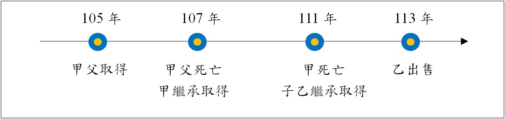

# 主題精選：遺贈

共收錄 4 篇文章。

## 1. 贈與及遺贈之對照
*發布日期: 2026-10-29* 

## 內文
贈與，指當事人約定，一方以自己之財產無償給與他方，他方允受之契約（民§460）。遺贈，指立遺囑而為贈與。前者於贈與人生前發生效力，後者於遺贈人死後發生效力。

• (一) 贈與：不動產贈與應辦理贈與所有權移轉登記。對贈與人課徵贈與梲，對受贈人課徵土地增值稅及契稅。被繼承人死亡前二年內贈與下列個人之財產，應於被繼承人死亡時，視為被繼承人之遺產，併入其遺產總額，依遺產及贈與稅法規定徵稅：

1. 被繼承人之配偶。

2. 被繼承人依民法第1138條及第1140條規定之各順序繼承人（即直系血親卑親屬、父母、兄弟姊妹、祖父母）。

3. 前款各順序繼承人之配偶。

上開擬制遺產之遺產稅，按受贈人財產占遺產總額比例計算稅額，發單向受贈人課徵。

• (二) 遺贈：不動產遺贈應先辦理繼承登記，再辦理遺贈所有權移轉登記。前者對繼承人及受遺贈人課徵遺產稅（遺贈§6Ⅰ），免徵土地增值稅及契稅。後者對受遺贈人課徵土地增值稅，不徵契稅。受遺贈人申辦遺贈之土地所有權移轉登記，應由繼承人先辦繼承登記後，由繼承人會同受遺贈人申請之；如遺囑另指定有遺囑執行人時，應於辦畢遺囑執行人及繼承登記後，由遺囑執行人會同受遺贈人申請之。前項情形，於繼承人有無不明時，仍應於辦畢遺產管理人登記後，由遺產管理人會同受遺贈人申請之（登§123）。

• (三) 兩者對照：

• T. ABLE_PLACEHOLDER_1

【註】 民：民法。 登：土地登記規則。 遺贈：遺產及贈與稅法。

---
*注：本文圖片存放於 ./images/ 目錄下*

## 2. 遺贈與死因贈與之比較
*發布日期: 2024-11-19* 

## 內文
本週專欄茲整理相關文獻，將遺贈與死因贈與進行比較如下：

• T. ABLE_PLACEHOLDER_1

參考資料：臺灣新北地方法院家事紀錄科，2020；曾品傑、陳瀅伃，2013，死因贈與侵害特留分時，繼承人得否行使扣減權？─最高法院一一一年度台上字第九一六號判決；林秀雄，2024，遺贈和死因贈與之異同─評最高法院106年度台上字第2731號判決與臺灣高等法院107年度重上更一字第6號民事判決；曾品傑，2024，死因贈與—最高法院112年度台上字第1871號；黃詩淳，2016，死因贈與在臺灣社會之實態與功能。

---
*注：本文圖片存放於 ./images/ 目錄下*

## 3. 房地合一稅有關放寬連續繼承之持有期間認定：台財稅字第11204619060號
*發布日期: 2023-11-07* 

## 內文
各位同學好

有關房地合一稅有最新的財政部函釋，針對以往連續繼承之持有期間認定爭議部分，有所放寬，屬於重要觀念，茲說明如下：

請先對照我們之前講過的一期專欄，就有提到這個爭議，後來經法院判決認定只能加計前一次不可以累計：

連續多次繼承之房地合一稅課徵認定：臺中高等行政法院110訴字第161號判決,曾榮耀老師,許文昌/曾榮耀不動產全制霸專欄,高點來勝不動產 (get.com.tw)

然而，此次函釋等同放寬可不斷加計到第一次繼承前之被繼承人持有期間。

函釋內容：

• 一、個人交易105年1月1日以後繼承或受遺贈取得之房屋、土地（以下簡稱房地），依所得稅法第14條之4第4項規定，計算同條第3項各款持有期間及同法第4條之5第1項第1款第1目及第2目期間時，如屬連續繼承或受遺贈取得之房地，得將連續各次繼承或受遺贈之被繼承人或遺贈人持有期間合併計算。但經稽徵機關查明有藉法律形式規避或減少納稅義務之安排或情事者，不適用之。

• 二、前點所稱連續繼承或受遺贈取得之房地，指該房地連續發生2次以上（含當次）繼承或受遺贈而移轉所有權之情形。

• 三、第1點個人計算所得稅法第4條之5第1項第1款第1目及第2目期間時，得併計之期間，以同點規定各次被繼承人、遺贈人或其配偶、未成年子女已於該房屋辦竣戶籍登記並居住，且無出租、供營業或執行業務使用之期間為限。

舉例：

[圖片1]

由於甲繼承後未出售，而後直接再次由乙繼承（連續繼承） 乙繼承取得至出售之持有期間＝111～113年＝2年 得合併計算乙之被繼承人甲之持有期間＝107～111年＝4年 得再合併計算甲之被繼承人父之持有期間＝105～107年＝2年

以上合併計算共計8年，適用稅率為20%。

另外，要適用自住房、地優惠的話，則這幾段需都符合規定之設戶籍、無出租營業等條件，可合併計算時間。

參考資料：財政部，112年11月2日，台財稅字第11204619060號，https://gazette2.nat.gov.tw/EG_FileManager/eguploadpub/eg029207/ch04/type2/gov30/num7/Eg.htm

## 文章圖片

## 4. 遺贈之稅負
*發布日期: 2020-08-20* 

## 內文
所稱遺贈，指遺贈人生前立遺囑，就不動產贈予受遺贈人；俟遺贈人死亡時，發生效力之法律行為。因此，遺贈人死亡後，就遺贈不動產移轉之稅負說明如下：

首先，以繼承人及受遺贈人為遺產稅之納稅義務人（遺§6Ⅰ②），繳稅後辦理繼承登記於繼承人名下。繼承移轉僅課徵遺產稅，免徵土地增值稅及契稅。

接著，以受遺贈人為土地增值稅之納稅義務人（土稅§5Ⅰ②），繳稅後辦理所有權移轉登記於受遺贈人名下。因繼承取得之土地再行移轉之原地價以繼承開始時該土地之公告現值（土稅§31Ⅱ），而遺贈土地申報移轉現值之審核標準以遺贈人死亡日當期之公告現值為準（土稅§30Ⅰ③）。辦理遺贈所有權移轉登記時，倘所申報之移轉現值為遺贈人死亡日當期之公告現值（即繼承開始時該土地之公告現值），則土地增值稅為零；倘所申報之移轉現值高於遺贈人死亡日當期之公告現值（即繼承開始時該土地之公告現值），則就其差額計算土地漲價總數額，課徵土地增值稅。

值得一提的是，遺贈所有權移轉僅課徵土地增值稅，不徵贈與稅及契稅。因為遺贈非屬贈與，故不徵贈與稅。又，遺贈非屬契稅之課徵時機（契稅之課徵時機僅買賣、贈與、占有、設典、交換、分割等六種），故不徵契稅。
---
*注：本文圖片存放於 ./images/ 目錄下*

